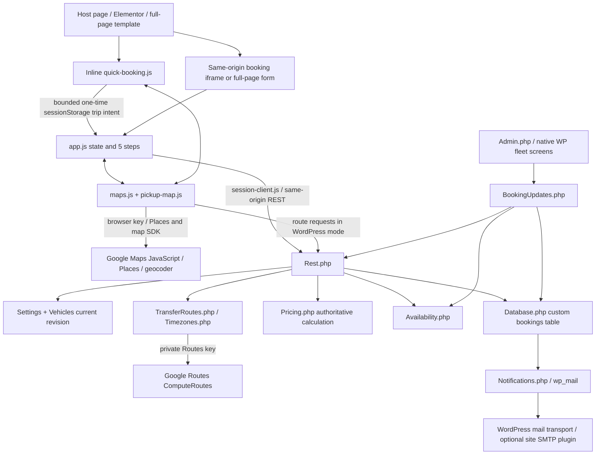

# Tuxano Booking Plugin — Development Handover

Prepared 9 November 2026 from the accessible repository, release archives, development records and owner instructions. Repository: `dev-najmul/car-pro-form`; working checkout: `/workspace/car-pro-form`; inspected HEAD: `19cd270558f8403e17257b7aaabe0ba780ce4a73`; current source/package version: **2.6.1**.

This is a technical continuation document for another AI developer. It documents the existing system; it is not approval to change business rules, redesign the form, deploy, contact customers or rerun production tests. **No existing project code was changed, no database was modified, no plugin was rebuilt, and no provider/mail/live-site request was made to prepare this handover.** Historical verification results are attributed below, rather than presented as freshly executed tests.

## Reading rules, authority and evidence

The owner explicitly identifies **2.5.0 as the stable rollback reference** and requests comparison with **2.6.0 as the development pricing/routing version**. The repository has since advanced to **2.6.1**, including focused form revisions and their recorded verification. Keep all three facts visible. Automated tests or a release ZIP do not prove which version the live customer site currently runs. Do not change the owner's stability classification without an explicit decision.

Evidence labels used throughout:

- **[CODE VERIFIED]** — inspected implementation, tracked files, configuration, archive bytes or Git metadata at the revision above. This means source-level verification, not necessarily execution in this task.
- **[HISTORY CONFIRMED]** — supported by accessible owner instructions, Git commits or recorded verification/deployment outcomes in `project.md` and upgrade records. Older outcomes remain historical.
- **[DOCUMENTATION ONLY]** — described in an existing document but not independently established by current executable code/evidence.
- **[INFERENCE — VERIFY]** — a reasoned interpretation, operational risk or proposed next action; verify before relying on it.
- **[UNKNOWN]** — not available or not established. Missing information is intentionally not filled in with assumptions.

Source precedence for current behavior: implementation and actual release contents → matching revision's tests → dated release/upgrade records → older general documentation. Owner instructions determine business intent and scope. Client DOCX mockups were to supply concepts while preserving the existing visual design; the owner clarified ambiguous details, for example that View Terms only needs a configurable URL opening a new tab. Do not reinstate superseded client wording as a new requirement.

Important documentation conflicts: `wordpress/ARCHITECTURE.md` begins with a 2.4.6-era overview and later adds 2.6 material; old root README prototype tariffs/2–12-hour descriptions do not describe current WordPress pricing; `wordpress/README.md:37` still says status changes do not automatically email, although later sections and current code implement lifecycle emails; its 2.4.5 trip-strip description is superseded by the 2.4.6 compact layout. The handover identifies further copy inconsistencies separately from calculation defects.

Line references are repository-relative and valid for the inspected revision; symbols are the more durable navigation anchors. Example locations and identifiers are synthetic. This file deliberately contains no API keys, login details, cookies, private customer records or database dumps. Original client attachments and unavailable private chat/session state cannot be reconstructed from source alone.

## Contents

1. [Project concept and implementation status](#1-project-concept-and-implementation-status)
2. [Development history](#2-development-history)
3. [Architecture and source map](#3-architecture-and-source-map)
4. [Google Maps, Places, GPS and map confirmation](#4-google-maps-places-gps-and-map-confirmation)
5. [Verified release comparisons](#5-verified-release-comparisons)
6. [Pricing and booking updates](#6-pricing-and-booking-updates)
7. [Booking workflow and frontend state](#7-booking-workflow-and-frontend-state)
8. [REST, routing, sessions and security](#8-rest-routing-sessions-and-security)
9. [Security and validation boundaries](#9-security-and-validation-boundaries)
10. [Timezones, storage, administration and email](#10-timezones-storage-administration-and-email)
11. [Frontend design preservation](#11-frontend-design-preservation)
12. [Confirmed bugs, potential risks and pending work](#12-confirmed-bugs-potential-risks-and-pending-work)
13. [Feature-to-files implementation guide](#13-feature-to-files-implementation-guide)
14. [Testing and quality assurance](#14-testing-and-quality-assurance)
15. [Dependencies, deployment and version management](#15-dependencies-deployment-and-version-management)
16. [Explicit answers to the 20 continuation questions](#16-explicit-answers-to-the-20-continuation-questions)
17. [Continuation priorities and missing confirmations](#17-continuation-priorities-and-missing-confirmations)
18. [THINGS THE NEXT DEVELOPER MUST NEVER SILENTLY CHANGE](#18-things-the-next-developer-must-never-silently-change)

The original requested topics are all retained, but closely coupled subjects are consolidated: detailed database, timezone and email internals are together in section 10; security has both the endpoint-level analysis in section 8 and trust-boundary summary in section 9; UI behavior is covered in sections 7 and 11.

## 1. Project concept and implementation status

### Business purpose and evolution

[HISTORY CONFIRMED] The original project was a responsive **five-step executive transportation reservation request form**, built from supplied desktop and phone designs with HTML, CSS and vanilla JavaScript. It began as a static prototype with local demonstration submission/thank-you behavior and invented tariffs. It subsequently gained real Google location/route integration, then became a WordPress plugin with persistent private submissions, administrator-managed fleet and pricing, authoritative server calculations and mail notifications. The current WordPress system is a request-and-confirmation workflow; the static preview remains a separate demonstration mode.

[CODE VERIFIED] The principal users are customers requesting transport and WordPress administrators managing requests, fleet, fares, settings and notifications. There is no implemented customer login portal, driver application, payment capture, dispatch assignment system, external calendar synchronization or separate fleet-unit inventory in the inspected source. Their absence does not make them an approved roadmap.

[CODE VERIFIED] Public service choices remain **Transfer** and **Hourly**:

| Service | Customer intent | Current WordPress pricing authority |
| --- | --- | --- |
| Transfer | An ordered pickup → optional stops → drop-off journey at a pickup-local schedule | Per-vehicle Transfer profile, normally **Mileage-Based**; administrator may select **Time-Based** instead. New Transfer routes include business-base legs and traffic-aware planning. |
| Hourly | A booked number of service hours, with an ordered route used for mileage/estimation | A separate per-vehicle Hourly profile, independent of the Transfer method selector. New public Hourly bookings include waiting in the hourly service instead of adding Transfer-style waiting charges. |

The owner explicitly clarified that “two pricing types” means the two public services. The client supplied two alternative **Transfer** calculation methods; these must not become two extra public service tabs. Rates not supplied by the client were to preserve existing saved operator values and remain editable per vehicle.

### Customer and administrator journeys

[CODE VERIFIED] Customer: quick planner or main Trip form → select canonical locations and pickup-local date/time → obtain road metrics/zone/quote → Select Vehicle and availability decision → Passengers & Extras → Contact & Billing → Review & Submit with policy acknowledgement → persisted request and receipt. Quick booking transports bounded trip intent to the configured booking page; it does not create a booking or carry an authoritative price.

[CODE VERIFIED] Administrator: WordPress **Tuxano Booking** menu → Dashboard/Submissions → view private request, status and independent mail outcomes → confirm/cancel/complete or edit booking details through validated update flow; manage vehicles/collections through native WordPress screens; edit separate service prices, general policy/API/business/email/appearance settings. Administrative writes require capability and nonce checks. Schedule/fare edits, status-only changes and mail retries are distinct operations.

### Status vocabulary

[CODE VERIFIED] Stored booking statuses are `new`, `pending`, `confirmed`, `completed`, `cancelled` (see `Database.php` and `Admin.php::status_label()`). “Pending Confirmation” is customer-facing request wording, not proof of an already confirmed reservation. `new`/`pending` requests can warn another customer about an already requested slot. A `confirmed` booking blocks the same vehicle's exact pickup slot; `completed`/`cancelled` release that confirmed slot. Mail has its own lifecycle and must not be confused with booking status.

### Functionality inventory and completion classification

| Capability | Classification | Evidence / continuation note |
| --- | --- | --- |
| Five-step responsive form, original Tuxano branding and receipt | Implemented | `app.js`, `styles.css`, original screenshots and focused UI regressions. Preserve approved geometry and flow. |
| Transfer/Hourly, ordered stops, waiting choices, child/booster seats, meet-and-greet, gratuity, contact/billing | Implemented | Frontend state + `Rest`, `Pricing`, `BookingUpdates`; exact validation and exceptions below. |
| Google Places (New), explicit map confirmation, GPS refinement, nearby suggested pickup, manual correction | Implemented | Shared `maps.js`/`pickup-map.js`; real hardware accuracy and permission behavior remain external acceptance constraints. |
| Pickup-geographic IANA timezones, UTC availability, DST gap/fold rejection | Implemented | Bundled exact boundary lookup, `Timezones.php`, server route binding. |
| WordPress REST sessions, recovery, quote ownership, idempotent submission | Implemented | `Rest.php`, `session-client.js`, immutable submission identity. Recovery is bounded, not an infinite session guarantee. |
| Per-vehicle independent service profiles, Transfer base A/B/C routing, mileage/time alternatives, upgrades | Implemented in current source | 2.6.0 architecture; historical snapshots remain compatible; owner retains 2.5.0 stable reference. |
| Private submissions, fleet/collections, admin booking editor, filters, bulk actions, pricing preview | Implemented | Native WP/CPT administration plus custom booking table; no public record-read API. |
| Branded customer/admin receipts, lifecycle and optional detailed update messages, retry states | Implemented | Mail transport acceptance recorded; actual inbox delivery is not proven by `wp_mail()` acceptance. |
| Same vehicle/same pickup-minute protection and pending warning acknowledgement | Implemented | Exact slot validation/locking/indexing; **not duration-overlap scheduling**. |
| Quick card, stops, safe one-time handoff, five-minute AM/PM chooser, configurable Terms URL | Implemented in 2.6.1 | No PDF generation/download feature is required after the owner's clarification. |
| Configurable header/backgrounds/email logo/targeted letter spacing and primary-button colors | Implemented | Existing settings and palette; arbitrary theme redesign is outside scope. |
| Privacy export/erase, configurable retention, explicit uninstall purge | Implemented | Retention/deletion defaults preserve records; WP-Cron best effort; media uploads retained. |
| Native physical Safari location permission prompt/device acceptance | Partially verified | Synchronous native request and deterministic compatibility coverage exist. Physical iPhone/WebKit/live host verification is not established. |
| Real Google traffic forecasting and correct host credential/API restrictions for current production release | Implemented integration, current deployment unverified | Historical live Google checks exist, but current live keys/installation/quota/host timeout values are unknown. |
| Online payment, driver dispatch, overlap-based vehicle utilization, customer accounts, calendar sync | Not implemented; no approved plan found | Require new requirements and authorization; do not invent them as unfinished client promises. |
| Current pricing guide for the client | Completed documentation artifact | `docs/client/TUXANO_Pricing_and_Rate_Management_Guide.docx` at current HEAD; do not confuse its prior request with an outstanding feature. |

[UNKNOWN] The exact current live plugin version, saved rates for each real vehicle, active Google Cloud restrictions/quotas, SMTP transport, physical fleet interpretation and current customer data were not inspected. Development records identify test/demo URLs including `https://bdreadyweb.com/carbook/`; later owner screenshots show `tuxano.com`. They do not establish a current production deployment target.

## 2. Development history

### Evidence and version terminology

- **[SOURCE-VERIFIED]** The checked-out repository is `car-pro-form`, branch `work`, at `19cd270558f8403e17257b7aaabe0ba780ce4a73` when inspected for this handover.
- **[SOURCE-VERIFIED]** That HEAD contains plugin **2.6.1**, not 2.5.0 or 2.6.0. `19cd270` adds the client pricing guide; it does not modify the plugin.
- **[USER-DESIGNATED]** Treat **2.5.0 as the owner's stable/rollback comparison reference** and **2.6.0 as the requested newer/development comparison**. Those business labels do not change what source is checked out.
- **[UNKNOWN]** The currently installed version on `tuxano.com` or `bdreadyweb.com/carbook/` was not established in this documentation task. A repository version, ZIP, old live report or user acceptance statement does not establish today's installed version.
- **[SOURCE-VERIFIED]** Relevant final references are 2.5.0 `0b60e11c86893f8b35925ec4867c844116299aca`, 2.6.0 `35ef4b0d97129393dc111e21610df4593e3c5ae8`, and 2.6.1 `ef582d8379fe8fd9c37f5fa0c6148a167ea44671`.
- **[RECORDED-VERIFICATION]** `project.md` and `wordpress/UPGRADE-*.md` record previous verification. Statements quoted below describe those recorded runs, not tests rerun for this handover.
- **[CURRENT-AUDIT]** Local Git history, source diffs and existing ZIP contents/hashes were inspected read-only. No booking, mail, DB operation, deployment or test suite was executed for this section.
- **[HISTORICAL-REQUIREMENT]** Early design checklists and demo assumptions in `project.md:1–1207` are historical requirements; subsequent source and release records supersede them where behavior differs.
- **[UNKNOWN]** The complete private conversation, ignored screenshot folders, historic runtime state and all original client uploads are not guaranteed to be available. Do not invent their contents from commit titles.

### Project evolution and implementation decisions

1. **Original concept, 14 October 2026:** reproduce an executive transportation reservation design as a responsive five-step form: Trip → Select Vehicle → Passengers & Extras → Contact & Billing → Review & Submit, followed by a thank-you receipt. Original screenshots/mockups guided presentation. The first implementation was a standalone frontend prototype with sample fleet/tariffs and local demonstration behavior, not a production WordPress booking backend. Evidence: `a084864`, `9bd33e5`, `project.md:1219–1299`.
2. **Google-backed prototype, 18 October:** `b273e79` added deliberate Places selections, ordered driving routes and route-derived demo prices. Geography, units, stop waiting and quote consistency became shared concerns rather than static text. Node server mode kept the private Routes credential off the browser. Evidence: `project.md:1302–1447`.
3. **Static GitHub Pages, 18 October:** Pages cannot execute Node `/api/maps/config`; `ba1c694` added module-relative public `maps-config.json` and supported browser Routes. Key permissions still blocked that route API. A later temporary server preview reused an authorized server key instead of publishing it or fabricating distances. Evidence: `project.md:1449–1517`.
4. **Location selection and GPS correctness, 18 October:** `da28f40` removed silent first-prediction selection; `c38f4b2` introduced candidate verification; `1091d70` added deliberate map-pin recovery for coarse desktop readings. These fixes deliberately preserved route coordinates and did not force results to resemble screenshots from a different itinerary. Evidence: `project.md:1519–1632`.
5. **WordPress conversion, 19 October, 2.0.0:** `47168b0` added native plugin activation/installation, settings/fleet administration, authoritative PHP pricing/validation, private durable booking records, REST endpoints, email transport and an embedded/full-page frontend. The Node/Pages prototype remains in the repository but is not the production WordPress server. Evidence: `project.md:1633–1682`, `wordpress/ARCHITECTURE.md`.
6. **PHP 7.4 support, 21 October, 2.0.1:** `080673b` adapted actual PHP syntax/APIs after the supplied host reported PHP 7.4.33. The minimum did not remain PHP 8.1. WordPress minimum remains 6.6. Evidence: `project.md:1683–1704`.
7. **Full administration and international form, 23 October, 2.1.0:** `60d8c52` added complete View/Edit, private revision history, stale-write protection, optional customer update, filtering/pagination/bulk deletion, 249 ISO countries, optional international region/postal fields, explained vehicle tariffs and masked key replacement/authorization checks. Contact-only edits preserve accepted fares; priced edits revalidate/reroute/reprice. Evidence: `project.md:1706–1735`, `wordpress/UPGRADE-2.1.md`.
8. **UI/map refinements, 23–24 October, 2.1.1–2.1.3:** transparent host background, admin typography, recent-item limit, configurable form header/navigation colors, live map preview behavior and touch confirmation/billing alignment were refined without replacing the five-step design. Evidence: `project.md:1738–1841`, corresponding upgrade files.
9. **Quick booking, 25 October, 2.2.0–2.2.1:** `c07b91f` added a homepage quick form, one-use handoff into the main form, map confirmation fixes and stable native checkbox/switch states. `f8a470b` fixed date/time picker activation from the whole field. Evidence: `project.md:1843–1895`.
10. **Branded notifications and per-vehicle exact pickup slots, 26 October, 2.3.0/2.3.1:** `ab47683` added configurable email logo, thank-you-style messages/status transitions, persisted UTC schedule indexing, pending warnings and atomic confirmed-slot enforcement. `4739405` fixed a late parent iframe bridge race. Evidence: `project.md:1897–1923`.
11. **Client revisions and geographic time authority, 31 October, 2.4.0:** `f5e5830` implemented the supplied client revision document and server-verifiable pickup-local IANA timezone lookup. Bundled geographic timezone data explains much of the enlarged ZIP. Do not substitute browser/WordPress timezone for pickup geography. Evidence: `project.md:1926–1952`, `wordpress/UPGRADE-2.4.0.md`.
12. **GPS recovery, 1 November, 2.4.1:** `e84e386` allowed a bounded high-accuracy refinement window; coarse readings automatically opened an unselected correction map in both forms. Untouched estimates could not replace a pickup. Evidence: `project.md:1954–1972`.
13. **Nearby suggested GPS pickup, 1 November, 2.4.2:** after the owner's further instruction, `b34c746` selected an actual canonical nearby Google place for approximate readings and marked it as suggested, with immediate correction controls. This superseded the earlier rule that every coarse reading must start with an unselected map; it did not make a 100 km device reading precise. Evidence: `project.md:1975–1991`.
14. **Package reduction/background settings, 2 November, 2.4.3:** `cfeb6b2` removed seven demonstrably unused lobby images, retained all active assets and timezone data, and added separate main/thank-you desktop/mobile background choices. The owner subsequently accepted leaving the remaining size. Evidence: `project.md:1994–2008`.
15. **Dual clocks/typography/Safari request path, 4 November, 2.4.4:** `43ed20e` added secondary 24-hour displays, configurable typography spacing and a GPS request path preserving Safari user activation. Recorded Chromium tests do not prove a physical iPhone permission dialog appeared. Evidence: `project.md:2011–2033`.
16. **Long-address first fix, 4 November, 2.4.5:** `70c6451` separated route and schedule rows because long multilingual addresses squeezed dates into nine lines. This fixed readability but the owner subsequently required the original compact design. `project.md` labels its section “5 November”; Git records 4 November. Retain that distinction rather than silently rewriting the chronology. Evidence: `project.md:2036–2052`.
17. **Session recovery and original compact UI, 5 November, 2.4.6:** `9d70a3e`, `90611ea`, `0fea530` removed mobile-IP dependence from recoverable sessions, preserved submission identity, required financial review on changed quotes, restored the protected compact desktop trip strip, scoped letter spacing, and standardized small map controls/full-width waiting/hourly inputs. Evidence: `project.md:2055–2075`.
18. **Owner's accepted palette/identity, 5 November, 2.5.0:** `0b60e11` changed only the existing blue main actions/selected segments to the supplied blue gradient and grey hover, with padding compensation for a two-pixel border. It added Farhan raj Najmul's author identity/website to readme metadata and advanced version. It did not introduce new booking behavior. Evidence: exact commit and `wordpress/tuxano-booking/readme.txt` changelog.
19. **Major pricing update, 8 November, 2.6.0:** `d7104e4` separated customer Transfer/Hourly pricing, with administrator-selectable Mileage-Based or Time-Based Transfer alternatives and pickup-time traffic-aware service-base routing. The owner approved Mileage default and preserving unspecified per-vehicle numeric rates. A backed-up one-time fleet migration changes the applicable formula; it does not rewrite accepted bookings. Follow-ups `3c8c92a` and `35ef4b0` complete selector preview handling and uninstall marker cleanup. Evidence: `project.md:2078–2093`, `wordpress/UPGRADE-2.6.0.md:1–57`.
20. **Focused form changes, 9 November, 2.6.1:** `44c7a5e` applied concepts from Form Changes 11.06.2026 within the existing design: ordered quick stops, compact estimates, shared AM/PM chooser, public Transfer wait options/public Hourly zero waits, numeric hour controls, once-only 3–24-hour settings upgrade and configured new-tab View Terms. Terms PDF/viewer was explicitly overridden by the owner. Pricing profiles/rates were not reset. Evidence: `project.md:2096–2114`, `wordpress/UPGRADE-2.6.1.md`.
21. **Current final documents:** `19cd270` added `docs/client/TUXANO_Pricing_and_Rate_Management_Guide.docx` and its README after verified 2.6.1. The guide is a client-facing explanation, not another pricing implementation or source of authority over PHP. Local Git verifies a 641,829-byte DOCX was added.

### Complete accessible Git chronology

The following is the complete local reachable history, in order, at the audited HEAD. Git dates are UTC-formatted repository dates; historical reports sometimes use Asia/Dhaka dates. Commit subjects describe intent; verified implementation/results are explained above and below.

| Commit | Git date | Recorded subject |
| --- | --- | --- |
| `a084864` | 2026-10-14 | docs: document car booking form design and implementation plan |
| `9bd33e5` | 2026-10-14 | feat: build responsive TUXANO reservation request prototype |
| `b273e79` | 2026-10-18 | feat: integrate Google Places and Routes with trip-based demo pricing |
| `ba1c694` | 2026-10-18 | fix: support Google Maps on static GitHub Pages hosting |
| `b13ce97` | 2026-10-18 | docs: record successful Pages deployment and remaining Routes permission |
| `f81fa62` | 2026-10-18 | feat: test Pages routes with a temporary private server backend |
| `c658235` | 2026-10-18 | test: verify the public Pages booking flow with live Google services |
| `20a50ba` | 2026-10-18 | fix: stop the temporary backend when deployment is cancelled |
| `86d6669` | 2026-10-18 | docs: record successful live Pages route and booking verification |
| `da28f40` | 2026-10-18 | fix: require deliberate place selection and verify exact route locations |
| `3e45373` | 2026-10-18 | docs: record verified Bangladesh location accuracy correction |
| `c38f4b2` | 2026-10-18 | fix: verify device location before changing a booking pickup |
| `7856b13` | 2026-10-18 | test: wait for the canonical pickup before checking device location |
| `fcba8f1` | 2026-10-18 | docs: record verified current-location safeguards and public test result |
| `1091d70` | 2026-10-18 | fix: allow exact map pickup when PC location is inaccurate |
| `de970e1` | 2026-10-18 | docs: record verified map pickup fallback and live test result |
| `47168b0` | 2026-10-19 | feat: convert Tuxano form into a configurable WordPress booking plugin |
| `35dd4f6` | 2026-10-19 | ci: extract WordPress ZIPs without truncating long core paths |
| `158f9ad` | 2026-10-19 | docs: record verified WordPress release and compatibility results |
| `6310756` | 2026-10-21 | docs: record verified direct plugin ZIP delivery |
| `080673b` | 2026-10-21 | fix: support PHP 7.4 with verified booking and pricing compatibility |
| `c5cb00d` | 2026-10-21 | docs: record successful PHP 7.4 live installation and booking tests |
| `60d8c52` | 2026-10-23 | feat: deliver full WordPress booking administration and form upgrade |
| `4f984de` | 2026-10-23 | ci: lint plugin PHP reliably on minimal runners |
| `fb60d4a` | 2026-10-23 | docs: record verified 2.1 release and live tests [skip ci] |
| `00a0632` | 2026-10-23 | feat: refine booking backgrounds, admin and map preview |
| `b245570` | 2026-10-23 | docs: record seven verified refinements and live 2.1.1 release [skip ci] |
| `4d3f3eb` | 2026-10-23 | feat: customize booking header colors and refine live map previews |
| `4a57a35` | 2026-10-24 | docs: record verified 2.1.2 live release [skip ci] |
| `437e7c8` | 2026-10-24 | fix: confirm map previews on touch devices and align mobile billing |
| `d4fadac` | 2026-10-24 | docs: record verified 2.1.3 mobile release [skip ci] |
| `c07b91f` | 2026-10-25 | feat: add quick booking handoff and fix map confirmation and switch states |
| `27d940b` | 2026-10-25 | docs: record verified 2.2.0 quick booking release [skip ci] |
| `f8a470b` | 2026-10-25 | fix: open quick booking date and time pickers from every field |
| `88cbe9c` | 2026-10-25 | test: assert map preview invariants after settled provider responses |
| `5a25960` | 2026-10-25 | test: verify native picker opening without browser-owned keyboard timing |
| `cf3d2d5` | 2026-10-25 | docs: record verified 2.2.1 picker fix and live acceptance [skip ci] |
| `ab47683` | 2026-10-26 | feat: add branded status emails and atomic vehicle pickup availability |
| `4739405` | 2026-10-26 | fix: synchronize iframe sizing when the parent bridge loads late |
| `15870b5` | 2026-10-26 | docs: record verified email and scheduling release 2.3.1 [skip ci] |
| `f5e5830` | 2026-10-31 | feat: apply client booking revisions with pickup-local timezone authority |
| `e84e386` | 2026-11-01 | fix: refine GPS readings and confirm exact pickup on coarse-location maps |
| `4df5bd2` | 2026-11-01 | docs: record verified GPS recovery release 2.4.1 [skip ci] |
| `b34c746` | 2026-11-01 | fix: suggest a real nearby pickup when GPS is approximate (2.4.2) |
| `7993f65` | 2026-11-01 | docs: record verified nearby GPS pickup release 2.4.2 [skip ci] |
| `cfeb6b2` | 2026-11-02 | feat: configurable backgrounds and smaller plugin package (2.4.3) |
| `eb53b54` | 2026-11-02 | docs: record smaller background release 2.4.3 verification [skip ci] |
| `43ed20e` | 2026-11-04 | feat: dual clocks, typography controls and Safari GPS requests (2.4.4) |
| `8035b2c` | 2026-11-04 | docs: record dual-clock and Safari request release 2.4.4 verification [skip ci] |
| `70c6451` | 2026-11-04 | fix: keep long trip addresses and schedules readable (2.4.5) |
| `056e92b` | 2026-11-04 | docs: record verified long-address release 2.4.5 [skip ci] |
| `9d70a3e` | 2026-11-05 | fix: recover booking sessions and restore requested form details (2.4.6) |
| `b1179ec` | 2026-11-05 | test: provide a complete public session in picker fixtures |
| `90611ea` | 2026-11-05 | fix: preserve mobile map activation during field validation |
| `0fea530` | 2026-11-05 | fix: require review when a renewed route changes the accepted estimate |
| `bb70d3a` | 2026-11-05 | docs: record verified booking session and UI release 2.4.6 [skip ci] |
| `0b60e11` | 2026-11-05 | style: apply final action-button palette for 2.5.0 |
| `d7104e4` | 2026-11-08 | feat: separate service pricing with traffic-aware transfer methods (2.6.0) |
| `3c8c92a` | 2026-11-08 | fix: refresh transfer previews when the pricing method changes |
| `35ef4b0` | 2026-11-08 | chore: include the pricing marker in explicit data removal |
| `7ac5062` | 2026-11-08 | docs: record verified pricing release 2.6.0 [skip ci] |
| `44c7a5e` | 2026-11-09 | feat: apply focused client form revisions (2.6.1) |
| `5e155cc` | 2026-11-09 | ci: expose browser failures and check controlled clock interactions first |
| `addf7b2` | 2026-11-09 | fix: retain Hourly route access and verify hidden timezone state |
| `2184e09` | 2026-11-09 | ci: pin the WordPress runner and remove the unzip dependency |
| `ef582d8` | 2026-11-09 | ci: invoke checksum-pinned WP-CLI through PHP |
| `a87a367` | 2026-11-09 | docs: record verified form release 2.6.1 [skip ci] |
| `19cd270` | 2026-11-09 | docs: add illustrated client pricing and rate management guide [skip ci] |

### Important previous bugs, fixes and failed-attempt context

The following are actual source/history findings. “Attempt” does not imply an undocumented incident; where there is no recorded failed attempt, none is claimed.

#### Static hosting and server boundaries

- **Symptom:** public Pages showed “Location search is temporarily unavailable” although local Node verification had passed.
- **Reproduction/root cause:** static page returned 200, but `/api/maps/config` returned 404 before Google loaded; Pages was publishing branch files without running the application server.
- **Fix/files:** `ba1c694`; module-relative generated `maps-config.json`, browser-provider configuration/build and Pages workflow. Private server configuration stays out of static output.
- **Boundary:** that fixed config loading, not Google authorization; browser Routes still returned `PERMISSION_DENIED` until the chosen temporary server-key preview path was used.
- **Evidence:** `project.md:1451–1477`; 48 unit + 43 browser recorded then.

#### Temporary Routes preview lifetime

- **Symptom/risk:** cancelled/replaced Pages preview could retain an owned temporary server/tunnel session longer than intended.
- **Fix:** `20a50ba` tightened keepalive to `success() && !cancelled()` with owned PID/path cleanup; endpoint metadata exposed a bounded two-hour expiry and provider budget.
- **Files/context:** prototype Pages/Node preview workflow, not WordPress session recovery. Preview infrastructure is historical and not a required production WordPress backend.
- **Evidence:** `project.md:1484–1516`; actual hosted live-provider flow recorded on temporary preview.

#### Wrong-looking route and accidental autocomplete selection

- **Symptom:** form 11.2 km/37 min versus Google screenshot about 167 km/3h29.
- **Verified cause:** screenshots selected different endpoints/direction, plus baseline versus traffic-aware comparison. This was not a kilometer/mile conversion defect.
- **Actual UI defect:** Enter without a highlighted option silently accepted Google's first prediction, which could be an unrelated business for a misspelled query.
- **Fix/files:** `da28f40`, root `maps.js`/`app.js` and exact-place comparison helpers: deliberate selection, canonical full address, exact Place-ID links, stop order and correct initial ArrowUp handling.
- **Evidence:** `project.md:1521–1559`; real Google calls and five Bangladesh route checks were recorded. Do not change provider metrics to match a screenshot from a different route.

#### PC coarse location mistaken for exact GPS

- **Symptom:** owner near Barishal received Dhaka coordinates and a long trip; device could report 100 km accuracy.
- **Verified cause:** browser returns network/Wi-Fi/IP-derived estimates on some PCs; old code accepted any coordinates without quality/freshness/confirmation. No reversed latitude or unit error was found.
- **First fix:** `c38f4b2` requested fresh high-accuracy data, validated accuracy/timestamp, previewed candidate/context, retained current pickup and original coordinates until confirmation.
- **Provider constraint discovered:** Geocoder was denied with the existing key while Places New Nearby Search worked; nearby business context is not proof of an exact entrance.
- **Fallback:** `1091d70` added deliberate map selection and confirmation; map initial center is not itself a chosen pickup.
- **Later owner-approved change:** `e84e386` refined coarse readings; `b34c746` selected a real canonical nearby place as a suggested pickup with correction UI. This is current intended graceful behavior, not a claim that weak device accuracy improved.
- **Files:** root `maps.js`, `pickup-map.js`, `app.js`, `quick-booking.js`, `quick-handoff.js`, matching CSS; shared Maps frontend helpers.
- **Caught follow-up:** 2.4.2 reload initially stripped suggestion provenance; focused restoration test caught it and canonical snapshot retention was corrected.
- **Evidence:** `project.md:1567–1622,1954–1991`; manual physical location accuracy remains device-dependent.

#### Asynchronous canonical address harness failure

- **Symptom:** first hosted device test compared a short typed query to a subsequently resolved full canonical address and failed.
- **Root cause/fix:** test captured the input before Places details settled; `7856b13` waits for selected-address card/input alignment.
- **Boundary:** not evidence that route coordinates changed. Actual source safeguards remained coordinate-preserving.
- **Evidence:** `project.md:1595–1602`.

#### Map preview, mobile touch and stale callbacks

- **Symptoms recorded:** map search could leave a stale preview/selection, touch activation and rerender could interfere with deliberate confirmation, and late provider responses could overwrite current intent.
- **Fix progression:** 2.1.1/2.1.2 preview/search refinements, `437e7c8` touch map confirmation, `c07b91f` quick/map confirmation, generation/abort guards and exact confirmation logic in shared maps/picker/form code.
- **2.4.6 concrete regression:** stop input blur validation painted an error and moved the map target during touch activation; `90611ea` defers inline error painting when native map-action intent is active.
- **2.6.1 concrete regression:** selector specificity overrode `hidden`, and service rerender duplicated a GPS map control; final rendering/hidden rules corrected and three affected cases passed.
- **Evidence:** `project.md:1738–1880,2071,2106`; `UPGRADE-2.6.1.md:45`. Do not infer additional bugs from broad test names.

#### PHP runtime requirement failure

- **Symptom:** native installer rejected 2.0.0 on PHP 7.4.33.
- **Root cause:** manifest required 8.1 and code used actual PHP 8 syntax/APIs; ZIP was not corrupt.
- **Fix/files:** `080673b` replaced union/mixed declarations with PHPDoc, PHP 8 string helpers with strict compatible comparisons and `array_is_list` with strict compatible validation; plugin metadata/CI updated.
- **Compatibility rule:** keep PHP 7.4 parser/runtime support, not just a lowered manifest. Preserve sparse/reordered stop rejection.
- **Evidence:** `project.md:1685–1704`; historical real PHP 7.4 and 8.3 WordPress checks/live native replacement recorded.

#### CI lint pipeline produced false confidence

- **Symptom:** 2.1 CI looked successful but runner lacked `rg`; old pipeline fed empty stdin to lint.
- **Fix:** `4f984de` uses portable `find`, null-delimited paths and Bash `pipefail`; logs then confirmed all 12 real plugin files linted per target.
- **Boundary:** infrastructure validation bug, not a demonstrated plugin runtime failure.
- **Evidence:** `project.md:1721`.

#### Quick booking native date/time picker activation

- **Symptom:** clicking portions of quick date/time fields did not open browser calendar/time UI.
- **Fix/files:** `f8a470b` fieldwide trusted activation, `showPicker()` where supported and compatible fallback in quick form; tests stopped depending on browser-owned keyboard animation timing (`5a25960`).
- **Later intended replacement:** 2.6.1 shared controlled AM/PM time chooser supersedes relying on native time UI; native date field remains.
- **Evidence:** `project.md:1882–1895`; `UPGRADE-2.6.1.md:23–27`.

#### Toggle rendering and duplicate state

- **Symptom/context:** earlier quick/main switch states could disagree with their visual presentation during interactions.
- **Fix:** `c07b91f` stabilized native checkbox-driven state instead of brittle generated visual state. Preserve native value/checked semantics, accessible labels and existing pricing effects.
- **Evidence:** `project.md:1843–1880`, `wordpress/UPGRADE-2.2.0.md`.

#### Iframe first-resize race

- **Symptom:** fast child sent initial dimensions before footer-loaded parent bridge registered, leaving wrong iframe height/blank tail.
- **Fix/files:** `4739405`, parent `wordpress/tuxano-booking/assets/embed.js` and child/root app bridge lifecycle: trusted readiness handshake plus resize resynchronization. Source/origin/frame checks remain.
- **Evidence:** `project.md:1915–1923`; strengthened fixture intentionally delivers first resize before bridge registration.

#### Double booking and notification transition races

- **Requirement/previous gap:** exact date/time alone was insufficient; conflict must be same vehicle at the same authoritative UTC pickup minute. Pending requests should warn; confirmed should block; another car remains available.
- **Implementation/fix:** `ab47683` adds availability index/backfill, unique confirmed slot protection, short DB write lock, final persistence/admin confirmation checks, once-per-committed status mail with leases.
- **Boundary:** this is exact pickup-minute conflict prevention, not full trip-duration/vehicle allocation scheduling. Do not claim overlap-based fleet dispatch.
- **Evidence:** `project.md:1903–1918`; actual two-process race/unique-key/lock-failure fixtures recorded; controlled live acceptance then preserved existing records and sent no customer QA mail.

#### Safari GPS denied/no prompt while Chrome worked

- **Reported behavior:** Safari showed denied without the expected prompt; user reported Chrome/PC worked.
- **Fix intent/files:** `43ed20e` calls native `getCurrentPosition()` in the user's activation path rather than making Permissions API preflight decide whether to request. Accurate result avoids unnecessary watch refinement; both old watch-only and current-position-only providers remain supported.
- **Limit:** browser/OS/site settings and actual hardware can deny location; code cannot force Safari to re-prompt after user denial. Existing manual/nearby/map recovery remains.
- **Evidence:** `project.md:2011–2033`; Chromium controlled fixtures passed, physical iPhone permission-sheet validation explicitly remains unproven.

#### Long address overflow and unintended redesign

- **Reproduction:** long Bengali pickup + English destination squeezed shared flex layout; date wrapped into nine lines and time/Edit overlapped.
- **First fix:** `70c6451` separated route/schedule rows and passed multilingual/unbroken-token desktop/phone cases.
- **Owner correction:** preserve original compact design instead of keeping that layout change.
- **Final fix/files:** 2.4.6 root `app.js`/`styles.css` protected date/time/Edit columns, bounded desktop address previews, full accessible/title text and unclamped phone addresses. Edit stays small with normal letter spacing.
- **Evidence:** `project.md:2038–2061`; do not reintroduce a two-row desktop redesign without a new instruction.

#### Letter spacing applied too broadly

- **Symptom:** autocomplete/suggestion/body/Edit text inherited spacing intended only for main titles, main blue actions and field labels.
- **Fix:** 2.4.6 scopes separate settings/CSS to those target categories, restores normal suggestion/input/body/secondary action text, and interprets old text-spacing preference as field-label spacing without resetting saved preference.
- **Related UI:** small 13px normal map choices/no underline, waiting select fills remainder of row, hourly quantity fills width; 24-hour clocks only summaries/thank-you/email, not repeated Step 1/Step 2/quick controls.
- **Evidence:** `project.md:2057–2061`, `wordpress/UPGRADE-2.4.6.md`.

#### Random session expired after GPS or at final submission

- **Confirmed code causes:** old two-hour transient was bound to `REMOTE_ADDR`; mobile network/relay IP change invalidated it. Eviction had no recovery, stale cached logged-in WordPress nonce could reject public requests, and expired quotes needed manual failure/retry.
- **Fix/files:** `9d70a3e` and root `session-client.js`, `app.js`, `quick-booking.js`, PHP `Rest.php`: signed site/protocol proof, same-token bounded resume, sliding active lease, no mandatory cookie/IP binding, separate fresh/resume budgets and stale public nonce omission.
- **Critical invariant:** keep same submission key/request identity through renewal or lost replies can duplicate bookings. Server checks existing receipt before requiring a fresh quote.
- **Further fix:** `0fea530` compares displayed financial snapshots and authoritative timezone/revision during route recovery; changed tariffs/fare/zone return to vehicle review, retain contact/trip fields and reset consent. Same rates do not prove same forecast fare.
- **Caught native edge case:** missing WordPress request header is `null`, not always empty string; final fresh-session checks handle it.
- **Evidence:** `project.md:2059–2075`; recorded actual anonymous/logged-in HTTP same-token recovery after deliberate local cache eviction.

#### Oversized release ZIP

- **Investigation:** seven unused lobby JPGs, not all images, were removable; bundled timezone geography was an active functional dependency.
- **Fix:** 2.4.3 removed those unused files and added selectable settings backgrounds; archive shrank by **8,505,061 bytes (25.38%)**, 33,514,258 → 25,009,197 bytes.
- **Owner decision:** keep remaining size for now. No further dataset removal/compression/remote timezone API switch was authorized as part of later small UI updates.
- **Evidence:** `project.md:1994–2008`; current `data/timezones/tiles.dat` alone is 21,765,938 uncompressed bytes and `index.json` 1,499,281 bytes in the ZIP manifests.

#### Transfer method admin preview did not switch

- **Reproduction/root cause:** change handler returned unless target was `HTMLInputElement`, so `<select>` method changes did not refresh preview/active status.
- **Fix:** `3c8c92a` accepts `HTMLSelectElement` as well and adds two focused browser regressions.
- **Boundary:** server stored method/calculator logic was separate; fixed examples are not provider quotes.
- **Evidence:** exact 2.6.0 `wordpress/tuxano-booking/assets/admin.js` diff, `UPGRADE-2.6.0.md:53–55`.

#### 2.6.1 visibility test and CI tooling failures

- **Visibility assertion:** a hidden quick-timezone element remains intentionally present for internal state; assertion must verify hidden rather than absent (`addf7b2`). Do not remove internal timezone resolution merely to satisfy UI prose removal.
- **Hourly route link:** `addf7b2` preserves access to the Google route link while the Hourly Summary replaces the detailed visible route metrics.
- **Infrastructure:** latest runner image assumptions/WP-CLI command invocation caused verification failures. `2184e09` pins Ubuntu 24.04/removes `unzip` dependency; `ef582d8` runs checksum-pinned official WP-CLI 2.12.0 through PHP. These are not pricing fixes.
- **Diagnostics:** `5e155cc` exposes browser error annotations and runs controlled-clock interactions first for readable CI failures.
- **Evidence:** Git commits, `project.md:2106–2112`, `UPGRADE-2.6.1.md:43–51`.

### Recorded verification by milestone; not rerun for this handover

| Milestone | Recorded checks/results | Practical limits |
| --- | --- | --- |
| 1.1.1 static Pages | 48 unit + 43 browser = 91; published config/suggestions worked. | Browser Routes authorization remained denied at that point. `project.md:1470–1476`. |
| 1.2.x prototype location | 1.2.1 79+52=131; 1.2.2 87+62=149; 1.2.3 87+69=156; hosted real Google Chicago/Bangladesh checks. | GPS coordinates were controlled browser readings, not the owner's physical laptop. `project.md:1549–1624`. |
| 2.0.1 PHP 7.4 | 358 distinct checks; actual ZIP installed/activated on recorded PHP 7.4.33/WordPress 7.1.3 site; synthetic booking persisted. | Mail “accepted by transport” does not prove inbox delivery; historic site version does not prove current version. `project.md:1695–1704`. |
| 2.1.0 admin | 543 distinct; four PHP targets; native admin and real Google/booking acceptance recorded; lint rerun fixed empty-input weakness. | Only marked synthetic QA request was altered; existing customers retained. `project.md:1719–1733`. |
| 2.3.1 emails/slots | 887 distinct =109 Node+137 data+116 REST+159 updates+31 logo+74 notifications+96 availability+165 browser; four PHP targets. | Historic live verification preserved existing state and did not send customer QA mail; status design tested via local capture. `project.md:1913–1923`. |
| 2.4.1 coarse GPS | 1,074 distinct =145+722+207; hosted plugin/browser green. | Optional legacy Pages preview failed separately; no new live/hardware acceptance claimed. `project.md:1965–1969`. |
| 2.4.2 nearby GPS | 1,107 distinct =160+722+225; hosted plugin/browser green. | Canonical nearby suggestion is not physical accuracy proof; delivery for owner manual update. `project.md:1983–1991`. |
| 2.4.3 smaller/backgrounds | 1,161 distinct =160+754+247; native Media Library/save/reload/phone controls; four-target hosted green. | Timezone data unchanged; unused assets only. `project.md:2002–2008`. |
| 2.4.4 clocks/Safari | 1,240 distinct =170+796+274; exact `43ed20e` hosted WP/browser green. | Actual iPhone Safari OS prompt still owner/device validation. `project.md:2031–2033`. |
| 2.4.5 long address | 1,247 distinct =170+796+281; exact `70c6451` hosted WP/browser green. | First readable redesign was superseded by owner's original-layout requirement in 2.4.6. `project.md:2044–2052`. |
| 2.4.6 session/UI | 1,319 distinct =185+835+299; four-target hosted green at exact `0fea530`. | No live installation claimed; preserve financial-review/idempotency invariants. `project.md:2065–2075`. |
| 2.5.0 palette | Existing stable 2.4.6 behavior plus focused palette/metadata diff; ZIP hash recomputed here. | Do not invent a separately documented 2.5.0 full CI/live run: no matching new project verification section exists. |
| 2.6.0 pricing | Final 1,988 distinct =217 Node+1,455 PHP assertions+316 browser; 27 vectors/334 fields; exact `35ef4b0` hosted WP/browser passed. | Earlier sentence records complete 314 cases before two extra admin checks; final full hosted collection is 316. Upstream Google/SDK deterministic, not new live-provider acceptance. `UPGRADE-2.6.0.md:46–57`. |
| 2.6.1 forms | 2,071 distinct =225 Node+1,508 PHP assertions+338 browser; exact `ef582d8` hosted all 4PHP + packaged activation passed. | Native local HTTP smoke made no external provider call, booking or mail; physical iPhone/live-provider/live-install not established. `UPGRADE-2.6.1.md:43–53`. |

Repeated compatibility runs count once in these distinct totals. Latest recorded compatibility targets are PHP 7.4/8.1 with WordPress 6.6, and PHP 8.3/8.5 with current WordPress at those runs. “Current WordPress” is a historical workflow selection, not a fixed tested version guarantee forever.

## 3. Architecture and source map

### Runtime systems and authority

[CODE VERIFIED] The project has **three execution contexts sharing frontend code**. They must not be conflated:

1. **Production WordPress plugin:** PHP persists requests and enforces fare/schedule/security rules. Shared ES modules are shipped under a versioned `public/<plugin-version>/` tree. Node is not required on the installed site.
2. **Local Node/static prototype:** `server.js` serves a public-file allowlist and `maps-api.js` proxies baseline road metrics. Static submission is a demo receipt, not a WordPress booking.
3. **GitHub Pages preview:** `scripts/build-pages.mjs` emits a public-only static artifact. Routing can use the browser SDK or an explicitly configured temporary backend; it is not the production WordPress pricing/session service.



[CODE VERIFIED] Browser quotes are for display. WordPress owns the selected vehicle's active tariff, route quote/session binding, geographic zone, normalized booking, total, persistent reference and slot claim. An administrator's validated repricing uses the same PHP calculation/routing contract rather than trusting a JavaScript total. `Database` persists before notification delivery. `Settings::public_data()` exposes permitted display/business data and revisions, not the private Routes key.

### Canonical source and generated delivery

[CODE VERIFIED] Edit the root ES modules/CSS and `wordpress/tuxano-booking/` PHP/admin assets. `scripts/build-wordpress.mjs` copies shared root files and `assets/` into `build/tuxano-booking/public/2.6.1/`, then packages `releases/tuxano-booking-2.6.1.zip`. `build/`, `dist/` and local reports are generated/ignored. Editing an unpacked plugin's `public/<version>/app.js` does not fix the canonical root `app.js`; the next build overwrites it. Updating only a top-level script query string leaves imported modules stale, which is why the complete public directory is versioned.

### Project tree

```text
car-pro-form/
├── index.html                    Static page shell; PHP frame has its own shell
├── app.js                        Main state, renderers, validation, routing and submission
├── maps.js                       Google/Places/GPS/country/link/route client and autocomplete
├── pickup-map.js                 Shared explicit-confirmation map picker
├── session-client.js             Public WP session/recovery/fetch behavior
├── pricing.js                    Pure display calculator and static demo tariffs
├── quick-booking.js              Inline WordPress quick planner adapter
├── quick-handoff.js              Short-lived, bounded trip-intent transport
├── time-picker.js / time-picker.css Controlled 12-hour five-minute chooser
├── countries.js                  Public country and phone metadata
├── styles.css / quick-booking.css Main/quick presentation
├── assets/                       Fonts, six vehicle pictures, logo, receipt backgrounds
├── terms.html / privacy.html     Static fallback policy pages; not final legal approval
├── maps-api.js                   Standalone Node route/config API (not WP Rest.php)
├── server.js                     Allowlisted local static server + Node API
├── package.json / package-lock.json
├── playwright.config.js
├── scripts/
│   ├── build-wordpress.mjs       Deterministic ZIP and private-file checks
│   ├── build-pages.mjs           Public-only static build
│   ├── build-timezone-data.mjs   Reproducible licensed boundary conversion
│   ├── download-cloudflared.mjs  Preview helper dependency acquisition
│   ├── start-route-preview.mjs / keep-route-preview.mjs
│   └── check-live-pages.mjs / check-live-bangladesh.mjs /
│       check-live-device-location.mjs
├── wordpress/
│   ├── README.md / ARCHITECTURE.md / UPGRADE-*.md
│   └── tuxano-booking/
│       ├── tuxano-booking.php    Bootstrap, lifecycle, hooks and version
│       ├── uninstall.php        Explicit opt-in owned-data purge
│       ├── readme.txt            Plugin metadata/change information/author identity
│       ├── includes/
│       │   ├── Frontend.php     Shortcodes, frame/full-page rendering and public config
│       │   ├── Rest.php         Public/admin REST, sessions, routes, submission validation
│       │   ├── TransferRoutes.php Four-call traffic-aware Transfer plan
│       │   ├── Pricing.php      PHP authoritative fare calculation
│       │   ├── Vehicles.php     Vehicle CPT/collection/meta/defaults/pricing migration
│       │   ├── Settings.php     Options, validation, public config and form-limit migration
│       │   ├── Timezones.php    Bundled geographic lookup and civil-time validation
│       │   ├── Countries.php    Server country/phone/billing normalization
│       │   ├── Availability.php Exact vehicle/pickup-slot warnings and blocking
│       │   ├── Database.php     Schema, persistence, optimistic revisions, mail states/privacy
│       │   ├── Notifications.php Branded templates, recipients, lease/retry and status/update mail
│       │   ├── BookingUpdates.php Validated admin edit/reprice/audit coordination
│       │   └── Admin.php        Screens, capability/nonces, editor and admin-post actions
│       ├── assets/
│       │   ├── bootstrap.js / embed.js  Frame and parent coordination
│       │   ├── admin.js          Settings, rate preview, media picker/admin interactions
│       │   ├── admin-booking.js  Places/map/routing in booking editor
│       │   └── admin.css
│       └── data/timezones/
│           ├── README.md / manifest.json / index.json / names.json / tiles.dat
│           └── LICENSE-ODbL-1.0.txt / LICENSE-Unicode.txt / LICENSE-geo-tz-MIT.txt
├── tests/
│   ├── *.test.js                 Node unit tests, no browser required
│   ├── *.spec.js                 Playwright/browser regressions
│   ├── wordpress-*.php          Isolated native WP and pure PHP fixtures
│   ├── fixtures/pricing-v2.json Shared PHP/JS parity vectors
│   └── helpers/                 Synthetic Places, local sessions, race worker
├── .github/workflows/           Browser/WP CI and optional Pages/live checks
├── releases/                   Versioned ZIPs plus .sha256 sidecars
├── docs/previews/               Design/reference and historical live screenshots
├── docs/client/                 Client pricing guide DOCX and description
├── README.md / project.md       Entry point and dated development ledger
└── TUXANO-DEVELOPMENT-HANDOVER.md This continuation document
```

### Bootstrap and extension points

[CODE VERIFIED] `wordpress/tuxano-booking/tuxano-booking.php:25` loads namespaced `Tuxano\Booking` components explicitly, with no Composer autoloader. Activation installs/upgrades the table, applies the form-limit migration, registers/seeds vehicles and schedules daily `tuxano_booking_maintenance`. Network-wide multisite activation is deliberately rejected; activation per site is supported. `plugins_loaded` checks the database version, registers Admin/Frontend, and applies idempotent form migration. `init` registers fleet and runs pricing migration at priority 11. `rest_api_init` registers the REST namespace. Deactivation clears cron but retains data. Privacy exporter/eraser hooks delegate to Database.

[CODE VERIFIED] `Frontend::register()` (`Frontend.php:8`) provides `[tuxano_booking]`, `[tuxano_quick_booking]`, page-template registration and frame rendering. `Frontend::shortcode()` produces an identified same-origin iframe; `quick_shortcode()` emits inline mounting markup and configuration. `Frontend::frame()` distinguishes the `tuxano_booking_form=1` shell and selected full-page template, sends the appropriate no-cache/security behavior and exposes only public configuration. See section 7 for parent-message rules and deployment implications.

[CODE VERIFIED] Admin screens and mutation registration live in `Admin::register()`/`menus()` (`Admin.php:11`, `Admin.php:27`). Fleet and collection screens use native WordPress post/term editing, not a custom remote store. Main custom screens are Dashboard, Submissions, Pricing and Settings. `Admin::authorize()` (`Admin.php:96`) centralizes capability enforcement; POST handlers additionally verify action nonces. No role-specific driver/customer capability model is implemented.

### Coupling map and failure impact

| Change | Immediate dependency | What can fail if only one side changes |
| --- | --- | --- |
| Trip state / new field | `app.js` persistence/handoff/render/validation, Rest schema, admin normalization, receipts | Field disappears on rerender; client submits unknown data; editor drops it; old snapshots cannot load. |
| Route payload/result | `maps.js`, `Rest`, `TransferRoutes`, `Pricing` JS/PHP, `BookingUpdates` | Quote mismatch, wrong A/B/C fare, stale-route reuse, rejected submission or admin edit. |
| Vehicle profile/meta | `Vehicles`, `Settings::revision`, JS/PHP calculator, editor/preview | Old form displays obsolete fares or a migration overwrites operator rates. |
| Timezone fields | `Timezones`, route binding, quick transfer, Availability, Database, Notifications | Correct display but wrong UTC slot; DST ambiguity; later email changes old schedule meaning. |
| API session/header behavior | `session-client.js`, `MapsClient`, `Rest`, all form/admin call sites | Cached pages/logged-in WP nonces break public session; recoverable loss turns into duplicate request. |
| Slot semantics/status | Availability, Database lock/index, final submission, admin update | Preview appears available but simultaneous confirmation double books, or cancellation never releases slot. |
| Mail/audit columns | Database install/upgrade, Notifications, BookingUpdates, Admin | Duplicate mail, wrong revision sent, lost audit, accepted transport mislabelled delivered. |
| Public CSS/type controls | Main/quick/admin selectors and inherited theme styles | Spacing leaks into Maps menus, small link buttons change geometry, long addresses squeeze dates. |
| Release version | Header/constant/package/readme, builder, CI artifact paths | Wrong public import path or old ZIP tested; stale CDN/browser modules. |

[CODE VERIFIED] Assets are self-hosted rather than loaded from arbitrary font/image CDNs. The large timezone database is a PHP runtime dependency, not an unused image. Its exact data/license/build provenance must remain available. Details and the owner's size decision appear in sections 10 and 15.

## 4. Google Maps, Places, GPS and map confirmation

### Evidence and version boundary

- [CODE VERIFIED] This section describes `maps.js`, `pickup-map.js`, and their main/quick integrations at repository HEAD `19cd270558f8403e17257b7aaabe0ba780ce4a73` (plugin 2.6.1). All paths below are relative to repository root; line numbers are for this revision.
- [HISTORY CONFIRMED] The user calls 2.5.0 the stable live/rollback baseline. Repository history subsequently contains 2.6.0 pricing and 2.6.1 form revisions. A repository release record is not proof of the currently installed live version.
- [CODE VERIFIED] Comparison `0b60e11..35ef4b0` (2.5.0→2.6.0) changes **no `pickup-map.js` bytes**. `maps.js` changes only the route request timeout and validation of new Transfer route fields; it does not rewrite autocomplete, GPS or picker interaction.
- [CODE VERIFIED] The v2 Transfer timeout change is 35→90 seconds for WordPress Transfer pricing; the added response checks require traffic-aware depot legs and a 64-character lowercase hex quote token (`maps.js:441`, `maps.js:476`).
- [HISTORY CONFIRMED] Historical test/deployment statements below are attributed to `project.md` and upgrade records. No live service, database, browser suite or test was invoked during this handover analysis.

### Files and communication boundaries

| File / symbol | Responsibility and callers |
| --- | --- |
| `maps.js:6` country helpers | Normalize structured provider countries; reject known mixed-country trips; restriction validation shared by normal fields and map picker. |
| `maps.js:38` `DEVICE_LOCATION_POLICY` | Shared GPS accuracy, freshness, timeout and refinement policy for main and quick forms. |
| `maps.js:52` `requestDeviceLocation()` | Native browser geolocation orchestration. Returns a validated sensor reading, not a Google-selected address. |
| `maps.js:175` Maps link helpers | Exact-ID/place/coordinate links and ordered, mobile-compatible route parts. |
| `maps.js:240` `MapsClient` | SDK/config loading, per-field Places sessions, canonical details/restore, reverse geocoding, nearby suggestion/context and route transport. |
| `maps.js:517` `mountAutocomplete()` | Shared DOM listbox, delayed prediction calls, explicit selection and cancellation/generation guards. |
| `pickup-map.js:5` `mountPickupMap()` | Shared embedded map, Places search preview, exact POI identity, raw pin placement, SDK camera/gesture readiness and explicit confirmation getter. |
| `app.js:675`–`app.js:875` | Main-form canonical point checks, GPS/map panels, assignment, precise-versus-suggested pickup flow and quote invalidation. |
| `app.js:899`–`app.js:1077` | Route request/signature, server route result ownership, timezone lookups and normal-field autocomplete. |
| `app.js:1078` `restoreLocations()` | Refresh saved Place IDs through Google details before allowing route use. |
| `quick-booking.js:18` `configuration()` | Fetch current WordPress session/settings, share SDK client per REST endpoint, validate destination page; does not replace global main-form runtime. |
| `quick-booking.js:194`–`quick-booking.js:252` | Quick GPS cleanup, suggested-place notice, canonical assignment and shared picker adapter. |
| `quick-booking.js:287`–`quick-booking.js:462` | Invalidate points on typing; GPS action; submit only canonical trip intent through `quick-handoff.js`. |

[CODE VERIFIED] The main form and quick planner both call the same `MapsClient`, `requestDeviceLocation()` and `mountPickupMap()`. Their state/UI adapters differ. Fixing only one adapter can leave the other path inconsistent even when the shared module is correct.

[CODE VERIFIED] Maps does not choose the business fare. It provides selected geographic identity, road metrics and pickup-zone evidence to the route/session/pricing layers. The WordPress route/submission logic remains authoritative; client metrics and a display label are not a trusted booking price.

### Canonical location models and provenance

[CODE VERIFIED] A normal selected provider place comes from `MapsClient.details()` (`maps.js:301`), after Google `Place.fetchFields()`:

```js
{
  placeId: "EXAMPLE_PROVIDER_PLACE_ID",
  latitude: 41.88,
  longitude: -87.63,
  countryCode: "US",
  countryName: "United States",
  name: "Example Hotel",
  address: "Example Street, Example City, USA",
  text: "Example Hotel, Example Street, Example City, USA",
  attributions: [{ displayName: "Example provider", uri: "https://example.com/" }]
}
```

[CODE VERIFIED] These are sanitized illustrative values, not valid live IDs or stored customers. The actual Place ID is the selection identity; `text` is the readable value. `details()` avoids duplicating the display name when it already occurs in the formatted address.

| Location kind | Fields/provenance | Geographic authority | Commit behavior |
| --- | --- | --- | --- |
| Normal explicit autocomplete | Canonical Place ID/details | Provider Place identity and its own geometry | Main field directly receives the explicit choice. |
| Explicit named map search/POI | Canonical Place plus `source: "map-place"` | Exact named Place identity/geometry; camera center is separate | Preview first; `confirmSelection()` and caller action commit. |
| Explicit raw map pin | `latitude`, `longitude`, `source: "map"`, contextual `text` | User-chosen coordinates | Never invent a Place ID or snap to a business; explicit confirmation required. |
| Accurate GPS | `accuracyMeters`, `capturedAt`, `precise`, `source: "device"`, `confirmedAt` | Original fresh device coordinates | Accepted street label may auto-fill; label lookup never changes those coordinates. |
| Coarse/failed-address nearby suggestion | Real canonical Place plus `suggestedPickup: true` | Actual nearby Place geometry, **not** the coarse sensor coordinate | Auto-fill with an honest compact suggestion/adjustment hint. |
| Unresolved coarse estimate | `source: "device-estimate"`, accuracy/time/coords | Camera/search seed only | Does not become a valid pickup; opens correction map if nearby suggestion fails. |

[CODE VERIFIED] Main `selectedPoint(point,value)` requires a point whose `text` exactly equals the current input value and that has a Place ID or finite coordinates (`app.js:675`). Typing into a previously selected address clears `...Place`, preserves the query text separately and invalidates the route (`app.js:1955`). Stops follow the same canonical-selection principle.

[CODE VERIFIED] Quick fields keep separate `points`, `queries` and visible inputs (`quick-booking.js:73`). Any `input` event sets `points[key]=null`; stop edits set `stop.point=null` and increment stop generation (`quick-booking.js:171`, `quick-booking.js:287`). A free-text address is not silently interpreted as a chosen Google location.

[CODE VERIFIED] Main persisted drafts retain a bounded Place ID/readable label and optional suggestion marker, then fetch fresh canonical details. They do **not** treat saved raw device/map coordinates as a newly verified location (`app.js:405`–`app.js:422`). This is intentionally stricter than the immediate, short-lived quick handoff.

[CODE VERIFIED] `restoreLocations()` captures the original state and exact point object. Delayed details can replace only that still-current object; failure clears the invalid point, resets progress and returns to Trip with feedback (`app.js:1078`). Suggested-place provenance survives a successful canonical restore.

### Places SDK and field autocomplete

[CODE VERIFIED] Configuration/SDK behavior is concentrated in `MapsClient.config()` and `ready()` (`maps.js:242`, `maps.js:261`):

1. WordPress reads the provided in-memory `TuxanoBooking.maps`; static preview reads relative `./maps-config.json`.
2. A configured remote route endpoint must use HTTPS, except HTTP loopback, and may not contain credentials or a fragment. WordPress endpoint origin must match current origin. Static endpoint query strings are rejected; WordPress plain-permalink REST query strings are permitted.
3. SDK loads once using callback `__tuxanoGoogleMapsReady`, `loading=async`, `v=weekly`, then imports `places` through `google.maps.importLibrary()`.
4. SDK loading has a 15-second watchdog. Failed config/library promises reset, so a manual retry can recover.
5. Browser-key presence/configuration is checked. Do not copy a real browser or server key into handover examples, logs or tests.

[CODE VERIFIED] The modern Places API is used: `AutocompleteSuggestion.fetchAutocompleteSuggestions()`, `AutocompleteSessionToken`, `prediction.toPlace()`, `new Place({id})`, and `Place.fetchFields()`. This is not the legacy Google-rendered autocomplete widget (`maps.js:277`–`maps.js:309`).

| Contract | Current implementation |
| --- | --- |
| Minimum ordinary prediction query | 2 trimmed characters; shorter queries close/cancel suggestions. |
| Prediction debounce | 300 ms in `mountAutocomplete()` (`maps.js:517`). |
| Maximum displayed predictions | First 5 place predictions; provider text normalized to `text`, `main`, `secondary`, `placeId`. |
| Session ownership | Separate token for each `fieldId`; restriction changes discard only that field token. |
| Selection session end | `select()` discards the session before awaiting chosen Place details. |
| Details field mask | `id`, `displayName`, `location`, `formattedAddress`, `addressComponents`, `attributions`. |
| Language | English (`language: "en"`). |
| Country prediction restriction | New SDK `includedRegionCodes: [lowercaseISO]` when a restriction is known. |
| Empty restriction | Worldwide search, used for pickup. |
| Render safety | DOM `textContent` for provider text; listbox/option ARIA and active descendant, not provider HTML. |

[CODE VERIFIED] Do not auto-select the first result on Enter. Arrow keys select an active suggestion; Enter accepts only an explicitly highlighted option. Enter with no active option prevents form submission and asks the visitor to choose a result. Escape cancels/increments generation. This avoids silently booking an unintended city (`maps.js:517`).

[CODE VERIFIED] Option `pointerdown.preventDefault()` preserves focus long enough for touch/click selection. Ordinary blur closes the list after 150 ms if focus leaves the owner and selection is not in progress. `cleanup.cancel()` invalidates timers, predictions and selected-detail requests; full cleanup also removes listeners.

[CODE VERIFIED] Both prediction and details callbacks compare: alive state, their generation, exact current query, and current country restriction. A response for earlier text/country cannot overwrite a newer edit. Clearing a list visually without incrementing generation is insufficient.

### Country policy: what it verifies and what it does not

| Helper / source | Exact behavior |
| --- | --- |
| `countryCodeOf()` (`maps.js:6`) | Exactly two ASCII letters → uppercase ISO-like value, otherwise empty. |
| `countryOfPlace()` (`maps.js:10`) | Reads structured Google country address component; supports modern `shortText`/`longText` and geocoder `short_name`/`long_name`. Never scans formatted address prose. |
| `assertSameCountry()` (`maps.js:16`) | Rejects more than one distinct known country among all trip points; ignores unknown countries. |
| `restrictionCountry()` (`maps.js:22`) | Callback/value accepted; empty is unrestricted; malformed nonempty restriction throws. |
| `assertLocationCountry()` (`maps.js:30`) | With a restriction, the selected provider Place must contain a matching structured country. Unknown named-place country fails. |
| Main field restrictions (`app.js:747`, `app.js:1064`) | Pickup worldwide; drop-off and each stop use a live getter for current pickup country's code. |
| Quick field restrictions (`quick-booking.js:179`, `quick-booking.js:295`) | Same pickup-versus-destination/stop policy; unique quick-card/stop IDs prevent session collisions. |

[CODE VERIFIED] Changing pickup does not silently rewrite a chosen destination/stop in another country. `countryConflict()` prevents route use and surfaces field feedback (`app.js:719`, `app.js:1029`). Quick performs the full known-country comparison again on submit (`quick-booking.js:442`).

[CODE VERIFIED] A deliberately chosen raw pin can lack independently verified country metadata; the code preserves the point rather than inventing a country or replacing it with a nearby business. Consequently “all points are provider-country-verified” would be an incorrect handover claim. Named Places and known conflicts have stronger checks than unidentified raw coordinates.

[INFERENCE — VERIFY] These frontend country checks improve selection correctness; they are not proof that arbitrary request payloads contain provider-authenticated country evidence. Keep backend coordinate/provider/routing/timezone validation authoritative when changing geographic eligibility rules.

### Native GPS request, accuracy, freshness and Safari

[CODE VERIFIED] GPS constants are explicit (`maps.js:38`):

| Constant/budget | Value | Meaning |
| --- | --- | --- |
| `maxAccuracyMeters` | 100 m | Threshold for `precise: true`; not an accuracy promise from the plugin. |
| `maxAgeMs` | 60,000 ms | Older reading rejected; freshness is checked again after refinement and before actual device commit. |
| Allowed timestamp future skew | 5,000 ms | More future-dated native reading rejected. |
| Native `timeoutMs` | 15,000 ms | Passed to `getCurrentPosition`/watch along with high accuracy and zero cached age. |
| Absolute request watchdog | 20,000 ms | Protects against browser providers ignoring native timeout. |
| `coarseRefinementMs` | 6,000 ms | One improvement window after first coarse reading; later updates do not extend it. |
| Native options | `enableHighAccuracy:true`, `maximumAge:0`, `timeout:15000` | Request fresh best-effort device data. |

[CODE VERIFIED] `normalizeDevicePosition()` rejects nonfinite/out-of-range lat/lng, negative/nonfinite accuracy, missing/bad timestamps, stale or excessively future timestamps. It returns `{latitude,longitude,accuracyMeters,capturedAt,precise}` (`maps.js:40`). A 100 km network estimate is valid coarse data, not precise GPS.

[CODE VERIFIED] `requestDeviceLocation()` deliberately calls native `getCurrentPosition()` **synchronously in the user's tap task**, before awaiting Google SDK, geocoding, permission state or network calls (`maps.js:153`). Both main and quick invoke it in that direct action path (`app.js:794`, `quick-booking.js:361`).

[CODE VERIFIED] There is no `navigator.permissions.query()` preflight. The source explains Safari can expose stale state and awaiting a permissions query would lose the activation context. Do not add an async preflight before the native request (`maps.js:60`).

[CODE VERIFIED] Security checks distinguish insecure origin/HTTPS requirement and explicit Permissions Policy/Feature Policy geolocation blocking from a visitor-denied permission. Safari-specific denial guidance mentions website Location and iOS/iPadOS Location Services for Safari Websites. Other browsers receive their own settings guidance (`maps.js:63`, `maps.js:92`).

[CODE VERIFIED] Accurate one-shot result resolves immediately and starts no watch. Coarse result starts a watch only if both `watchPosition` and `clearWatch` exist. Watch-only providers are supported. Smaller accuracy wins; equal accuracy prefers newer timestamp. An invalid initial result can recover through a valid watch result.

[CODE VERIFIED] True permission denial (`code===1`) is terminal, even after an initial coarse reading. It does not silently request another prompt or fall through to a watch. Temporary unavailability may recover; native timeout uses only a still-fresh best reading. Once a watch is active, late one-shot success/failure cannot replace its state.

[CODE VERIFIED] Abort, success, denial and timeout settle only once and clear timers/listener/watch. Watch ID `0` is valid; synchronous callbacks before ID assignment are handled. An already-aborted signal starts no provider work. Do not replace explicit assignment flags with a truthy `watchId` test.

[HISTORY CONFIRMED] 2.4.4 added this synchronous one-shot/Safari path (`43ed20e`, `project.md:2011`). Its Safari cases used Chromium with an iPhone Safari user agent and controlled native callbacks. They prove request order and state handling, **not** an observed real Safari OS permission sheet.

[UNKNOWN] Physical iPhone Safari permission-sheet/website-policy behavior and any current customer device's actual sensor accuracy remain device acceptance checks. JavaScript cannot force a denied OS/site permission to display a new prompt or manufacture GPS hardware precision.

### Address lookup and nearest real-place fallback

[CODE VERIFIED] There are three different provider lookups. They must not be merged into one “get address” operation because their geographic authority differs.

| Method | Budget and provider search | Accepted result and invariant |
| --- | --- | --- |
| `reverseGeocode()` (`maps.js:311`) | 8-second overall race; inspect first 20 geocodes; geometry within 500 m | Exact original input lat/lng retained. Only usable street/premise/route/intersection/POI/establishment/plus-code results with bounded label and structured country. |
| `suggestDevicePickup()` (`maps.js:346`) | 10-second logical watchdog; Nearby radius 500 m then 1,500 m; `DISTANCE`, max 10 requested, inspect max 20 | Real Place ID, bounded name/address/country, actual geometry within requested radius; nearest distance then ID ordering. Returned canonical point becomes the suggestion. |
| Suggestion geocode fallback | After Nearby error/no usable candidate: inspect bounded genuine address results within 1,500 m; restore at most 2 real IDs | Restore revalidates actual canonical geometry/country. Broad centroids, fake IDs and distant restored points cannot populate pickup. |
| `describeDeviceLocation()` (`maps.js:411`) | 7-second overall race; Nearby radius 50 m, max 3 | Optional nearby name/address/attributions only. Never adds an ID or substitutes coordinates. |

[CODE VERIFIED] Reverse-geocode acceptable types are `street_address`, `premise`, `subpremise`, `route`, `intersection`, `point_of_interest`, `establishment`, `plus_code`. Broad city/country centroids are not accepted as a street address. A nearby plus-code label can be usable without a Place ID. Original sensor/pin coordinates remain the route point.

[CODE VERIFIED] Suggested pickup requires Place ID matching `[A-Za-z0-9_-]{3,512}`; bounded provider strings include name 200, address 1,024 and country name 120 characters. Provider attribution entries are capped at 20; unsafe/non-HTTPS/credentialed links are not accepted as clickable provenance (`maps.js:346`).

[CODE VERIFIED] Provider authorization/billing/raw errors are replaced with actionable visitor text; diagnostics/keys are not emitted. These helper promises can ignore/cancel late **logical results**; Google SDK calls themselves are not necessarily physically aborted. Generation/active checks prevent delayed SDK readiness from starting further search work after timeout/cancel.

[CODE VERIFIED] Main GPS flow (`app.js:794`):

1. New detection aborts the previous controller, increments `locationGeneration`, and captures navigation, state object, step and current pickup text.
2. Coarse reading → try real nearby Place suggestion. On success, `useSuggestedPickup()` commits canonical identity with `suggestedPickup:true` and immediately gets a new route/zone.
3. If no valid nearby candidate, open an unselected map centered on the coarse estimate. Optional reverse-geocoded area text is context only and cannot overwrite subsequent typing/selection.
4. Precise reading → reverse geocode. A valid readable address auto-fills original device coordinates after a fresh precision check.
5. Precise address failure → try canonical nearby suggestion. If unavailable, optionally describe a nearby landmark and present explicit device confirmation/map/manual options.
6. Device confirmation rechecks freshness and precision, writes `source:"device"`, `confirmedAt`, preserves original coordinates, invalidates quote and saves/renders.

[CODE VERIFIED] Quick follows the same coarse/suggested/precise hierarchy (`quick-booking.js:369`–`quick-booking.js:412`). Its precise no-address final fallback shows coordinates plus an explicit “Use this pickup location” button. That button normalizes/rechecks the reading before committing (`quick-booking.js:331`).

[CODE VERIFIED] A suggested nearby Place is intentionally allowed to differ from an inaccurate sensor estimate. The UI says it is suggested and offers immediate adjustment; it does not claim the browser fix became exact. Explicit map confirmation deletes/clears `suggestedPickup` (`app.js:731`, `quick-booking.js:347`).

### Embedded picker: camera, preview and committed selection

[CODE VERIFIED] `mountPickupMap(container,{client,initial,onPick,onPreview,onError,fieldId,label,countryCode})` returns cleanup plus `.confirmSelection()` (`pickup-map.js:5`, `pickup-map.js:298`). `onPick`/`onPreview` are candidate UI callbacks; **neither is the final booking commit**.

| State inside picker | Purpose |
| --- | --- |
| `selectedChoice` | Deliberately chosen named place or raw pin. Initial data is selected only when its source is explicitly `map`/`map-place`. |
| `areaChoice` | Current transient first-prediction preview with query/country/preview-generation/choice-generation association. Separate from selected booking point. |
| `generation` | Invalidates explicit/committed choice and late POI/context work. |
| `typingGeneration` | Invalidates pending transient prediction/detail preview without conflating it with deliberate point selection. |
| `cameraMoving`, `cameraCommand`, `cameraChanges` | Track SDK motion versus an application-commanded camera move and genuine no-op moves. |
| `dragging`, `userPan`, pointers and gesture windows | Identify actual manual panning/pinch/trackpad actions and wait for their final settled point. |

[CODE VERIFIED] Initial input is readonly/aria-busy until SDK/listeners are ready, preventing lost early typing. With no valid initial point the camera starts at **39.8283, −98.5795 / zoom 4** (US), with no selection. Existing accurate/Place/map point uses zoom 17; a coarse seed uses zoom 7 (`pickup-map.js:204`). Default controls disable map-type/street-view/fullscreen, retain clickable POIs, cooperative gestures and keyboard shortcuts.

[CODE VERIFIED] Map typing preview is a distinct extra path (`pickup-map.js:71`): minimum query 3, extra **350 ms** debounce after prediction delivery, only first valid predicted Place ID, one transient current-preview cache and one shared pending lookup for the same ID/country. It is not a persistent general Google-content cache.

[CODE VERIFIED] A typed preview restores canonical provider details, checks both generations/query/country, moves camera to zoom 15 and leaves the main booking field unchanged. Once resolved/visible/settled it can be accepted by a deliberate “Use this map point” action. A selected suggestion or POI previews exact identity at zoom 17 (`pickup-map.js:58`, `pickup-map.js:100`).

[CODE VERIFIED] Ordinary map-search blur preserves a resolved preview, so dismissing a phone keyboard or scrolling to the confirmation button does not destroy it. Editing, Escape, country change, a newer choice, manual map interaction or cleanup invalidates obsolete work. Do not revert to blanket preview clearing on blur (`pickup-map.js:21`).

[CODE VERIFIED] Map preview/recenter uses `moveCamera` when available, with compatible fallbacks. Confirmation waits for SDK idle readiness, not exact or rounded equality between requested Place geometry and rendered camera center. A true no-op camera command can settle without waiting for an idle event that will never occur (`pickup-map.js:127`–`pickup-map.js:171`).

[CODE VERIFIED] Named Place geometry must remain inside the settled visible bounds. If it is offscreen or the map is still moving, its label cannot validate some unrelated center coordinate. A selected canonical Place does not change merely because Google internally rounded/normalized its camera.

[CODE VERIFIED] `coordinate()` normalizes **SDK** wrapped longitude into [−180,180], allowing equivalent camera world copies (`pickup-map.js:110`). It must not be used to legitimize malformed stored/provider coordinates. Provider location validation remains strict.

[CODE VERIFIED] Pin rendering uses an actual Google `OverlayView` (`pickup-map.js:212`). It projects the selected actual Place/pin coordinate, otherwise current valid preview, otherwise center; picks the nearest world copy to the camera using `lng+360*round((cameraLng-lng)/360)`; and uses a nonwrapping `LatLng`. A CSS pin fixed to the center would falsely imply the exact named Place equals Google's rounded center.

[CODE VERIFIED] The overlay retains/restores its original DOM location/style on removal and exposes `data-map-pin-*` diagnostic coordinates/source for controlled tests. These attributes are not separate route authority.

### Picker events and mobile race handling

| Event / operation | Implemented behavior and source |
| --- | --- |
| Map `click` with `placeId` | Stop default POI action, cancel obsolete autocomplete work, restore exact POI, preview it; no immediate parent-field commit (`pickup-map.js:259`). |
| Map `click` without ID | Choose event's actual coordinate, recenter, mark raw `source:"map"`; optional nearby label never snaps the pin. |
| `dragstart` | Cancel prior preview/choice, mark manual drag; final point cannot be confirmed mid-motion (`pickup-map.js:272`). |
| `dragend` | Arm manual pan; defer point to final camera idle, including inertia, rather than accepting stale dragend center. |
| `center_changed`, `zoom_changed`, `bounds_changed` | Mark camera pending/update overlay; only gesture-correlated real center movement becomes manual replacement (`pickup-map.js:243`). |
| `idle` | Clear moving; wait for drag/pointers; for manual pan choose final actual center; otherwise restore valid named choice/preview (`pickup-map.js:252`). |
| Arrow key | Explicit manual-pan intent; unrelated keys do not invent a new point (`pickup-map.js:275`). |
| Pointer tracking | Track pointer IDs; require all fingers released; global release handles finger ending outside canvas (`pickup-map.js:278`). |
| Pinch / wheel | 500 ms post-pinch and wheel windows cover delayed SDK camera changes from pinch or trackpad zoom. |
| Ordinary cooperative page scroll | Single pointer/page scroll without genuine map movement preserves named selection. |
| New named selection | Resets stale wheel/pinch/manual intent so asynchronous old camera events cannot replace the new Place. |

[CODE VERIFIED] Manual map movement discards a prior searched Place ID and replaces it with **actual final raw coordinates**. Retaining the old ID after moving the pin would route to the old named place even if the visual pin moved (`pickup-map.js:180`, `pickup-map.js:239`).

[CODE VERIFIED] `confirmSelection()` is the last authority check (`pickup-map.js:306`). It rechecks alive/connected map, valid current area/choice, bounded coordinates, settled camera/no unfinished gesture, same query/country/generations, actual point visibility and named-place country restriction. It returns a clone or `null`; it does not assign state itself.

[CODE VERIFIED] Main calls this getter in `useMapLocation()` and then checks source/bounds/target generation again before `commitMapPlace()` (`app.js:726`, `app.js:774`). Quick calls the same getter and validates source/bounds/nonempty text before `applyPickup()` (`quick-booking.js:343`). Never enable a commit merely from a cached button state or earlier callback value.

[CODE VERIFIED] Main remount clears old `mapPreview`; the new actual map must establish its own visible candidate before use (`app.js:738`). Main open-map state prevents advancing until confirmed or canceled (`app.js:1633`); quick similarly blocks Check Price while map selection is open (`quick-booking.js:434`). Cancel keeps the existing trip location.

[CODE VERIFIED] Map cleanup marks dead, increments generation, invalidates typing, clears transient caches, cleans autocomplete/SDK/global DOM listeners, detaches overlay and clears pointer state (`pickup-map.js:298`). Main rerender cleanup and quick `clearDevice()` must retain these calls.

### Cancellation and stale-response ownership matrix

| Async operation | Guard/abort ownership | What must not happen after invalidation |
| --- | --- | --- |
| Field prediction | `mountAutocomplete` alive + generation + query + restriction | Old list appears under new text/country. |
| Chosen Place details | Same checks; session discarded before await | Delayed selection overwrites a new typed value. |
| Map typing details | Typing gen + choice gen + query + country + connected container | Old preview recenters after explicit new point. |
| Map POI/nearby context | Choice gen + country + query/current | Old label or country validates another point. |
| GPS native/watch | AbortSignal + settled state + complete cleanup | Late sensor point overwrites a manual edit/retry. |
| Main GPS adapter | Location gen + navigation gen + state object + step 0 + original pickup string | Detection from old step/state replaces new booking input. |
| Nearby suggestion | Signal + active/deadline checks at each await + adapter generation | Timeout/cancel starts additional radius/geocode work or applies old result. |
| Main route | AbortController + `routeGeneration` + serialized route signature | Old road metrics/zone/token price a newly edited trip. |
| Main restored Place | Original state + exact still-current point object | Draft restore overrides a customer edit. |
| Quick map/GPS | `locating`, controller, connected/alive state and `!navigating` | Old request writes after navigation/manual edit/clear/retry. |
| Quick submit/timezone | Selected point object identities + stop/timezone generations + service/date/time/hours snapshot | Async zone result navigates using trip intent that customer already changed. |

[CODE VERIFIED] Main `invalidateRoute()` increments generation, aborts, clears promise/route/status (`app.js:1019`). `calculateRoute()` rejects known-country conflicts and applies results only if generation **and** request signature still match (`app.js:1029`). Date/time edits also invalidate/debounce Transfer context by 300 ms (`app.js:1023`, `app.js:1968`).

[CODE VERIFIED] `routeRequest()` serializes exact Place IDs or exact raw coordinates and ordered stops, never a best-effort free-text address (`app.js:899`). Under v2 pricing, Transfer requires complete date/time before routing; request includes service/date/time and stop waits. That shape explains why changing schedule can invalidate a quote even when locations are unchanged.

[CODE VERIFIED] Quick `clearDevice()` increments its locating generation, aborts tracking, cleans embedded map and resets busy controls (`quick-booking.js:194`). `pagehide` clears tracking; BFCache `pageshow` restores a usable planner (`quick-booking.js:253`). No quick action submits a booking or sends email.

[CODE VERIFIED] Quick-to-main handoff sends minimal selected intent: Place IDs/query/optional suggested marker, or explicitly whitelisted immediate coordinate provenance; no reusable fare/route quote, contact or consent authority. Main restores canonical IDs and obtains its own fresh route/session/zone. Ordered stop IDs/query/waits were added in 2.6.1 (`quick-booking.js:449`).

### Routes, external Maps links and attribution

[CODE VERIFIED] `MapsClient.route()` checks known-country conflicts before provider work and uses `bookingFetch()` for WordPress session recovery (`maps.js:441`). Timeout is 90 seconds for v2 Transfer, 35 seconds for other WordPress requests, 15 seconds for static proxy. Caller AbortSignal is propagated through a local controller.

[CODE VERIFIED] Returned passenger distance/duration must be finite/nonnegative. Pickup timezone strings and labels are validated before use; v2 Transfer additionally requires `trafficAware:true`, valid pickup/return depot segments (≤100,000,000 m and ≤31,536,000 s each) and a lowercase 64-hex quote token. Server acceptance is still required at submission.

[CODE VERIFIED] Optional static `browserRoute()` imports Routes/Places, uses `DRIVING`, `TRAFFIC_UNAWARE`, no waypoint optimization, ordered `via:false` intermediates and a 12-second logical timeout (`maps.js:482`). It is a preview path, not interchangeable with server-signed v2 Transfer pricing authority.

[CODE VERIFIED] `googlePlaceUrl()` creates `/maps/search/?api=1` links with exact Place ID when available, otherwise validated raw coordinates. `googleRouteLinks()` creates driving links preserving order and every stop (`maps.js:197`, `maps.js:208`).

[CODE VERIFIED] Maps URLs are capped at **2,000 characters**. Route parts use at most **3 intermediate waypoints** per URL, with consecutive parts sharing their boundary. Mixed coordinate/ID waypoint lists and delimiter-containing IDs cause smaller parts, not dropped identities. Only display labels shorten through bounded lengths; exact IDs never truncate. Unrepresentable/invalid input fails closed without an inaccurate link.

[CODE VERIFIED] Provider attribution and Google Maps attribution remain visible. Provider strings are escaped/textContent; links use HTTPS and new-tab `noopener noreferrer` where implemented. Do not strip attribution to simplify map panels or treat provider text as safe HTML.

### Historical bug/fix record and remaining verification limits

| Evidence | Observed issue / decision | Current behavior and practical warning |
| --- | --- | --- |
| [HISTORY CONFIRMED] `project.md:1779`, 2.1.2 | Needed full-width prediction list, US initial view and live typing preview without silently choosing address. | Preview and booking authority are separate; default map is unselected. |
| [HISTORY CONFIRMED] `project.md:1814`, `437e7c8` (2.1.3) | Phone keyboard dismissal/scroll caused a resolved preview to disappear; remount and late-country races also found. | Blur preserves resolved preview; explicit confirmation revalidates live state. Earlier “current center” descriptions are historical, superseded by world-wrap fix. |
| [HISTORY CONFIRMED] `project.md:1847`, `c07b91f` (2.2.0) | Exact named Place longitude and SDK camera longitude were equivalent world copies; exact-center equality incorrectly said map still moving. | SDK idle + actual selection visibility, world normalization only for SDK points and OverlayView anchored to exact provider point. Do not reintroduce center equality. |
| [HISTORY CONFIRMED] `project.md:1954`, `e84e386` (2.4.1) | Browser returned ~100 km precision; previous quick path only errored and main needed another map action. | Bounded high-accuracy refinement; fallback correction map, never fabricate precise reading. |
| [HISTORY CONFIRMED] `project.md:1975`, `b34c746` (2.4.2) | Owner requested smoother real nearby pickup rather than always a large coarse-warning map. | Canonical nearest Place suggestion plus honest adjustment hint; explicitly supersedes blanket coarse→unselected-map rule. |
| [HISTORY CONFIRMED] `project.md:1981` | Reload stripped `suggestedPickup` hint. | Draft canonical-ID snapshot/restore retain optional suggestion provenance; deliberate correction clears it. |
| [HISTORY CONFIRMED] `project.md:2011`, `43ed20e` (2.4.4) | Safari denial/no prompt report while other browsers worked. | Synchronous one-shot in tap, bounded watch only when needed, true denial/manual retry guidance; no physical Safari success claim. |
| [HISTORY CONFIRMED] `project.md:2055`, `9d70a3e` (2.4.6) | Intermittent session expiry, including after GPS; mobile stop-map click could be displaced by blur error painting. | Shared recoverable session client and deferred inline validation painting for map action intent. Do not infer GPS changes WordPress auth cookies. |
| [HISTORY CONFIRMED] `project.md:2106`, 2.6.1 | GPS map-icon hidden-state specificity/rerender issue caught in regression. | Preserve explicit hidden behavior and candidate rerender checks. |

[UNKNOWN] An actual current live deployment, current Google project billing/API enablement/referrer settings, true device GPS quality and physical Safari permission dialogs cannot be established from repository source or mocked tests. Check these separately when diagnosing an observed customer issue; do not describe a simulated provider callback as a live hardware measurement.

### Focused regression map and “must not break” checklist

[CODE VERIFIED] The following test sources exist and document intended contracts. Their existence is not a claim they were run for this documentation task.

| Test file | Relevant coverage |
| --- | --- |
| `tests/map-picker-new.spec.js:58` | US unselected initial view; typing preview; phone blur; moving/offscreen/wrapped camera; raw pin; POI; country/remount/late-preview guards; pointer/wheel/pinch behavior. |
| `tests/maps-country.test.js:7` | Structured country parsing, known-country comparison, unknown raw coordinate handling, restriction sessions and modern API region restriction. |
| `tests/maps-links.test.js:12` | Exact Place IDs, coordinate fallback, ordered multi-part links, 2,000-character cap and mixed waypoint types. |
| `tests/maps-device-address.test.js:31` | Reverse geocode keeps exact coordinates; broad/distant/malformed/timeout/address fallback behavior; safe errors. |
| `tests/maps-nearby-pickup.test.js:22` | Genuine nearest provider choice, 500→1,500 m bounds, restored canonical fallback, cancellation/deadline, safe attribution. |
| `tests/device-watch.test.js:13` | Precision improvement, fixed refinement window, freshness, best reading, denial, watch ID 0 and abort cleanup. |
| `tests/device-request-compat.test.js:17` | Immediate one-shot, no unnecessary watch, true-denial terminal behavior, late one-shot suppression and shared hard deadline. |
| `tests/safari-location.spec.js:72` | Main/quick trusted-tap ordering and denial/edit/retry/refinement state; mocked browser-native provider, not physical iPhone. |
| `tests/device-location.spec.js`, `tests/device-watch.spec.js` | Main/quick device UI, correction-map transitions and cleanup. |
| `tests/nearby-pickup.spec.js:91` | Suggested pickup/fresh fares, adjust/keep, stale response/retry, fallback and provenance reload; compact quick/main UI. |
| `tests/location-verification.spec.js:38` | Canonical values and Maps links, stop order, saved restore and long-address behavior. |
| `tests/maps-timezone-route.test.js` | Route/timezone response acceptance and invalid data checks. |

| Feature changed next | Required invariant / targeted checks |
| --- | --- |
| Autocomplete UI/typography | Normal suggestion text spacing; full readable list; no auto-first selection; input edit invalidates canonical point. |
| Main/quick GPS | Native request stays inside tap task; precise reading never forced into watch; abort/denial clean up; coarse point never claimed exact. |
| Nearby fallback | Real nearby canonical ID + true geometry + suggestion hint; bounded requests; stale/canceled work cannot win. |
| Map search | Preview never writes parent field; resolved preview survives mobile blur; explicit confirmation validates current candidate. |
| Camera/pin | Exact named geometry remains independent of camera rounding/world copies; no center equality; no old ID on manually moved pin. |
| Touch interaction | Scroll versus true pan, inertia idle, multi-pointer release, pinch/trackpad windows, outside-canvas release and no-op camera commands. |
| Country behavior | Worldwide pickup; known-country-restricted destinations/stops; no guessed country for raw pins; pending work checked after pickup-country changes. |
| Route/schedule | Invalidate all old metrics/zone/token on canonical points, stops, service or relevant date/time/waits changes; check both generation/signature. |
| Draft/handoff | Restore IDs from provider; device coordinates require fresh draft verification; quick only passes bounded short-lived intent and fetches fresh quote. |
| Cleanup/rerender | Remove SDK/DOM/global listeners and overlay; abort tracking; stale candidate from removed map cannot enable new map's button. |
| External links/attribution | Preserve exact identities/every stop; bounded URL parts; safe new-tab links; keep Google/provider attribution. |
| Safari report | Separate code-order regression proof from physical device acceptance; retain HTTPS/policy/site/OS denial diagnosis. |

## 5. Verified release comparisons

### Release artifacts independently checked during this audit

| Version | Files in ZIP | ZIP bytes | SHA-256 | Reference |
| --- | ---: | ---: | --- | --- |
| 2.5.0 | 54 | 25,018,546 | `6e71d3ae3d1279d3b27e2ea13c9744ab1b93987095b131d6dac25ae362868cc6` | `0b60e11` |
| 2.6.0 | 55 | 25,032,116 | `aa672b89a3f716773aab7a820d5f1d02c8d589634df717afd02c9182288951b3` | `35ef4b0` |
| 2.6.1 | 57 | 25,039,775 | `e2c136aa0c179e4a582e822b5374b48e3c56e35cc10a90f5934bdb3f7ffe9ddb` | `ef582d8` |

- Paths are `releases/tuxano-booking-VERSION.zip` with adjacent `.sha256` sidecars.
- All entries share the install root `tuxano-booking/`; do not install by replacing it with a differently named plugin root.
- SHA/file counts above were recomputed from existing bytes for this handover, not merely copied from documentation.
- A full ZIP-size comparison is not a semantic diff; metadata/compression and the public asset directory's version name change too.
- To compare contents, normalize `tuxano-booking/public/2.5.0/`, `public/2.6.0/` and `public/2.6.1/` to `public/<version>/`, then compare each file's decompressed SHA-256.
- The normalized **2.5.0 → 2.6.0** result is **1 added, 0 removed, 15 byte-modified and 39 byte-identical files**.
- The normalized **2.6.0 → 2.6.1** result is **2 added, 0 removed, 11 byte-modified and 44 byte-identical files**.
- A version-directory rename alone is not a code change. In particular, 2.6.0's `pickup-map.js` and both frontend CSS files are unchanged.
- Existing releases are manual-replacement deliverables. Current live installation and fresh download reachability were not checked here.

### 2.5.0 versus 2.6.0: every shipped file change

Paths below are relative to the ZIP's `tuxano-booking/` root. Shared frontend files are maintained at repository root and copied to versioned public paths by the builder; do not patch only an extracted ZIP copy.

| File | Verified semantic difference and rationale | Dependencies, compatibility and regression concerns | Recorded evidence |
| --- | --- | --- | --- |
| `includes/TransferRoutes.php` **added** | New bounded Google traffic-aware route orchestrator for service base → pickup, passenger journey, and drop-off → base. A geographic/baseline probe establishes pickup geography and positioning timing. Computes selected-pickup passenger departure and later return departure including selected waits. | Used by `Rest::measure_pricing_route`; requires configured private Routes key/service base and reachable driving segments. All provider attempts count against budget. Missing legs fail; they cannot become zero positioning fare. Legacy/Hourly baseline measurement remains available. | `d7104e4`; `wordpress/UPGRADE-2.6.0.md:27–35`; routing-v2 native fixtures. |
| `includes/Rest.php` | Accepts canonical `trip` context on route requests, binds service/date/time/ordered waits/revision into quotes, dispatches new Transfer versus baseline Hourly, verifies complete positioning legs, and verifies context before availability/submission. Captures pricing revision before provider work and rejects changed configuration. | New frontend route protocol is feature-flagged. Legacy flat vehicle snapshots retain compatibility. Final price remains server calculated; receipt-before-quote idempotency stays intact. Admin provider budget changes from 10 to 40 per minute because one complete Transfer forecast may take four calls. Daily budget is now per provider call, not once per quote. | `d7104e4`; `tests/wordpress-routing-v2.php`; `project.md:2082–2084`. |
| `includes/Pricing.php` | Adds strict complete service profiles and separate Time/Mileage Transfer calculations, independent Hourly rates, new breakdown fields, required verified positioning legs and once-rounded Transfer line amounts. | Keeps legacy combined formula when neither profile is present; a half-present profile is an error, not a fallback. Fare, capacity, currency/extras/gratuity validations remain. New modes do not add old base/driving-minute charges. JS/PHP parity must remain aligned. | `d7104e4`; `tests/wordpress-pricing-v2.php`; 27 vectors/334 matched fields, `UPGRADE-2.6.0.md:46`. |
| `includes/Vehicles.php` | Adds Transfer rules/method selector, independent Hourly controls, validations, fixed examples, safe editor defaults, stale pre-upgrade editor guard, profile-aware fresh seeds and `upgrade_pricing()` one-time migration. | Migration backs up old tariffs in private `_tuxano_pricing_pre_260`; does not change IDs/content/images/capacities or accepted booking JSON. Existing profiles, including invalid ones, are authoritative and not overwritten by guesses. Conditional metadata update protects concurrent saves. Premium supplied defaults change; unspecified rates are retained/copied. | `d7104e4`; `tests/wordpress-pricing-upgrade.php`; `UPGRADE-2.6.0.md:13–25`. |
| `includes/Settings.php` | Adds editable `transfer_base_address` (default Carol Stream street address), validation, public protocol flags `transferPricing`/`transferTrafficBasis`, and includes base address in pricing revision. | Base/address changes invalidate unsent quotes without rewriting accepted requests. The private Routes key remains private; public flags do not allow customers to choose the administrator's pricing mode. Appearance settings remain outside fare revisions. | `d7104e4`; settings/data fixtures; `UPGRADE-2.6.0.md:17–18,29–35`. |
| `includes/BookingUpdates.php` | Reprices current-model Transfer schedule/wait/itinerary changes with fresh complete routes; preserves accepted route/price/timezone for contact/status-only edits. Records refreshed route before/after history and detects pricing configuration races. | Legacy date-only correction keeps accepted fare; explicit reprice or priced changes may intentionally adopt the current model. Missing legacy snapshot is not silently upgraded during contact edits. Historical past reprices use labelled current traffic, not an invented past forecast. Capacity is checked against the applicable selected vehicle. | `d7104e4`; existing updates/native migration tests; `UPGRADE-2.6.0.md:35`. |
| `includes/Notifications.php` | Splits nonzero new-profile waiting out of displayed Transportation and adds a separate waiting line/note, while the stored transportation/gratuity base still includes waiting once. | Legacy stored receipts retain their previous display behavior. Uses saved authoritative amounts, not fresh route/provider calls. Templates/status leases/logo delivery are otherwise retained; do not subtract/add waiting twice. | `d7104e4`; 106 recorded notification assertions; `project.md:2082–2084`. |
| `includes/Admin.php` | Adds service-base pricing control, separate per-vehicle Transfer/Hourly overview and clear routing/edit help; saved booking details distinguish baseline, forecast and historical-current-traffic estimates. | Works with `Vehicles` metabox and `admin.js`; existing request management/revision machinery retained. Setting group must include base key or saving Pricing would lose/ignore that edit. Snapshot prices remain immutable until deliberate applicable reprice. | `d7104e4`; native admin browser verification, `UPGRADE-2.6.0.md:15,53`. |
| `assets/admin.js` | Computes live short/long Transfer method previews and independent Hourly example; toggles active/inactive saved methods and zero-rate states. Final follow-up accepts `HTMLSelectElement` in change handling. | `3c8c92a` fixes the method selector being ignored by the older input-only listener. Retains legacy preview fallback for already-open/old fixtures. Fixed sample metrics are explanatory examples, not live traffic quotes. | `d7104e4`, `3c8c92a`; `tests/admin-pricing-v2.spec.js`; two added admin regression cases. |
| `assets/admin.css` | Adds responsive method cards, service groups, saved/inactive labels, retained legacy details and two sample-preview columns within the existing admin card design. | Targets vehicle pricing workspace only. Does not replace public form styling or the 2.5.0 button palette. Desktop/phone admin fit recorded at 390px. | `d7104e4`; native admin verification, `UPGRADE-2.6.0.md:53`. |
| `public/<version>/app.js` | Sends service/schedule/wait context, invalidates/debounces stale route work after relevant edits, refreshes routing protocol before accepting new tariffs, binds service to availability, labels traffic-aware estimates, and itemizes waiting once in summaries/thank-you. | Existing session renewal, exact selection and idempotent submit machinery retained. Financial refresh commits only after matching authoritative route verification. No public CSS redesign in this release. Main source is root `app.js`. | `d7104e4`; `tests/transfer-pricing.spec.js`; `project.md:2082,2089`. |
| `public/<version>/maps.js` | Extends new Transfer request timeout to 90 seconds and rejects incomplete/malformed traffic-aware base legs or quote tokens. | Hourly/other WordPress requests retain 35-second handling and non-WP mode 15 seconds. This is route-response validation, not map-pin UI; `pickup-map.js` is byte-identical. Main source is root `maps.js`. | `d7104e4`; new route/provider/browser fixtures. |
| `public/<version>/pricing.js` | Mirrors the PHP service-profile algorithms and breakdown fields for displayed quotes, rejects partial profiles/missing positioning metrics, preserves legacy formula and independent Hourly calculations. | Browser figures are previews; PHP is final authority. Change matching PHP/JS/vector expectations together. No hidden mix of mileage and time formulas; transfer rate and allowance choices belong to vehicle configuration. | `d7104e4`; `tests/pricing-v2.test.js`; 27 parity vectors. |
| `tuxano-booking.php` | Bumps header/constant 2.5.0 → 2.6.0, loads `TransferRoutes`, schedules one-time pricing upgrade on `init` priority 11. | Upgrade occurs on an existing plugin replacement without requiring deactivate/reactivate. Must keep component load order/dependency names correct and package the new class. Does not alter DB table definitions itself. | `d7104e4`; packaged activation/upgrade suites. |
| `uninstall.php` | Adds pricing upgrade marker to explicit permanent data removal. | Follow-up `35ef4b0`; default uninstall preservation behavior remains governed by existing opt-in. It is not an automatic rollback and must not be used to restore old rates. | `35ef4b0`; direct source diff. |
| `readme.txt` | Updates stable tag/install filename and documents pricing defaults, alternative Transfer methods, separated Hourly controls, service-base migration/compatibility/change log. | Documentation/release metadata only; readme explanations do not override code. Author identity added in 2.5.0 is retained. | `d7104e4`; exact archived readme. |

### 2.5.0 versus 2.6.0: all byte-identical shipped files

The following 39 files have identical decompressed SHA-256 after normalizing the version path. This explicit list prevents attributing unrelated work to the pricing release:

- `assets/admin-booking.js`
- `assets/bootstrap.js`
- `assets/embed.js`
- `data/timezones/LICENSE-ODbL-1.0.txt`
- `data/timezones/LICENSE-Unicode.txt`
- `data/timezones/LICENSE-geo-tz-MIT.txt`
- `data/timezones/README.md`
- `data/timezones/index.json`
- `data/timezones/manifest.json`
- `data/timezones/names.json`
- `data/timezones/tiles.dat`
- `includes/Availability.php`
- `includes/Countries.php`
- `includes/Database.php`
- `includes/Frontend.php`
- `includes/Timezones.php`
- `public/<version>/assets/README.md`
- `public/<version>/assets/cormorant-garamond-OFL.txt`
- `public/<version>/assets/cormorant-garamond.ttf`
- `public/<version>/assets/executive-suv.png`
- `public/<version>/assets/luxury-suv.png`
- `public/<version>/assets/navigator-cutout.png`
- `public/<version>/assets/navigator-summary.png`
- `public/<version>/assets/plus-jakarta-sans-OFL.txt`
- `public/<version>/assets/plus-jakarta-sans.ttf`
- `public/<version>/assets/premium-suv.png`
- `public/<version>/assets/rolls-royce-cullinan.png`
- `public/<version>/assets/rolls-royce-ghost.png`
- `public/<version>/assets/rolls-royce-phantom.png`
- `public/<version>/assets/thank-you-desktop.jpg`
- `public/<version>/assets/thank-you-mobile.jpg`
- `public/<version>/assets/tuxano-wordmark.png`
- `public/<version>/countries.js`
- `public/<version>/pickup-map.js`
- `public/<version>/quick-booking.css`
- `public/<version>/quick-booking.js`
- `public/<version>/quick-handoff.js`
- `public/<version>/session-client.js`
- `public/<version>/styles.css`

Consequences of the byte comparison:

- No 2.6.0 booking table schema change is present in `Database.php`; fleet metadata migration is distinct from DB table migration.
- Confirmed-slot enforcement code in `Availability.php` is unchanged, although callers now validate the matching pricing context.
- Timezone geographic data/resolver implementation is unchanged; a pricing migration must not be described as a timezone-data refresh.
- Map chooser UI, quick booking UI, session-client recovery and iframe/bootstrap bridges are unchanged in 2.6.0.
- Both public CSS files are unchanged, preserving 2.5.0's accepted main-form geometry/button treatment.
- No bundled font, vehicle image, thank-you background or wordmark changed in the pricing release.

### Development-only/source diff accompanying 2.6.0

`git diff --name-status 0b60e11 35ef4b0` lists 37 repository files; the ZIP has fewer logical changes because tests/docs/workflows are deliberately not shipped and public files are generated from root modules.

| Repository paths | Purpose and compatibility implication |
| --- | --- |
| `.github/workflows/check.yml`, `.github/workflows/wordpress.yml` | Add calculator/routing/migration suites to hosted checks and plugin PHP lint. These are build verification changes, not runtime feature files. |
| `README.md`, `wordpress/README.md`, `wordpress/ARCHITECTURE.md`, `project.md`, `wordpress/UPGRADE-2.6.0.md` | Current setup/architecture/release reasoning, final defaults, verified limits and rollback guidance. Historical project notes remain append-only context. |
| `package.json`, `package-lock.json` | Advance version and wire new native/unit checks; no new runtime JavaScript library is introduced by this pricing change. |
| `tests/fixtures/pricing-v2.json`, `tests/pricing-v2.test.js`, `tests/wordpress-pricing-v2.php` | Literal shared calculator vectors and JS/PHP result parity, including fractional boundaries and all four client examples. |
| `tests/wordpress-pricing-upgrade.php` | Migration, independent edits, preserved values/history, stale editor and invalid profile behavior. |
| `tests/wordpress-routing-v2.php` | Selected-time traffic context, service-base legs, route budgets/errors, revision-race and admin historical behavior. |
| `tests/transfer-pricing.spec.js`, `tests/admin-pricing-v2.spec.js` | Browser service/method isolation, routing invalidation, handoff, waiting once and native selector preview regression. |
| `tests/wordpress-data.php`, `tests/wordpress-integration.php`, `tests/wordpress-notifications.php` | Extend existing data/REST/template coverage for new service profiles and itemized waiting. |
| `releases/tuxano-booking-2.6.0.zip`, adjacent `.sha256` | Built immutable distribution and integrity sidecar, not a second place to implement business logic. |

### Current repository delta: 2.6.0 to 2.6.1

This later delta must be considered before continuing work at HEAD. It is not part of the stable-2.5.0 versus development-2.6.0 comparison above.

| Shipped file | 2.6.1 change | Preservation/risk/evidence |
| --- | --- | --- |
| `public/<version>/time-picker.js` **added** | Shared controlled hour/minute/AM–PM chooser; five-minute choices; canonical `HH:mm`; keyboard/touch/open/cancel/commit handling. | Avoid native iPhone 12/24-hour preference dependence. Saved off-step minute values are not silently rounded by open/cancel. `UPGRADE-2.6.1.md:23–27`; time-picker unit/browser fixtures. |
| `public/<version>/time-picker.css` **added** | Compact responsive chooser presentation integrated into existing form design. | Style/JS must both be included in Pages/WordPress allowlists, HTTP serving and package module parity. |
| `public/<version>/app.js` | Compact Transfer Trip Estimate/Hourly Summary, pickup-local elapsed arrival/end times, map icons instead of repeated panels, simplified public waiting controls, numeric hour display, Terms link and shared chooser integration. | Preserve internal routes/geographic zones/pricing/consent authority. Hourly stop waits normalize to zero on service switch, restore, route request and submission. `UPGRADE-2.6.1.md:12–33`. |
| `public/<version>/styles.css` | Supports compact estimate/hour/map icon presentation and fixed hidden map-control specificity. | `[hidden]` must remain effective under more specific map-action CSS; do not allow duplicate GPS/map controls after rerender. Compact original trip strip and accepted palette remain. |
| `public/<version>/quick-booking.js` | Ordered stop add/remove/select/wait interactions, matching Hourly zero-wait rules, shared chooser, numeric hours, compact helper and removal of routine timezone/price disclosures. | Internal timezone state and validation remain; hidden is not absent. Requires fresh main quote after handoff. `UPGRADE-2.6.1.md:5–10`. |
| `public/<version>/quick-booking.css` | Fits ordered stop rows/remove actions, picker and numeric/full-width hourly presentation inside current quick card. | Existing accepted card design/buttons preserved; verify phone overflow and multiple quick instances if changed later. |
| `public/<version>/quick-handoff.js` | Validated ordered stop intent schema; stop-bearing intent protocol version 2; consumers still accept old no-stop version 1. | Version 2 protects against a cached old consumer silently losing stops. Handoff never accepts client prices/quotes/customer contacts. `UPGRADE-2.6.1.md:45`. |
| `includes/Settings.php` | Adds one-time form-limit upgrade marker and prior-limit backup; CAS update changes only min/max hours to 3/24. | Unknown/unrelated saved preferences/rates survive. Concurrent editor wins trigger retry; corrupt option is not guessed. Later admin duration changes are not reset on reactivation. `UPGRADE-2.6.1.md:10,39`; 16 new recorded setting checks. |
| `includes/Rest.php` | Adds 75 to valid wait values. | Historical lower wait values still supported by server/admin; new public Transfer options are narrower. No pricing formula rewrite. |
| `includes/Admin.php` | Adds 75-minute waiting choice in admin editor. | Historical accepted waiting stays editable; hiding new public Hourly selectors does not remove administrator/history support. |
| `tuxano-booking.php` | Bumps version and calls form-limit upgrade on activation and plugin load. | Existing replacement activates upgrade without manual reactivation. Pricing-profile migration remains the 2.6.0 routine, not reapplied defaults. |
| `uninstall.php` | Includes form-limit marker and backup in explicit data deletion. | Preservation remains default. Never use uninstall as deployment rollback. |
| `readme.txt` | Documents focused revision, version, picker, quick stops, wait/range/Terms behavior. | Owner's final Terms instruction is new-tab configured URL; no PDF feature was implemented. |

The other 44 normalized files are unchanged from 2.6.0. In particular: all 2.6.0 calculators, `TransferRoutes.php`, `BookingUpdates.php`, `Vehicles.php`, `Notifications.php`, `maps.js`, `pickup-map.js`, `session-client.js`, `Database.php`, `Availability.php`, `Timezones.php`, `Countries.php`, `Frontend.php`, admin JS/CSS/bridges, all fonts/images/timezone files and `countries.js` are byte-identical. No pricing-rate reset, geographic data refresh, notification rewrite or DB table schema change is part of 2.6.1.

Development files in the 2.6.1 delta also wire the two picker files into `scripts/build-pages.mjs`, `scripts/build-wordpress.mjs` and `server.js`; add form/Terms/picker/handoff/setting regressions; update affected UI fixtures; and pin CI infrastructure. Native deployment must serve both new picker files alongside root shared modules.

### Rollback and continuation cautions derived from history

- Keep 2.5.0 as the owner's stable reference, but **rolling plugin files back alone is not a rate rollback** after 2.6.0 metadata migration.
- Preserve DB backup and per-vehicle `_tuxano_pricing_pre_260` values; use a deliberate restore plan if reverting numeric rates/formula configuration. Do not delete data or run uninstall to achieve rollback.
- 2.6.1's once-only 3–24-hour update has its own previous-limit backup/marker. Reinstalling an older ZIP does not undo these option changes.
- Accepted booking price/route/vehicle snapshots remain historical evidence. Never bulk recompute them merely because current fleet rates or formula changed.
- Existing confirmed-slot unique protection is exact pickup-minute per vehicle, not full-duration overlap scheduling; a future dispatch feature requires new requirements/schema/design.
- The configured base defaults to the Chicago-area address; its actual saved live value is unknown. An overseas passenger trip may be unreachable from that default base and must fail safely. Do not insert a zero-positioning fallback to make a Bangladesh demo quote work.
- Live access failures recorded after 2.4.0 were environment allowlist/policy limits, not evidence of a wrong WordPress URL or broken plugin. This handover makes no new network diagnosis.
- The two client pricing documents are alternative administrator Transfer methods, not additional customer tabs and not a reason to alter independent Hourly rules.
- The latest owner Terms answer explicitly replaces document PDF/download ideas with a configurable URL opening in a new tab. Keep that as implemented, not unfinished work.
- Secondary 24-hour time is intentionally restricted to existing summaries/thank-you/emails, despite broader early 2.4.4 placement; Step1/Step2/quick repetition was explicitly removed.
- Preserve the original accepted desktop trip strip and existing font/button system. Early mockups are concepts, and the owner repeatedly rejected unrelated redesign.
- Font spacing controls must not leak into autocomplete, normal body/input text, small Edit or secondary map links.
- GPS should remain honest: an actual nearby suggestion must stay marked suggested and editable; a browser denial cannot be overridden or turned into fabricated exact location.
- Handoff versioning matters across cached old/new assets: v2 with stops must not silently enter an older consumer and lose stops. Versioned module delivery/cache clearing is part of upgrade acceptance.
- A delivery ZIP prepared and hashed is not the same as a site installation, a live Google forecast, actual mailbox receipt or a physical Safari prompt. Keep these states explicitly separate in future updates.

## 6. Pricing and booking updates

### Evidence and release boundaries

- **[CODE VERIFIED]** References in this section describe the checked-in **2.6.1** implementation at `19cd270558f8403e17257b7aaabe0ba780ce4a73`; `pricing.js`, `app.js` and `wordpress/tuxano-booking/includes/*.php` are the editable source locations. The versioned `public/2.6.1/` files are packaged copies, not a second independent application.
- **[HISTORY CONFIRMED]** The owner explicitly identified **2.5.0** as the working live baseline before the major pricing change. The legacy calculator can be inspected with `git show 0b60e11:pricing.js`. Do not describe 2.5.0 as having the later separate service profiles.
- **[HISTORY CONFIRMED]** **2.6.0** introduced the separate Transfer/Hourly pricing model and the Time-Based/Mileage-Based Transfer alternatives. Its verified release source is `35ef4b0d97129393dc111e21610df4593e3c5ae8` (`wordpress/UPGRADE-2.6.0.md:55`). It is the pricing-development comparison point, not the latest checkout.
- **[HISTORY CONFIRMED]** **2.6.1** retained those formulas and changed public form interactions, waiting selection, estimates and hours controls. Its pinned tested release is `ef582d8379fe8fd9c37f5fa0c6148a167ea44671`; later commits include documentation/client-guide work (`wordpress/UPGRADE-2.6.1.md:51`).
- **[UNKNOWN]** The current live site's installed ZIP, saved rates, actual Google account permissions and organic provider behavior were not audited for this handover. A local release or a green controlled test does not prove live deployment.
- **[DOCUMENTATION ONLY]** No calculator, vehicle, booking, database or notification behavior was changed while preparing this handover. Recorded tests below are prior release evidence; they were not rerun for documentation.

### Product interpretation that must be preserved

**[HISTORY CONFIRMED]** Customers choose **Transfer** or **Hourly**, not three competing services. The two client pricing documents specify alternative methods within **Transfer**. The administrator chooses one Transfer method for each vehicle; Mileage-Based was selected as the initial default. Hourly has its own rates. The owner directed that unspecified vehicle rates retain prior values and that the developer choose a standard forecast approach. The resulting decision and formulas are recorded in `wordpress/UPGRADE-2.6.0.md:3` and `:17`.

**[CODE VERIFIED]** Only one Transfer method contributes to a quote. It is not a sum of mileage, time, base fare and per-driving-minute charges. `Vehicles::pricing_fields()` explains this in the editor (`Vehicles.php:82`); `Pricing::calculate()` and `quoteTransportation()` enforce it (`Pricing.php:54`, `pricing.js:43`). Existing legacy fields remain saved for compatibility and historical snapshots.

### Component communication and financial authority

```text
WordPress vehicle CPT + _tuxano_vehicle_data
    -> Vehicles::all()/find()/frontend_record()
    -> Settings bootstrap: fleet tariffs + pricingRevision
    -> app.js selects vehicle/service and requests verified route
    -> pricing.js quotes transportation for display
    -> app.js costs() adds extras/gratuity for display
    -> public submit sends booking choices + quote token + request key
    -> server validates authoritative quote/fleet/settings
    -> Pricing::calculate() calculates accepted price
    -> persisted price/route/vehicle snapshot -> receipt -> thank-you/email

Administrator edits an accepted request
    -> BookingUpdates::save()
    -> preserve accepted price OR verify route + recalculate
    -> Database::revise() persists revision + audit entry atomically
    -> Notifications::send_update() only after persistence
```

- **[CODE VERIFIED]** Google supplies distances, durations and geographic routing context; it does not return TUXANO's fare. Comments make that boundary explicit (`pricing.js:1`, `Pricing.php:19`).
- **[CODE VERIFIED]** `pricing.js::quoteTransportation()` calculates transportation only. `app.js::costs()` adds child seats, Meet & Greet and gratuity. PHP `Pricing::calculate()` calculates the complete authoritative accepted price (`pricing.js:31`, `app.js:529`, `Pricing.php:19`).
- **[CODE VERIFIED]** Once there is a receipt, `costs()` returns `receipt.pricing` rather than re-estimating from possibly changed browser settings (`app.js:530`). Preserve this rule for thank-you/review changes.
- **[CODE VERIFIED]** Browser runtime uses server-provided `vehicle.tariff`; hard-coded `PRICING` is the standalone/demo fallback. Changing static defaults alone does not update existing WordPress vehicles (`app.js:915`, `pricing.js:4`).

### Stored tariff contract

**[CODE VERIFIED]** A current tariff retains six numeric flat keys and adds two complete profiles. The flat keys remain important: some are active Transfer inputs and some are legacy-only. Example structure below describes the fresh Premium seed, not audited live data (`Vehicles.php:15`, `:439`, `:520`):

```json
{
  "base": 0,
  "perMile": 3,
  "perDrivingMinute": 2.5,
  "minimum": 150,
  "perWaitingMinute": 2.5,
  "hourly": 150,
  "transfer": {
    "version": 2,
    "mode": "mileage",
    "pickupFreeMinutes": 30,
    "returnFreeMinutes": 30,
    "roundingMinutes": 15,
    "minimumMinutes": 60,
    "pickupFreeMiles": 20,
    "returnFreeMiles": 20
  },
  "hourlyBooking": {
    "hourly": 150,
    "perMile": 2,
    "perWaitingMinute": 1
  }
}
```

| Saved key | Current use |
| --- | --- |
| `perMile` | Mileage-Based Transfer rate only; also used by a flat-only legacy tariff |
| `minimum` | Mileage-Based Transfer monetary minimum; also legacy minimum |
| `hourly` | Time-Based Transfer hourly rate; flat-only Hourly legacy fallback |
| `perWaitingMinute` | Transfer stop waiting rate; flat-only legacy waiting fallback |
| `base`, `perDrivingMinute` | Retained but inactive for both new Transfer methods |
| `transfer.*` | Transfer method, independent positioning allowances and time rules |
| `hourlyBooking.*` | Independent Hourly service rate, passenger mileage rate and legacy/admin explicit waiting rate |

- **[CODE VERIFIED]** `service_profiles()`/`serviceProfiles()` select legacy behavior only when **both** profile keys are absent. One present/one missing, null profiles, an unsupported version/mode, incomplete Hourly rates, invalid allowances or nonpositive/noninteger time increments cause an error. Do not interpret invalid modern data as a legacy tariff (`Pricing.php:156`, `pricing.js:16`).
- **[CODE VERIFIED]** Calculator profile `version` is numeric `2`, not string `"2"`. The admin vehicle validator accepts form string `"2"` and normalizes it to integer `2` before storage (`Vehicles.php:386`, `Pricing.php:160`, `tests/wordpress-pricing-v2.php:51`).
- **[CODE VERIFIED]** Numeric vehicle amounts accept 0–1,000,000 with at most four decimal places. Free minutes accept 0–1,440; free miles 0–100,000; rounding/minimum minutes are positive whole numbers up to 1,440 (`Vehicles.php:368`, `:390`, `Settings.php:440`). Zero/“None / not charged” is explicit and valid, not a missing value.

### Route variables: A, B and C

**[CODE VERIFIED]** The Transfer calculator consumes three verified driving components, with passenger stops in their selected order:

- **A:** service base → pickup: `route.transferLegs.pickup.distanceMeters` and `.durationSeconds`.
- **B:** pickup → ordered passenger stops → final drop-off: top-level `route.distanceMeters` and `.durationSeconds`.
- **C:** final drop-off → service base: `route.transferLegs.return.distanceMeters` and `.durationSeconds`.

The service base initially defaults to **304 Sype Dr., Carol Stream, IL 60188, USA** and is editable in global Pricing settings (`wordpress/UPGRADE-2.6.0.md:17`). It is not inferred separately from each vehicle.

**[CODE VERIFIED]** New Transfer requires both positioning legs even if allowances would make their billable contribution zero. Missing/unreachable A or C cannot be replaced by zero to manufacture a fare (`Pricing.php:172`, `pricing.js:25`). Do not combine B with an already aggregated base loop: that would count passenger travel twice.

**[CODE VERIFIED]** Miles are always `meters / 1609.344`; minutes are `seconds / 60`. No early whole-mile rounding or time display rounding belongs in the price calculation (`Pricing.php:10`, `:54`, `pricing.js:3`, `:41`). UI distance/time formatting is separate from billable precision.

### Original 2.5.0 / flat-only historical formulas

**[CODE VERIFIED — historical source]** The original Transfer calculator mixed base, distance and passenger driving time:

```text
legacyDriving = max(minimum,
    base + passengerMiles * perMile
         + passengerDrivingMinutes * perDrivingMinute)
legacyWaiting = selectedStopWaitMinutes * perWaitingMinute
transportation = roundToCents(legacyDriving + legacyWaiting)
```

It had no A/C positioning charge or complimentary positioning allowances. Hourly already used `max(bookedHours, passengerDrivingHours) * hourly + passengerMiles * perMile`, with explicit waiting added separately. Evidence: `git show 0b60e11:pricing.js`, current retained branches at `pricing.js:66` and `Pricing.php:85`.

**[CODE VERIFIED]** That branch remains intentional for flat-only accepted snapshots, not merely obsolete code to delete. Legacy line-item driving/wait values are individually formatted to cents, while transportation uses the sum of raw components before its final rounding. Preserve that stage when maintaining historical parity (`Pricing.php:90`, `pricing.js:70`).

### Current Mileage-Based Transfer

**[CODE VERIFIED]** For a modern profile with `transfer.mode === "mileage"`:

```text
billablePickupMiles = max(0, A_miles - pickupFreeMiles)
billableReturnMiles = max(0, C_miles - returnFreeMiles)
billableMiles = billablePickupMiles + B_miles + billableReturnMiles
drivingCharge = roundToCents(max(minimum, billableMiles * perMile))
waitingCharge = roundToCents(sum(selectedStopWaitMinutes) * perWaitingMinute)
transportation = roundToCents(drivingCharge + waitingCharge)
```

The two allowances are independent, applied once to A and C respectively. All B passenger miles are chargeable; there is no passenger-mile allowance. Apply the monetary minimum **once after adding the three billable mileage portions**, not to each leg. Do not add the time rate, legacy base or legacy driving-minute rate (`Pricing.php:78`, `pricing.js:60`).

Returned breakdown keys are `pricingMode`, `billablePickupMiles`, `passengerMiles`, `billableReturnMiles` and `billableMiles`. These supplement common fare fields rather than replace them (`Pricing.php:83`, `pricing.js:64`).

### Current Time-Based Transfer

**[CODE VERIFIED]** For `transfer.mode === "time"`:

```text
billablePickupMinutes = max(0, A_seconds / 60 - pickupFreeMinutes)
roundedPassengerMinutes = ceil((B_seconds / 60) / roundingMinutes)
                          * roundingMinutes
billableReturnMinutes = max(0, C_seconds / 60 - returnFreeMinutes)
billableMinutes = billablePickupMinutes + roundedPassengerMinutes
                  + billableReturnMinutes
chargedMinutes = max(minimumMinutes, billableMinutes)
drivingCharge = roundToCents(chargedMinutes / 60 * tariff.hourly)
waitingCharge = roundToCents(sum(selectedStopWaitMinutes) * perWaitingMinute)
transportation = roundToCents(drivingCharge + waitingCharge)
```

Only **aggregate passenger driving B** rounds up to the configured increment, once. Positioning A/C remains fractional after independent free allowances. Do not round each passenger stop leg, round positioning early or put waiting inside B's rounding. The time minimum applies once to the combined billable minutes. The monetary `minimum`, mileage rate and legacy base/driving-minute fields are inactive (`Pricing.php:70`, `pricing.js:52`).

Returned time breakdown includes `billablePickupMinutes`, `roundedPassengerMinutes`, `billableReturnMinutes`, `billableMinutes`, `chargedMinutes` and `pricingMode`. `formatDuration()` rounds displayed durations up to whole minutes; that display rule is not an additional billable rounding pass (`pricing.js:79`).

### Current Hourly service and the 2.6.1 waiting distinction

**[CODE VERIFIED]** A modern Hourly booking uses only the separate `hourlyBooking` rates:

```text
drivingCharge = max(bookedHours, B_seconds / 3600) * hourlyBooking.hourly
                + B_miles * hourlyBooking.perMile
explicitWaiting = sum(waitMinutes) * hourlyBooking.perWaitingMinute
transportation = roundToCents(drivingCharge + explicitWaiting)
```

- Transfer mode, A/C positioning legs, Transfer monetary minimum and free positioning allowances do not apply. Changing Transfer hourly/mileage/wait rates must not alter Hourly service rates (`Pricing.php:58`, `pricing.js:43`, `tests/pricing-v2.test.js:86`).
- Public forms currently enforce a minimum of **3 hours**, administrator-configured maximum up to 24. A one-time 2.6.1 migration applies 3–24 while backing up older limits. The underlying PHP calculator/admin settings support older valid 1–24 records; do not replace this with a blanket historical-record rejection (`Pricing.php:59`, `app.js:1778`, `wordpress/UPGRADE-2.6.1.md:10`).
- **2.6.1 new public Hourly trips have no wait selectors and pass explicit waiting `0`.** Stops remain routing waypoints. The browser normalizes new stops, restored drafts, quick-intent import and service switches; `waitingMinutes()` also returns zero for Hourly (`app.js:98`, `:433`, `:913`, `:1114`, `:1184`, `:2032`).
- The calculator and administrator edit paths still accept explicit waiting for historical Hourly records. Hiding public controls did not erase old accepted waiting or remove `hourlyBooking.perWaitingMinute` (`Pricing.php:64`, `BookingUpdates.php:147`, `wordpress/UPGRADE-2.6.1.md:37`).
- **[CODE VERIFIED] **Retained inconsistency:**** The native vehicle editor's help and Hourly example still mention **15 minutes stop waiting** and calculate it (`Vehicles.php:142`, `:148`). At fresh Premium rates that admin example is **$505**, while an equivalent new public 3-hour/20-mile trip is **$490** before extras/gratuity. This is retained help/preview behavior, not proof the new public form charges an invisible wait. Any future copy adjustment should preserve historical admin waiting support.

### Waiting, extras, gratuity and rounding

**[CODE VERIFIED]** Waiting is selected per ordered stop, summed once and added after either Transfer driving formula. Calculator constraints: individual integer waits 0–120 minutes, total up to 600 minutes, stop count within global limit 0–5 (`Pricing.php:31`). Public 2.6.1 Transfer choices are **15, 30, 45, 60, 75, 90, 120**, default 15; REST/admin also retain older valid values for existing requests (`wordpress/UPGRADE-2.6.1.md:17`).

Waiting has separate consequences that must not become duplicate charges: it contributes once to waiting money, once to passenger journey duration, and once when determining the return segment's departure time. It is not inserted into rounded B driving time (`Pricing.php:89`, `:151`, `tests/wordpress-routing-v2.php:109`).

**[CODE VERIFIED]** Full price calculation follows transportation, then optional extras and gratuity (`Pricing.php:96`):

1. If child seats are off, both billable quantities become zero. Combined car+booster seats must fit vehicle passenger capacity.
2. The first seat of either type costs global `first_seat_price` (default 75); every additional seat costs `additional_seat_price` (default 50). If any car seat exists, it receives the first-seat price and all boosters use the additional price. Otherwise the first booster receives the first-seat price. Never charge the first-seat fee twice (`Pricing.php:107`).
3. Meet & Greet is global `meet_price` (default 50), added once only when selected (`Pricing.php:113`).
4. Default gratuity is 20%; customer may choose a listed/custom percentage 0–100 or “tip in person,” which makes included gratuity zero. Tip base is **transportation, including waiting**, excluding seats and Meet & Greet (`Pricing.php:115`, `app.js:542`).
5. PHP tip is `floor(transportation * percent + 0.5) / 100`, equivalent to browser `Math.round(transportation * percent) / 100`. Do not accidentally divide the percent twice or calculate gratuity on the grand total.
6. Final total is transportation + rounded car-seat amount + rounded booster amount + rounded Meet & Greet + tip, rounded to cents. Currency is a validated three-letter code; this is not FX conversion (`Pricing.php:125`).

**[CODE VERIFIED]** New Transfer rounds driving and waiting to cents **before** summing them; legacy and Hourly retain the existing combined rounding stage. PHP positive-money rounding uses `floor((value + PHP_FLOAT_EPSILON) * 100 + 0.5) / 100`; JS uses `Math.round((value + Number.EPSILON) * 100) / 100` (`Pricing.php:90`, `:218`, `pricing.js:73`, `:78`). Do not refactor all branches to one altered rounding order.

**[CODE VERIFIED]** Display itemization in 2.6.1 subtracts nonzero `fare.waitingCharge` from the displayed Transportation line and adds a separate waiting line. `c.transportation` itself continues to include waiting, so total and gratuity do not change. Do not add that displayed waiting line to transportation again (`app.js:661`).

### Worked, reproducible reference amounts

**[CODE VERIFIED — literal fixtures]** These examples use Premium's reference rates and supplied route metrics; they are not live Google quotes. Literal expected values live in `tests/fixtures/pricing-v2.json:15`, `:61`, `:107`, `:147`; UI coverage is in `tests/transfer-pricing.spec.js:151`.

| Method/example | A / B / C raw metrics | Calculation | Driving only | With 20% gratuity and no other extras |
| --- | --- | --- | --- | --- |
| Time local |35 /30 /15 minutes |`max(60,5+30+0)/60*150` |$150.00 |$180.00 |
| Time Notre Dame |120 /104 /45 minutes |`(90+105+15)/60*150` |$525.00 |$630.00 |
| Mileage local |15 /30 /10 miles |`max(150,(0+30+0)*3)` |$150.00 |$180.00 |
| Mileage Notre Dame |123 /96.5 /34.9 miles |`(103+96.5+14.9)*3` |$643.20 |$771.84 |

**[CODE VERIFIED]** Complete local Transfer example: $150 driving + 15 minutes × $2.50 waiting = **$187.50 transportation**. Add $50 Meet & Greet and one $75 child seat. 20% gratuity on $187.50 = $37.50. Final **$350.00**, not gratuity on $312.50 and not another waiting addition (`tests/transfer-pricing.spec.js:94`, `:251`).

**[CODE VERIFIED]** New public Hourly reference: 3 booked hours, 30 passenger driving minutes, 20 passenger miles, no explicit waiting. `max(3,0.5)*150+20*2 = $490` transportation. 20% gratuity with no extras produces $588 total. The $490 vehicle-card/transportation assertion is present in `tests/form-changes-261.spec.js:109` and `tests/transfer-pricing.spec.js:204`.

### Fleet seeds, migration and administrator rate controls

**[CODE VERIFIED]** `Vehicles` registers the fleet CPT and collection taxonomy, uses `_tuxano_vehicle_data` postmeta, and exposes only published, complete validated records for new booking. `find()` requires a canonical numeric WordPress post-ID string; fixed standalone names such as `premium` are not production vehicle IDs (`Vehicles.php:12`, `:235`, `:246`).

**[CODE VERIFIED]** Vehicle editor: **Vehicles → Edit → Booking Vehicle & Pricing**. Separate Transfer and Hourly groups support method selection, active/inactive methods, explicit zero-rate switches and fixed previews. Inactive method values stay saved across method changes. Global Pricing settings hold service base and shared extras, not one universal fleet rate (`Vehicles.php:82`, `wordpress/UPGRADE-2.6.0.md:15`).

| Fresh vehicle | Transfer per mile | Mileage minimum | Time Transfer per hour | Transfer wait/min | Hourly rate | Hourly mile | Hourly wait/min |
| --- | --- | --- | --- | --- | --- | --- | --- |
| Premium SUV |3 |150 |150 |2.50 |150 |2 |1 |
| Luxury SUV |3 |125 |115 |1.50 |115 |3 |1.50 |
| Executive SUV |3.50 |150 |135 |2 |135 |3.50 |2 |
| Rolls-Royce Ghost |15 |600 |500 |5 |500 |15 |5 |
| Rolls-Royce Cullinan |20 |900 |750 |7.50 |750 |20 |7.50 |
| Rolls-Royce Phantom |30 |1500 |1250 |10 |1250 |30 |10 |

**[CODE VERIFIED]** Table values are **fresh seeds** from `seed_records()` and `profile_tariff()`, not a claim that a real installation still has them. On upgrade, unspecified/custom non-Premium numeric values remain whatever the administrator saved (`Vehicles.php:439`, `:520`). All fresh modern Transfer profiles start Mileage-Based with 20-mile independent allowances, or 30-minute independent allowances, a 15-minute B increment and 60-minute minimum when Time-Based is selected.

**[CODE VERIFIED]** `Vehicles::upgrade_pricing()` is a one-time, marker-controlled upgrade (`Vehicles.php:457`):

1. Return when option `tuxano_booking_transfer_pricing_version >= 2`.
2. Inspect existing fleet posts across publish/draft/pending/private/future/trash/auto-draft, preserving IDs, visibility, images and unrelated metadata.
3. Only valid flat-only tariffs are candidates. If **either** profile key already exists, do not guess/rewrite it, even if invalid.
4. Copy legacy hourly/per-mile/waiting values into independent `hourlyBooking` first.
5. Only exact seed slug **`tuxano-premium`** receives Transfer $3/mile, minimum $150, Time $150/hour, waiting $2.50/min and Hourly $150/hour. Its existing Hourly mileage/wait rates stay copied. No fuzzy name/category matching identifies custom “Premium” vehicles.
6. Preserve existing inactive base/driving-minute values. Only a fresh Premium seed uses inactive base 0 / driving-minute 2.50.
7. Add the pre-upgrade tariff once with unique postmeta `_tuxano_pricing_pre_260`; never update that private backup in later saves.
8. Conditionally replace `_tuxano_vehicle_data` only if it still equals the original read value, avoiding overwrite of a concurrent editor. Mark upgrade complete only when replacements completed or already match.

**[CODE VERIFIED]** Initial fleet seeding has its own `tuxano_booking_fleet_seeded` marker. Reactivation does not reset edited rates, republish removed vehicles or recreate intentionally deleted defaults (`Vehicles.php:480`). Migration does not rewrite existing booking payloads or send customer notifications.

**[CODE VERIFIED]** An old editor opened before profiles existed cannot save incomplete flat data over a migrated profile: `save_meta()` requires reload and exits before changing vehicle details (`Vehicles.php:196`). Admin writes require capability, object edit permission and nonce. Validation errors leave saved metadata intact and create an administrator notice (`Vehicles.php:186`, `:221`).

**[CODE VERIFIED]** `metadata()` may show safe repair defaults in the editor; `frontend_record()` validates the **raw saved record** and excludes invalid/incomplete vehicles. Seeing defaults in the editor does not mean broken production tariffs silently fall back to free/default quotes (`Vehicles.php:256`, `:293`).

**[HISTORY CONFIRMED]** Rolling back a ZIP does not restore pre-migration rate values. A rate rollback requires a DB backup or deliberate restoration from the private per-vehicle backup. Deactivation does not restore rates (`wordpress/UPGRADE-2.6.0.md:41`).

### Quote revision binding and stale calculations

**[CODE VERIFIED]** `Settings::revision()` hashes plugin version, global financial settings/service base, and sorted active vehicle content/capacities/tariffs. Currency, global extras, gratuity, hour/stop limits and fleet edits can invalidate old quotes (`Settings.php:416`). It is not just a simple counter or Transfer-rate-only hash.

**[CODE VERIFIED]** Browser route requests include canonical origin/destination/ordered stops and, when the modern protocol is active, selected service, schedule and ordered waits. Transfer needs a complete schedule before quoting. `routeSignature()` is serialized request context; `usableRoute()` accepts only a matching signature (`app.js:900`). This prevents reuse of Transfer route results after service/date/time/wait changes.

**[CODE VERIFIED]** On a changed revision, `reviewChangedPricing()` verifies a route matching the fresh revision **before** adopting new financial settings/fleet. A failed route refresh retains the prior displayed revision so a later retry still requires review. Successful refresh preserves user details but stops progression with an explicit updated-price review message (`app.js:1762`).

**[CODE VERIFIED]** Submission uses a persistent request key. One expired-quote retry refreshes the route, but if financial revision, transportation/tip/total or authoritative pickup timezone changes, the user must review; it does not silently accept a changed fare. Receipt fields are validated before use (`app.js:1784`). Preserve receipt-first duplicate handling in server code when changing quote validation.

### Saved-booking update behavior and historical compatibility

**[CODE VERIFIED]** `BookingUpdates::save()` is a `manage_options`-only application service. It loads the booking, validates a supplied optimistic revision, status, notes (≤5,000 characters), payload (≤64 KB), contact fields and canonical points **before** provider work (`BookingUpdates.php:21`). A conflicting admin revision returns 409 and requires reload; provider work must never happen first.

**[CODE VERIFIED]** Financial trigger detection (`BookingUpdates.php:45`, `:142`):

- Route points changed: pickup, ordered stops or drop-off.
- Priced fields changed: vehicle, service, booked hours, ordered waits, Meet & Greet, child toggle/quantities, in-person gratuity flag, gratuity choice/custom percent.
- Administrator explicitly requested reprice.
- Pickup/date/time changed for an **accepted modern Transfer snapshot** because its traffic forecast depends on schedule.

**[CODE VERIFIED]** A date/time-only correction on a flat legacy accepted booking does not automatically adopt modern prices. Contact/status/internal-notes-only edits retain accepted price and original route/snapshot/geographic interpretation where already available. A missing geographic interpretation can require resolution for validation; do not promise that every ancient contact edit makes no provider request (`BookingUpdates.php:49`, `:60`).

**[CODE VERIFIED]** When recalculation is required, capture `Settings::revision()` and settings, choose the current active vehicle where available, and obtain fresh applicable route data. A modern Transfer always refreshes positioning metrics; a service switch or old traffic-aware route cannot reuse stale context. Current-model routing calls the shared budgeted `Rest::measure_booking_route()`; legacy routing uses budget checks and baseline measurement (`BookingUpdates.php:54`, `:62`).

**[CODE VERIFIED]** Early UTC validation checks field/calendar shape only. The request is then validated again with the accepted or newly verified geographic pickup timezone, including appropriate schedule context. Full modern repricing adopts verified geographic interpretation. Past administrative repricing is labelled **current traffic for historical pickup**, not a historical forecast; a deterministic assertion records `trafficBasis === 'current-for-historical-pickup'` (`BookingUpdates.php:40`, `:73`, `:80`, `tests/wordpress-pricing-upgrade.php:245`).

**[CODE VERIFIED]** After `Pricing::calculate()`, the captured revision must still match `Settings::revision()` or saving fails 409. This catches financial settings/fleet changes during provider latency rather than saving a mixed old/new tariff (`BookingUpdates.php:85`).

**[CODE VERIFIED]** Historical vehicle resolution is deliberate (`BookingUpdates.php:125`):

| Record state | Contact/status edit | Explicit/financial edit |
| --- | --- | --- |
| Accepted snapshot matches booking vehicle |Use snapshot and preserve accepted price |Prefer active current fleet record if present; otherwise valid archived snapshot remains fallback tariff |
| Flat-only legacy snapshot |Preserve legacy accepted data |Legacy calculation remains available when that snapshot is applicable; selecting an active current vehicle can adopt its modern profile |
| No snapshot, active vehicle still exists |Do not attach a new snapshot solely for a nonfinancial edit |Current valid tariff can be used with corresponding verified route context |
| No snapshot and vehicle removed |Synthetic bounded capacity/name permits contact correction |Empty synthetic tariff cannot produce a reprice; use a valid applicable vehicle/tariff |

When no reprice occurs, the exact original snapshot is restored; if there was no snapshot, it remains absent. Do not silently attach a modern tariff to a historical request lacking its corresponding verified base legs (`BookingUpdates.php:91`).

### Audit history and notification coordination

**[CODE VERIFIED]** After validation/repricing, `save()` computes recursive dot-path differences and explicit status/notes differences. It preserves before/after prices, records whether price recalculated or route changed, includes before/after routes when refreshed, and records whether notification was requested (`BookingUpdates.php:98`, `:116`, `:155`).

**[CODE VERIFIED]** A change to confirmed/cancelled/completed automatically qualifies for customer update mail when global customer email is enabled; an explicit notification request also qualifies. Contact edits do not force customer mail unless selected. No changes + no explicit reprice + no notification returns the existing row without incrementing its revision (`BookingUpdates.php:102`).

**[CODE VERIFIED]** A real update persists next revision, payload, financial result, route, row summaries and revision-bound `update_mail` state together through `Database::revise()`. Notification transport runs **after** successful persistence, using saved ID/revision; it must never send an email for a rejected edit or provider failure (`BookingUpdates.php:105`, `:118`, `:120`). Database locking/slot reservation and mail claiming/retry internals are documented in their own sections.

### Existing verification evidence; not rerun for this handover

- **[CODE VERIFIED]** Shared independent literal vectors are in `tests/fixtures/pricing-v2.json`. JS verifies transportation fields and no input mutation (`tests/pricing-v2.test.js:17`); PHP verifies fare/full-price fields, duration and immutable input snapshots (`tests/wordpress-pricing-v2.php:31`). Invalid profiles and missing legs must fail instead of falling back.
- **[HISTORY CONFIRMED]** 2.6.0 release records report **27 literal vectors / 334 shared calculator field checks**, 217 Node checks, 1,455 backend assertions per native PHP version and a final 316-case browser collection. Final hosted Browser/WordPress links and four compatibility targets are in `wordpress/UPGRADE-2.6.0.md:46` and `:55`. Count compatibility reruns once: 1,988 distinct checks.
- **[HISTORY CONFIRMED]** 2.6.1 records report 225 Node checks, 1,508 backend assertions per native PHP version, 338 browser cases and 2,071 distinct checks. Final hosted exact-source/ZIP checks are linked in `wordpress/UPGRADE-2.6.1.md:43` and `:51`.
- **[CODE VERIFIED]** Relevant tests: `tests/pricing.test.js` (legacy); `tests/pricing-v2.test.js` + `tests/wordpress-pricing-v2.php` (modern/legacy formulas and boundaries); `tests/wordpress-pricing-upgrade.php` (seeding/migration/editor/history/reprice); `tests/wordpress-routing-v2.php` (A/B/C, traffic, waits); `tests/admin-pricing-v2.spec.js` (native settings previews); `tests/transfer-pricing.spec.js` (service isolation, itemization, receipt); `tests/form-changes-261.spec.js` (new public Hourly zero waiting).
- **[HISTORY CONFIRMED]** Controlled route/provider fixtures and local WordPress checks are not proof of live Google acceptance or physical iPhone Safari behavior; those limits are explicit in `wordpress/UPGRADE-2.6.1.md:49`.

### Modification map and nonnegotiable regression boundaries

| Requested future change | Primary source locations | Coupled behavior to inspect |
| --- | --- | --- |
| Transfer formula or rounding |`pricing.js::quoteTransportation`, `Pricing.php::calculate` |Shared literal vectors, admin preview `Vehicles.php::transfer_preview`, inline admin JS previews |
| New profile/rule or tariff field |`Vehicles.php::validate/metadata/pricing_fields`, both calculators |Migration/backup, bootstrap revision, snapshots, editor stale-post guard, public assets packaging |
| New-install default rate |`Vehicles.php::seed_records/profile_tariff` |Do not overwrite existing administrator rates or confuse static demo `PRICING` |
| Deliberate existing-fleet migration |`Vehicles.php::upgrade_pricing` plus a new idempotent marker strategy |Exact IDs/slugs, immutable backup, concurrent save, inactive/custom rates, rollback |
| Global extras/gratuity |`Settings.php` defaults/validation/frontend mapping/revision; `app.js::costs`; `Pricing.php::calculate` |First seat charged once, tip base, receipt display, historical price retention |
| Public waiting choices/Hourly zero wait |`app.js::makeStop`/draft restore/import/service switch/waitingMinutes; `quick-booking.js` equivalent |Canonical route context, REST/admin historical values, estimate duration, return departure, no double charge |
| Waiting display/itemization |`app.js::displayedDrivingCharge/waitingPriceLine/lines` |Transportation still includes waiting; do not mutate authoritative totals |
| Administrator repricing policy |`BookingUpdates.php::save/priced_fields/historical_vehicle` |Provider budgets, geographic timezone, optimistic revision, audit, slot reservation, mail after persistence |
| Changed-price refresh UX |`app.js::reviewChangedPricing/submitBooking`, `Settings.php::revision`, public REST quote protocol |Retain user data, matching fresh route before settings adoption, idempotent duplicate receipts |
| Client-facing explanation |`docs/client/TUXANO_Pricing_and_Rate_Management_Guide.docx`, `docs/client/README.md` |Reference rates vs actual saved settings, current public Hourly wait 0 and legacy admin example |

**[CODE VERIFIED]** Preserve these safeguards: never price using unverified/missing positioning legs; never mix the two Transfer formulas; never let partial modern profiles fall through to legacy; never silently change accepted financial snapshots on contact edits; never reset fleet rates on reactivation; never expose server API keys in public config; never notify before persistence; never remove revision/idempotency/slot protections to make an error disappear.

**[CODE VERIFIED]** Material existing behavior requiring care includes route calls and expense on modern Transfer repricing (even a changed priced extra), active-fleet revision invalidation from non-rate content edits, invalid saved profiles being excluded from public fleet, and the retained Hourly editor preview mismatch described above. These are code-supported operating considerations, not newly asserted production failures.

**[UNKNOWN]** No additional unfinished pricing feature or new formula was established from the checked-in code and release records. Do not invent planned taxes, tolls, surge pricing, payment capture, vehicle-specific service bases, overlapping-duration availability or a new waiting policy. Any such expansion needs a separate requirement and coordinated design.

## 7. Booking workflow and frontend state

### Evidence and version boundary

- **[CODE VERIFIED]** This section describes repository source at current HEAD `19cd270558f8403e17257b7aaabe0ba780ce4a73`, product 2.6.1; it is not proof of the currently installed public-site version.
- **[HISTORY CONFIRMED]** The owner described 2.4.6 as working well, then requested the narrow 2.5.0 button palette/author-identity update. Preserve 2.5.0 as the owner's stable rollback reference; do not call new 2.6.1 UI functionality part of 2.5.0 or 2.6.0.
- **[HISTORY CONFIRMED]** 2.6.0 introduced separate service pricing; 2.6.1 adds focused form changes while retaining those calculations, tariff snapshots, slot protection and duplicate-safe submission. See `wordpress/UPGRADE-2.6.1.md:3`, `:35` and `project.md:2078`.
- **[HISTORY CONFIRMED]** Client mockups convey interaction/content concepts, not permission to redesign the current five-step flow, typography, palette or responsive layout (`wordpress/UPGRADE-2.6.1.md:3`). The user repeatedly explicitly required preservation of the existing design.
- **[DOCUMENTATION ONLY]** No code, database, live settings or release was changed for this handover. Historical test claims below are attributed to the existing upgrade notes; they were not rerun for writing this section.

### File ownership and component communication

| Source | Responsibility | Main dependencies/callers |
| --- | --- | --- |
| `app.js` | Main five-step UI, retained in-memory booking state, summaries, validation, rendering, navigation, availability prompts and submit/receipt flow | Imports maps, pricing, pickup-map, country data, quick handoff, session client and controlled time picker |
| `styles.css` | Complete main-form and thank-you presentation, responsive layout, validation styles, typography scopes and original trip strip | Loaded with main form; later scoped overrides are significant |
| `quick-booking.js` | Native host-page quick shortcode card; obtains configuration, selections, schedule and temporary handoff | Uses session client, MapsClient, pickup-map, quick-handoff, controlled time picker |
| `quick-booking.css` | Theme-resistant quick-card styling outside the iframe | Scope is `[data-tuxano-quick-booking]`; desktop glass card and phone white card |
| `quick-handoff.js` | Small, validated, one-use same-origin intent transfer | Produced by quick form, consumed by WordPress frame bootstrap; imports device-position validation |
| `time-picker.js` / `.css` | Controlled 12-hour hour/minute/AM–PM dialog over canonical time input | Mounted by both main and quick forms; loads its stylesheet using `import.meta.url` |
| `wordpress/tuxano-booking/assets/bootstrap.js` | Private frame startup, fresh public session/configuration, quick-intent import, resize reporting | Sets `globalThis.TuxanoBooking`, then imports shared `app.js` |
| `wordpress/tuxano-booking/assets/embed.js` | Parent-page frame resize/scroll bridge and narrowly scoped Elementor empty-tail correction | Same-origin, same-source, exact-frame-ID `postMessage` handshake |
| `wordpress/tuxano-booking/assets/admin.js` | Settings/fleet media pickers, previews, key-test UI, bulk selection, live tariff examples | Uses `TuxanoAdmin`, authenticated REST test route and `wp.media`; PHP remains save authority |
| `wordpress/tuxano-booking/assets/admin-booking.js` | Booking-editor inline validation, passenger copy, map identity selection, ordered stops | Uses `TuxanoEditor`; native form submission goes to PHP for validation, routes and financial changes |
| `wordpress/tuxano-booking/assets/admin.css` | Admin dashboard/settings/editor/native-screen styles | Separate from customer action-button palette |

- **[CODE VERIFIED]** Browser files are ES modules, not a React/Vue component tree. Main rendering is template strings plus delegated input/change/click/submit listeners inside an IIFE (`app.js:11`, `:1334`, `:1916`).
- **[CODE VERIFIED]** The WordPress runtime is detected through `globalThis.TuxanoBooking`; static preview has its own fallback data and persistence behavior (`app.js:11`, `:79`, `:212`). Never treat static fixture configuration as live fleet/pricing authority.
- **[CODE VERIFIED]** Main state feeds `transportQuote()`/`costs()` and UI templates; MapsClient obtains validated location identities and route context; `bookingFetch()` supplies the renewable public-session protocol; server receipt replaces displayed financial authority after a successful submission (`app.js:529`, `:899`, `:915`, `:1784`, `:1866`).
- **[CODE VERIFIED]** Do not manually patch only a deployed/versioned copy of shared modules. Follow the repository's packaging/parity workflow so root JS/CSS and plugin-served equivalents remain identical (2.6.1 parity evidence: `wordpress/UPGRADE-2.6.1.md:47`).

### Main booking model and navigation

- **[CODE VERIFIED]** Route hashes are `#trip`, `#vehicles`, `#passengers`, `#contact`, `#review`, `#thank-you`; only the first five are the user-facing numbered steps (`app.js:99`, `:107`).
- **[CODE VERIFIED]** `defaults()` includes trip service, pickup/drop-off, date/time, hours, ordered stops and location snapshots; vehicle ID; passenger/luggage counts; aviation type/airline/flight; meet-and-greet; child-seat toggle/counts; gratuity/custom/in-person flag; trip notes; billing; primary passenger; same-contact flag; consent; completed-step index; submitted flag and request ID (`app.js:302`).
- **[CODE VERIFIED]** Defaults are Transfer, one passenger, zero luggage, commercial flight, no paid extras, configured default gratuity, unchecked consent and no submitted request. Runtime settings override static defaults (`app.js:13`, `:302`).
- **[CODE VERIFIED]** New stops receive a unique ID; Transfer starts at 15 waiting minutes and Hourly starts at zero (`app.js:98`).
- **[CODE VERIFIED]** `go()` prevents advancing beyond completed steps, prevents reaching thank-you without submission, blocks navigation while submitting and updates history, render, scroll and live announcement (`app.js:1403`).
- **[CODE VERIFIED]** Browser hash navigation is also guarded; entering `#thank-you` does not create a receipt, and a forged future-step hash does not bypass required steps (`app.js:2143`, `:2164`).
- **[CODE VERIFIED]** Changing a field invokes `dirty()`: cancels pending availability, increments edit generation, clears the accepted receipt and request key, and clears submitted/request-ID status. Editing a previous WordPress receipt invalidates its route (`app.js:511`).
- **[CODE VERIFIED]** `render()` captures a limited selector for the current focus target, cleans up autocomplete, controlled clock and map instances, replaces markup, remounts helpers and restores focus when possible (`app.js:1334`). Avoid adding listeners that survive this cleanup unnoticed.
- **[CODE VERIFIED]** Async route, availability, map/location import, navigation and edit generations prevent a late result from advancing a changed trip. Preserve these guards when adding asynchronous features (`app.js:84`, `:1103`, `:1498`, `:1544`, `:1838`).
- **[CODE VERIFIED]** Each actual step navigation scrolls the frame to zero, focuses `#main` and asks only the matching parent frame to scroll into view. Browser scroll restoration is manual (`app.js:1389`).
- **[CODE VERIFIED]** Reset cancels location work, clears field errors/touched fields, exits demo mode, resets route and defaults, and returns to the first step (`app.js:2116`).

### Step 1 — trip and schedule

- **[CODE VERIFIED]** `tripPage()` renders the existing Transfer/Hourly segment, pickup, ordered optional stops, destination, conditional Hourly duration, date, pickup time, route estimate and CHECK PRICE (`app.js:1176`).
- **[CODE VERIFIED]** Pickup/drop-off/stops require a selected Maps identity or supported deliberately confirmed point, not merely a typed label. The detailed location provider and provenance protocol is documented in the Maps section (`app.js:675`, `:899`, `:1598`).
- **[CODE VERIFIED]** Pickup includes GPS; pickup, stop and drop-off map-adjustment icons stay inside the location inputs with accessible labels. One pickup search helper remains (`app.js:1177`).
- **[CODE VERIFIED]** Current 2.6.1 removes repeated gray selected-location panels, per-address Google links and repeated textual map-choice links, rather than removing actual map functionality (`app.js:877`, `:1176`; `wordpress/UPGRADE-2.6.1.md:14`).
- **[CODE VERIFIED]** The map icon is hidden while the relevant GPS/map panel is active, both in initial template output and refresh logic; CSS explicitly respects `[hidden]` even under the stronger positional selector (`app.js:691`, `:1177`; `styles.css:4133`).
- **[HISTORY CONFIRMED]** This explicit initial-render/CSS handling fixed duplicate map controls found during GPS preview and service rerender in 2.6.1 (`wordpress/UPGRADE-2.6.1.md:45`). Do not restore duplication by hiding only after first render.
- **[CODE VERIFIED]** Ordered stops are limited by configured `maxStops`, default five. Adding/removing a stop invalidates the route; stable IDs keep map callbacks associated with the correct field (`app.js:98`, `:1184`, `:2073`, `:2104`).
- **[CODE VERIFIED]** Transfer public waits are exactly 15, 30, 45, 60, 75, 90, 120 minutes; main UI starts new stops at 15 (`app.js:83`, `:98`, `:1184`).
- **[CODE VERIFIED]** Hourly retains route-planning stops but has no public waiting selector. Switching to Hourly zeroes all stop waits; switching back normalizes them to the public menu/default (`app.js:913`, `:1184`, `:2030`).
- **[HISTORY CONFIRMED]** Older backend/editor wait values are intentionally retained for historical accepted bookings; hiding new public Hourly waiting does not rewrite existing accepted records (`wordpress/UPGRADE-2.6.1.md:17`, `:37`).
- **[CODE VERIFIED]** Hourly uses a numeric-only, full-width minus/input/plus control with whole-hour constraints, configured min/max and compact notes. Frontend clamps effective bounds to 3–24 (`app.js:13`, `:636`, `:639`, `:1187`).
- **[HISTORY CONFIRMED]** Upgrade 2.6.1 applies 3–24 once, backing up old service limits; subsequent administrator choices remain effective. That migration is backend-owned, not a recurring UI reset (`wordpress/UPGRADE-2.6.1.md:10`).
- **[CODE VERIFIED]** Transfer Trip Estimate shows passenger distance in miles, estimated travel time plus selected waiting and estimated arrival. Hourly Summary shows service hours, pickup-local start and service end. Both preserve the Google route link and provider attribution (`app.js:922`, `:934`, `:961`).
- **[CODE VERIFIED]** Estimated end adds elapsed duration to a validated instant in the pickup timezone, then formats in that timezone; midnight/date changes are shown. It does not add naive local wall-clock numbers (`app.js:922`).
- **[CODE VERIFIED]** Step 1 omits routine timezone prose, Terms/Privacy links, duplicate route explanations and secondary 24-hour clocks. Geographic timezone lookup, future/DST validation and actionable loading/failure messages remain (`app.js:979`, `:992`, `:1176`, `:1856`).
- **[CODE VERIFIED]** During an unconfirmed map selection, advancing is blocked and the user is instructed to confirm or cancel, preserving the previous trip (`app.js:1631`).
- **[CODE VERIFIED]** A touch/blur guard avoids inserting a new validation paragraph and moving a map icon before the pending native click completes (`app.js:1913`).

### Step 2 — fleet selection and capacity

- **[CODE VERIFIED]** `vehiclesPage()` renders the original compact trip strip, category collections, vehicle cards and pricing note (`app.js:1206`).
- **[CODE VERIFIED]** Runtime fleet items are grouped by configured category/description rather than hard-coded collection slices. Static mode uses six demo vehicles in SUV/Rolls-Royce collections (`app.js:114`, `:1196`).
- **[CODE VERIFIED]** Cards show configured image, name, passenger/bag limits, model/ideal-for text, features, transportation estimate, currency and SELECT & CONTINUE (`app.js:1192`).
- **[CODE VERIFIED]** Card `TOTAL ALL-INCLUSIVE` is transportation; the explanatory note states gratuity is added later. The server-confirmed final estimate includes selected extras/gratuity. Do not redefine card figures independently of the shared pricing formula (`app.js:1192`, `:1206`, `:529`).
- **[CODE VERIFIED]** 2.6.1 removes the former “Includes … min waiting” card text; waiting is itemized in the detailed price summary instead (`wordpress/UPGRADE-2.6.1.md:31`; `app.js:661`).
- **[CODE VERIFIED]** SELECT & CONTINUE sets the vehicle, rerenders its selected state, refreshes route/revision if needed, checks availability and advances only if the same vehicle/navigation/edit state still applies (`app.js:1544`, `:2039`).
- **[CODE VERIFIED]** Availability UI handles `available`, `requested` and `unavailable`. Requested slots may continue after explicit acknowledgement tied to the current signature; confirmed unavailable slots cannot continue (`app.js:1436`, `:1444`, `:1498`).
- **[CODE VERIFIED]** A failed availability check offers retry or return; it does not silently assume availability. Timeout is bounded and controls are restored (`app.js:1505`, `:1532`).
- **[CODE VERIFIED]** An expired quote can be recalculated once for availability, then checked again against an unchanged selection (`app.js:1518`).
- **[CODE VERIFIED]** This frontend check is guidance; backend slot validation remains authoritative for simultaneous requests/admin confirmation. Do not treat modal acknowledgement as a reservation guarantee.

### Step 3 — passengers and extras

- **[CODE VERIFIED]** Passenger and luggage quantities are constrained to the selected vehicle's capacity and luggage capacity; passenger minimum is one (`app.js:1215`, `:1640`, `:2060`).
- **[CODE VERIFIED]** Switching vehicle after already entering counts is not permission to save an over-capacity request: validation repeats before advancing and again before final submit (`app.js:1631`, `:1662`).
- **[CODE VERIFIED]** Commercial/private aviation selector switches Airline/Operator semantics; flight fields are optional (`app.js:1215`).
- **[CODE VERIFIED]** Meet-and-greet uses configured extra amount. Child-seat toggle reveals car-seat/booster quantities; selected child seats cannot exceed passengers (`app.js:1211`, `:1215`, `:1652`).
- **[CODE VERIFIED]** First-seat pricing is shared across car and booster groups: the first selected seat incurs `firstSeatPrice`, all subsequent seats `additionalSeatPrice`; zero/off toggles contribute zero (`app.js:534`).
- **[CODE VERIFIED]** Gratuity options are 10/15/20/25 plus any distinct configured default, custom percent or in-person. Custom range is 0–100%; in-person uses zero calculated tip (`app.js:82`, `:542`, `:1215`, `:1698`).
- **[CODE VERIFIED]** Tip is calculated on transportation, not on child seats or meet-and-greet (`app.js:547`). Pricing/backend sections explain the matching server calculation.
- **[CODE VERIFIED]** Selecting a tip percentage turns off in-person; toggling meet/child/in-person rerenders pricing and announces the update (`app.js:1988`, `:2053`).
- **[CODE VERIFIED]** Trip notes are limited to 250 characters and summarized later (`app.js:1215`, `:624`).

### Step 4 — contacts and billing

- **[CODE VERIFIED]** Required billing fields are first name, last name, email, phone, street, city and country; company/unit/state/province/postal code are optional (`app.js:1224`, `:1704`).
- **[CODE VERIFIED]** Primary passenger first/last/mobile are required; passenger email is optional but validated if supplied (`app.js:1224`, `:1724`).
- **[CODE VERIFIED]** Same as billing copies first/last/email/phone to passenger first/last/email/mobile. Main-form billing edits continue syncing; manually editing a passenger field unchecks the link (`app.js:1894`, `:1959`).
- **[CODE VERIFIED]** Countries use the shared full ISO country list. State/province remains free text rather than an obligatory US-only select. Region/postal requirements must not be reintroduced globally (`app.js:1221`, `:1224`; `project.md:1715`).
- **[CODE VERIFIED]** Email syntax requires a domain dot; phone text allows a leading plus and common punctuation with 7–15 digits. Required whitespace-only strings, lengths and number ranges receive inline errors (`app.js:1589`).
- **[CODE VERIFIED]** Billing notes are limited to 500 characters (`app.js:1224`).
- **[CODE VERIFIED]** Generated field markup includes stable ID/label association and inline error containers. Validation sets `aria-invalid`, updates `aria-describedby`, focuses/scrolls the first error, and announces a summary (`app.js:609`, `:1560`, `:1615`).
- **[CODE VERIFIED]** Forms use `noValidate`; the application owns consistent inline feedback while still inspecting the browser constraint-validation API (`app.js:1334`, `:1589`).

### Step 5 and thank-you receipt

- **[CODE VERIFIED]** Review has retained trip, vehicle/extras, passenger, billing/address and notes plus explicit Edit shortcuts to prior completed steps (`app.js:1245`).
- **[CODE VERIFIED]** Consent text is exactly “I agree to the Terms & Conditions.” and remains an explicit required checkbox (`app.js:1245`).
- **[CODE VERIFIED]** When `termsUrl` is valid, separate View Terms opens `_blank` with `noopener noreferrer`; clicking does not toggle consent or submit (`app.js:286`, `:293`, `:1245`).
- **[HISTORY CONFIRMED]** Owner explicitly chose configurable URL/new tab. No PDF generator, downloadable-PDF workflow, viewer, replacement legal document or required second PDF setting was implemented (`wordpress/UPGRADE-2.6.1.md:33`).
- **[CODE VERIFIED]** WordPress review contains a hidden honeypot. It submits along with booking state, server quote token and request key (`app.js:1245`, `:1784`).
- **[CODE VERIFIED]** Final submission rechecks retained trip/vehicle/count/contact validity even though previous steps already passed. Bad retained values return the user to the appropriate step with details kept (`app.js:1662`, `:1838`).
- **[CODE VERIFIED]** Thank-you is a request-received state, not a claim the operator has already confirmed the reservation. It includes request ID, pickup-local schedule, trip details, selected vehicle/extras, contacts/notes, itemized amount, payment guidance, next steps and reset (`app.js:1276`, `:1280`).
- **[CODE VERIFIED]** After WordPress success `receipt` becomes the source of `costs()` and server route is adopted. Displayed accepted prices/route do not stay tied to stale browser calculations (`app.js:529`, `:1866`).
- **[CODE VERIFIED]** Static mode produces a clearly marked demo summary and local demo request ID; it does not create a WordPress booking, collect payment or send mail (`app.js:1280`, `:1871`, `:2082`).

### Price changes, recovery and duplicate-safe submission

- **[CODE VERIFIED]** `financialRevision` captures the configuration revision; `pricingNeedsReview()` compares it with the current route revision (`app.js:12`, `:1745`).
- **[CODE VERIFIED]** `reviewChangedPricing()` renews session/configuration, validates tariffs/revision shape, adopts required routing protocol, refreshes and verifies the matching route, and only then commits new public tariffs/settings (`app.js:1757`).
- **[CODE VERIFIED]** Failed financial refresh leaves the old revision; a later retry still requires review. Do not commit half of a new pricing configuration before matching route verification (`app.js:1765`).
- **[CODE VERIFIED]** A changed revision clears consent/completion to vehicle review, retains entered contact/extras, and explicitly asks the user to review the estimate (`app.js:1748`, `:1881`).
- **[CODE VERIFIED]** `submitBooking()` captures accepted pricing/timezone and creates `requestKey` once via `crypto.randomUUID()`; all retry attempts for that unchanged request reuse the same payload/key (`app.js:1784`).
- **[CODE VERIFIED]** During submit all controls are temporarily disabled and button reads Submitting. `finally` restores each control's prior disabled state (`app.js:1789`, `:1832`).
- **[CODE VERIFIED]** POST timeout is 50 seconds. A transport/lost-reply message invites retry and explicitly says retry will not duplicate; durable backend idempotency is the corresponding server guarantee (`app.js:1796`).
- **[CODE VERIFIED]** The submission retries one expired quote after route recalculation only when accepted transportation, tip, total (rounded cents), revision and pickup timezone still agree. Changed values require explicit review; never silently accept an increased price or changed zone (`app.js:1808`).
- **[CODE VERIFIED]** Saved receipt is shape checked for bounded request ID, nonnegative finite financial components, route distance and duration before showing success (`app.js:1829`).
- **[CODE VERIFIED]** Unchanged Back/resubmit may reuse the received receipt; an actual edit clears it and the idempotency key (`app.js:511`, `:1840`).
- **[HISTORY CONFIRMED]** 2.4.6 targeted intermittent session-expired failures after GPS/mobile IP/cache changes; session identity recovery and stale WP nonce separation are in the shared session/server protocol. Frontend must continue using `bookingFetch()`/renewal, not raw public mutation `fetch()` (`wordpress/UPGRADE-2.4.6.md:5`, `:13`).
- **[HISTORY CONFIRMED]** This is resilient recovery, not a promise that network/provider/site failures can never display an error. Preserve details and offer retry rather than instructing users to discard everything (`wordpress/UPGRADE-2.4.6.md:13`).

### Persistence, static preview and demo limitations

- **[CODE VERIFIED]** Main WordPress drafts and receipts are deliberately in memory only. `save()` immediately returns when runtime exists; static storage is removed at WordPress initialization (`app.js:484`, `:489`).
- **[CODE VERIFIED]** WordPress page reload is not a durable draft-resume feature. Do not describe browser session renewal as restoration of a lost full-page booking draft.
- **[CODE VERIFIED]** Standalone/static preview stores whitelisted state in `sessionStorage['tuxano-booking-v1']`. `restoreDraft()` validates types, bounds, unique stop IDs, ISO date/time, known enums, completed index and request ID (`app.js:79`, `:392`).
- **[CODE VERIFIED]** Static preview saves the broader draft, including contact fields if entered, in tab-scoped sessionStorage; its privacy/storage behavior must not be confused with the stricter WordPress runtime (`app.js:489`).
- **[CODE VERIFIED]** Static non-demo location snapshots retain provider Place identity and visitor query, not canonical provider address/attributions/route metrics. Canonical places are restored before route use (`app.js:489`, `:1078`).
- **[CODE VERIFIED]** Coordinate-only device/map pickups do not restore as confirmed after reload; they are cleared and require fresh user selection. They are not reusable authority indefinitely (`app.js:392`, `:497`).
- **[CODE VERIFIED]** Legacy restored Hourly waits are normalized to zero. A wait normalization invalidates previous progression/consent so a hidden stale surcharge cannot survive (`app.js:392`).
- **[CODE VERIFIED]** Demo mode requires both absence of WordPress runtime and `?demo=1`; injecting a demo hash/storage into a real WordPress form does not enable a live demo booking (`app.js:80`, `:484`, `:2158`).
- **[CODE VERIFIED]** User values are escaped with `e()` in templates. Configurable links use safe HTTP(S) parsing; UI CSS values use explicit whitelists and validation (`app.js:24`, `:40`, `:259`, `:286`).

### Quick booking and handoff protocol

- **[CODE VERIFIED]** Quick card lives directly in the host page so backdrop blur sees the hero; it is not embedded inside the isolated main form (`quick-booking.css:9`).
- **[CODE VERIFIED]** `configuration()` gets a fresh public session from a same-origin HTTP(S) endpoint, checks browser Maps configuration and a same-origin configured booking page, and caches a pending promise per endpoint; rejected promises are removed for retry (`quick-booking.js:18`).
- **[CODE VERIFIED]** Multiple quick cards share configuration/SDK loading but receive unique IDs and their own field identity/selection state. They do not overwrite `globalThis.TuxanoBooking` (`quick-booking.js:26`, `:38`).
- **[CODE VERIFIED]** Quick fields are service, pickup/GPS, ordered optional stops, drop-off, conditional numeric Hourly duration, date and time. It is trip intent only; it does not choose fleet/contact/consent or finalize a booking (`quick-booking.js:61`, `:69`).
- **[CODE VERIFIED]** 2.6.1 quick stops respect administrator max (clamped0–5), preserve order and Transfer waits. Hourly carries zero waits, matching full form behavior (`quick-booking.js:64`, `:124`; `quick-handoff.js:42`).
- **[CODE VERIFIED]** Quick time-zone disclosure and estimated-pricing footer are hidden/removed in current UI, but lookup, same-country checks and future/DST schedule validation remain active (`quick-booking.js:66`, `:430`; `wordpress/UPGRADE-2.6.1.md:8`).
- **[CODE VERIFIED]** Submission refuses an unconfirmed map panel, validates every location against its selected canonical identity, checks country consistency, snapshots stop/timezone/selection generations and ignores stale async results (`quick-booking.js:430`).
- **[CODE VERIFIED]** Quick navigation uses OPENING BOOKING busy state and a 12-second restoration path if navigation fails; pagehide aborts location work, and BFCache restoration resets navigation controls (`quick-booking.js:253`, `:430`).
- **[CODE VERIFIED]** `quickDestination()` rejects cross-origin URLs, credentials, fragments, non-HTTP(S), empty/oversized destinations; quick form and full booking must share origin and browser sessionStorage (`quick-handoff.js:13`).
- **[CODE VERIFIED]** Handoff prefix is intentionally still `tuxano-quick-trip-v1:`. A cryptographic 16-byte random value creates a 32-character lowercase hex reference; only `#tuxano-trip=<reference>` enters the URL (`quick-handoff.js:3`, `:121`).
- **[CODE VERIFIED]** Stored record TTL is exactly 10 minutes, maximum JSON length8192, and fields are version, destination, created, expires and normalized trip (`quick-handoff.js:4`, `:121`).
- **[CODE VERIFIED]** No prices, rate tables, session credentials, completion index, consent, receipt, request ID, passenger or billing values travel in this handoff (`quick-handoff.js:21`, `:42`, `:121`).
- **[CODE VERIFIED]** Place payloads contain only Place ID, bounded visitor query and optional pickup-suggestion marker. A supported confirmed map/device pickup may contain tightly validated coordinates and provenance instead; destination/stops still use valid Place identities (`quick-handoff.js:21`).
- **[CODE VERIFIED]** Normalizer validates service, integer hours1–24, actual ISO date, HH:mm, max five stops and valid wait options. Destination then re-clamps to its configured public 3–24 bounds and independently verifies canonical points, timezone, future schedule and route (`quick-handoff.js:42`; `app.js:1103`).
- **[CODE VERIFIED]** Nonempty stop-bearing intents use record version 2; no-stop intents use version 1. New consumers accept both. This prevents a cached older no-stop consumer from silently discarding newly requested stops (`quick-handoff.js:127`, `:140`).
- **[CODE VERIFIED]** Consume checks reference shape, bounded JSON, supported version, exact expiry arithmetic, future-created tolerance, TTL and exact destination match. It removes the record before import/validation; reuse fails. Wrong-destination use does not consume another page's valid intent (`quick-handoff.js:140`).
- **[CODE VERIFIED]** Pruning removes only this feature's expired/malformed records and bounds inspected storage keys; it does not clear unrelated plugin storage (`quick-handoff.js:104`).
- **[CODE VERIFIED]** Bootstrap reads same-origin parent hash, consumes the record, removes the hash even on handoff error, and passes only normalized intent/error to the app (`wordpress/tuxano-booking/assets/bootstrap.js:67`).
- **[CODE VERIFIED]** `initializeQuickTrip()` re-restores points including ordered stops, computes its own authoritative route/timezone and only then advances to vehicle selection. The quick handoff does not grant completed steps (`app.js:1103`).
- **[UNKNOWN]** Cross-domain quick-to-booking transfer is not implemented. Do not solve it by exposing booking state or session tokens in query strings.

### Pickup clock and timezone display

- **[CODE VERIFIED]** `time-picker.js` exports pure `timePickerParts()`/`timePickerValue()` plus `mountTimePicker()`; five-minute menu is 00/05/10/15/20/25/30/35/40/45/50/55 (`time-picker.js:3`).
- **[CODE VERIFIED]** UI is a controlled hour1–12, minute and AM/PM modal; stored value remains existing canonical24-hour `HH:mm` (`time-picker.js:11`, `:54`).
- **[CODE VERIFIED]** 00:xx is 12:xxAM, 12:xx is 12:xxPM. This is presentation, not a second booking time or timezone conversion (`time-picker.js:5`, `:11`).
- **[CODE VERIFIED]** Opening/cancelling a saved non-five-minute value does not round it. The minute select is unchosen until the user deliberately selects a valid new increment; Set remains disabled meanwhile (`time-picker.js:77`).
- **[CODE VERIFIED]** Pointerdown temporarily makes the canonical time input readonly and prevents native focus, completed click opens the dialog. Focus return also temporarily uses readonly to avoid summoning iOS native wheel (`time-picker.js:40`, `:119`).
- **[CODE VERIFIED]** Dialog handles Cancel/Escape/backdrop, labelled selects, bounded Tab focus, `aria-haspopup/expanded/controls`, focus restoration and full cleanup. It supports an `open`/ARIA fallback if `showModal()` is absent (`time-picker.js:27`, `:98`, `:140`).
- **[CODE VERIFIED]** Set dispatches bubbling input/change events, preserving main/quick field synchronization and existing route invalidation logic (`time-picker.js:88`).
- **[CODE VERIFIED]** Main and quick both mount this chooser; date still uses its working native date picker with showPicker/fallback behavior (`app.js:1375`; `quick-booking.js:259`).
- **[CODE VERIFIED]** Primary display uses AM/PM; saved wall time is interpreted in verified pickup geography, not visitor computer timezone (`app.js:569`, `:577`; `quick-handoff.js:74`).
- **[CODE VERIFIED]** `resolveQuickPickupInstant()` checks candidate timezone offsets around the requested day and rejects nonexistent spring-forward or repeated fall-back wall times; `validateQuickPickupTime()` rejects past instants (`quick-handoff.js:74`, `:99`).
- **[CODE VERIFIED]** Secondary24-hour line is display-only, sourced from the same canonical time and zone; only sidebar/detailed summaries, review, thank-you and corresponding backend email locations retain it (`app.js:583`, `:668`, `:1245`, `:1280`).
- **[HISTORY CONFIRMED]** Step1, quick card, Step2 compact trip strip and availability prompts intentionally keep12-hour only after the 2.4.6 correction (`wordpress/UPGRADE-2.4.6.md:8`). Do not reinsert24-hour lines everywhere.
- **[UNKNOWN]** Automated controlled browser/touch tests do not establish a real iPhone Safari permission prompt or native hardware behavior. Owner physical-device acceptance remains distinct (`wordpress/UPGRADE-2.6.1.md:49`).

### Main iframe startup, sizing and host integration

- **[CODE VERIFIED]** Bootstrap validates same-origin REST/assets URLs, imports `session-client.js`, obtains session+vehicles+settings+maps, freezes `TuxanoBooking` runtime and only then imports shared app (`wordpress/tuxano-booking/assets/bootstrap.js:52`).
- **[CODE VERIFIED]** Startup failure uses textContent/DOM-built alert panel and Try again reload; incomplete config does not fall back to a functioning-looking static checkout (`wordpress/tuxano-booking/assets/bootstrap.js:31`).
- **[CODE VERIFIED]** Frame height reports app content bounding rectangle rather than viewport height, clamped240–30000 and rounded up. Only changed height/view messages are emitted within requestAnimationFrame (`wordpress/tuxano-booking/assets/bootstrap.js:8`).
- **[CODE VERIFIED]** ResizeObserver follows app content; body-class MutationObserver distinguishes form/thank-you; fonts-ready triggers a new measurement (`wordpress/tuxano-booking/assets/bootstrap.js:57`).
- **[CODE VERIFIED]** Child ready handshake verifies exact parent source, same origin, message type and frame ID, then forces measurement. This handles a frame finishing before footer-loaded parent bridge (`wordpress/tuxano-booking/assets/bootstrap.js:23`).
- **[CODE VERIFIED]** Parent accepts only resize/scroll message types from same origin, bounded frame-ID strings and matching `frame.contentWindow`; arbitrary sibling messages cannot resize or scroll another frame (`wordpress/tuxano-booking/assets/embed.js:32`).
- **[CODE VERIFIED]** Height must be finite240–30000. Scroll verifies connected/visible frame and accounts for a fixed WordPress admin bar (`wordpress/tuxano-booking/assets/embed.js:38`).
- **[CODE VERIFIED]** Elementor fix hides only entirely empty trailing paragraph runs after this shortcode wrapper inside a Text Editor widget, and only on thank-you; real content/links/media or another widget prevents the fix. Prior inline display styles are restored on return (`wordpress/tuxano-booking/assets/embed.js:4`).
- **[CODE VERIFIED]** Parent host page/theme can influence iframe placement or its native quick card, but main form interior styles are isolated by the frame. Keep host-specific adjustments narrow; do not hide whole Elementor sections or arbitrary site footer content.

### Presentation invariants and appearance controls

- **[CODE VERIFIED]** Local fonts are Cormorant Garamond for serif headings and Plus Jakarta Sans for body/interface; CSS has fallback Georgia/Arial families (`styles.css:1`).
- **[CODE VERIFIED]** Main page uses branded five-circle progress, white panels and existing summary/thank-you layout. Runtime may set whitelisted form title/subtitle/progress colors and configured background images (`app.js:24`, `:48`; `styles.css:4003`).
- **[CODE VERIFIED]** Only fixed CSS variable keys and six-digit hex colors are applied; background URL parsing rejects credentials, fragments, controls/whitespace, oversized values and non-HTTP(S) (`app.js:24`, `:40`).
- **[CODE VERIFIED]** Background preferences separately address form and thank-you desktop/mobile. Mobile can fall back to desktop. Preserve page-background inheritance/no-image/original/custom semantics instead of adding a photograph behind all pages (`app.js:48`; admin preview semantics `wordpress/tuxano-booking/assets/admin.js:28`).
- **[CODE VERIFIED]** Main title, field-label and main-button letter spacing are independent numeric -1..5px in0.1 steps; blank retains default, zero is meaningful. Main and quick apply the same settings without altering email typography (`app.js:65`; `quick-booking.js:48`).
- **[CODE VERIFIED]** CSS scopes spacing to main headers, major button groups and field labels; autocomplete/provider attribution/input values, body copy and Edit Trip retain normal spacing (`styles.css:4101`).
- **[CODE VERIFIED]** Main form max width1200px; desktop contact/passenger/review have2:1 layout at1024px+. Phone <=639px reduces outer gaps/panel padding, preserves full-width controls and 16px input font (`styles.css:4020`, `:4060`).
- **[CODE VERIFIED]** Earlier base breakpoints also exist at1279/1023/639/374px plus narrower feature blocks; the cascade's later scoped overrides win. Do not infer layout from the first `.trip-strip` rule alone (`styles.css:1888`, `:2023`, `:2170`, `:3437`, `:4156`).
- **[CODE VERIFIED]** Original compact desktop strip has two flexible address columns, arrow, protected max-content date/time/Edit columns. Addresses clamp to two lines with full title/accessible text; date/time never break into letter columns (`styles.css:4156`; `app.js:1206`).
- **[CODE VERIFIED]** At640–1099px route and schedule become separate responsive rows; <=639px full addresses show with wrapping, arrow turns downward and schedule/Edit stack (`styles.css:4172`).
- **[HISTORY CONFIRMED]** 2.4.5 fixed extreme address overflow with a changed layout; owner then rejected the redesign. 2.4.6 restored original compact design while preserving long-address safety. A new full-width/two-row redesign for ordinary desktop is not an accepted fix (`wordpress/UPGRADE-2.4.5.md:3`; `wordpress/UPGRADE-2.4.6.md:9`).
- **[CODE VERIFIED]** Main map controls use consistent13px secondary typography, no underline, normal spacing and visible focus; current icons sit inside input. Waiting select fills available row and stacks at phone widths (`styles.css:3893`, `:4126`).
- **[CODE VERIFIED]** Blue main actions and selected service/aviation buttons use gradient135deg `#0A1F5C,#0E2A7A,#0A1F5C`,2px `#1E3A9A` border and white text; hover `#CCCCCC` background/border, `#030B1E` text. Padding compensates to preserve existing geometry (`styles.css:4190`).
- **[CODE VERIFIED]** Quick submit/map-confirm actions and active service segment use the matching palette, with padding adjustments to preserve shape (`quick-booking.css:425`). Do not recolor ordinary map/Edit/secondary controls as major actions.
- **[CODE VERIFIED]** Quick card is max 440px, glass/blur/dark desktop; <=639px changes to existing white/light card and 16px inputs. <=359px reduces padding; reduced-motion rules remain (`quick-booking.css:9`, `:374`).
- **[CODE VERIFIED]** Time-picker CSS is independently scoped `.tuxano-time-picker`, uses normal letter spacing and 16px selects, and adapts at360px; it does not inherit broad label/button custom spacing (`time-picker.css:1`).

### Administrator JavaScript boundaries

- **[CODE VERIFIED]** `admin.js` previews email logo/public image URLs and offers Media Library select/reset. Blank logo uses bundled default; save is required to affect emails (`wordpress/tuxano-booking/assets/admin.js:5`, `:196`).
- **[CODE VERIFIED]** Background mode updates enabled/required fields and previews; inactive custom choices are retained, phone falls back to desktop, and URL errors are inline (`wordpress/tuxano-booking/assets/admin.js:28`).
- **[CODE VERIFIED]** Fleet-photo media picker updates the existing URL field; PHP still sanitizes/persists it (`wordpress/tuxano-booking/assets/admin.js:264`).
- **[CODE VERIFIED]** Key replace/clear/undo are staged until save; saved server keys are not injected into ordinary UI. Browser test uses same-origin authenticated `admin/test-api`, then a fresh isolated SDK/Places authorization test so an already-loaded key cannot falsely validate another (`wordpress/tuxano-booking/assets/admin.js:83`, `:213`).
- **[CODE VERIFIED]** Key-test messaging separates format/configured/verified/network/authorization outcomes and restores busy controls. Do not print submitted key values into diagnostic handovers or logs (`wordpress/tuxano-booking/assets/admin.js:234`).
- **[CODE VERIFIED]** Bulk delete requires actual selected rows and action, maintains master indeterminate state and displays configured confirmation prompt (`wordpress/tuxano-booking/assets/admin.js:123`).
- **[CODE VERIFIED]** `updateRates()` controls field groups and live short/long Transfer and Hourly examples. Change handler supports both `HTMLInputElement` and `HTMLSelectElement`; dropping select support breaks Transfer method switching (`wordpress/tuxano-booking/assets/admin.js:148`, `:270`).
- **[CODE VERIFIED]** Administrator examples are illustrative client calculations; authoritative save/reprice logic is PHP-owned. Do not reuse an example amount as a route quote.
- **[CODE VERIFIED]** `admin-booking.js` reads hidden structured points, validates fields, syncs readonly passenger-copy fields, adds/removes/renumbers stops, and mounts autocomplete with pickup-country restriction (`wordpress/tuxano-booking/assets/admin-booking.js:9`, `:28`, `:38`, `:73`, `:101`).
- **[CODE VERIFIED]** Existing booking locations remain available if Maps loading fails; JS warns that existing locations/contact edits can still be saved, rather than blocking every editor change (`wordpress/tuxano-booking/assets/admin-booking.js:128`).
- **[CODE VERIFIED]** Native submit performs client validation, sets busy state, then PHP owns new route/price/slot/notification decisions. Browser editor does not independently grant slot ownership (`wordpress/tuxano-booking/assets/admin-booking.js:63`).
- **[CODE VERIFIED] **Partial / limitation:**** There is no verified interactive live repriced-total preview inside the editor before save. The source comment explicitly makes PHP route/price authority; do not advertise unsaved editor estimates as an implemented feature (`wordpress/tuxano-booking/assets/admin-booking.js:1`).
- **[CODE VERIFIED]** Admin CSS has separate1300/1050/700px adaptations; Transfer method cards stack<= 1100 and previews<= 700. Frontend blue/gray request must not blindly recolor WordPress native/admin actions (`wordpress/tuxano-booking/assets/admin.css:258`, `:316`).

### UI history, implementation status and future change map

| Milestone | Established behavior / regression lesson | Evidence |
| --- | --- | --- |
| 2.0.0 WordPress conversion | Shared prototype becomes native plugin; PHP financial authority; WordPress drafts/receipts no longer browser-persistent | `project.md:1633`, `:1655` |
| 2.1.0 client revisions |1200px later-step width, inline errors,249 countries, international optional state/postal, secure step-scroll | `project.md:1713` |
| 2.2.0 /2.2.1 | Native quick card and working date/time click activation, exact main-form handoff rather than a second booking engine | `project.md:1843`, `:1882` |
| 2.3.0 | Vehicle/date/time availability warnings and final server enforcement, branded email/receipt alignment | `project.md:1897` |
| 2.4.0 | Client document revisions, admin full editor and geographic pickup timezone refinements; see backend sections | `project.md:1926` |
| 2.4.1–2.4.2 | Coarse desktop GPS becomes qualified nearby suggestion/manual map workflow, never fabricated precise GPS | `project.md:1954`, `:1975` |
| 2.4.3 | Remove unused images; configurable backgrounds; size mostly intentional assets/timezone data | `project.md:1994` |
| 2.4.4 | Dual clocks, appearance spacing and one-shot geolocation request inside trusted Safari tap | `wordpress/UPGRADE-2.4.4.md:5` |
| 2.4.5 | Extreme multilingual address overflow fixed; changed desktop summary design later rejected by owner | `wordpress/UPGRADE-2.4.5.md:3` |
| 2.4.6 | Recoverable sessions, separate title/label/button spacing, original compact strip,24h scope corrected | `wordpress/UPGRADE-2.4.6.md:5` |
| 2.5.0 | Narrow owner-requested action palette and author identity; stable rollback reference | User instructions; exact palette `styles.css:4190` |
| 2.6.0 | Separate Transfer/Hourly tariff UI and pricing revision review; customer still chooses only service, not internal Transfer method | `wordpress/UPGRADE-2.6.0.md`; `app.js:1745` |
| 2.6.1 | Quick stops, compact Trip Estimate/Hourly Summary,3–24h, controlled AM/PM5-minute chooser, Terms new-tab override, no UI redesign | `wordpress/UPGRADE-2.6.1.md:5` |

- **[IMPLEMENTED]** All five customer steps, responsive fleet selection, capacity/contact/consent checks, controlled schedule UI, quick handoff, price-revision review, itemized waiting, receipt rendering and protected iframe bridge are source verified above.
- **[IMPLEMENTED WITH EXTERNAL LIMITS]** GPS/location permission depends on secure origin, browser/site/OS settings, page policy, actual hardware and provider availability. JavaScript cannot force a denied Safari prompt; preserve manual autocomplete/map recovery (`wordpress/UPGRADE-2.4.4.md:10`).
- **[PARTIAL / ACCEPTANCE PENDING]** 2.6.1 real iPhone Safari permission/picker, current live Google acceptance and owner live installation are not established by controlled local/hosted tests (`wordpress/UPGRADE-2.6.1.md:49`).
- **[NOT IMPLEMENTED]** Durable WordPress customer draft resume after full reload, cross-origin quick handoff, Terms PDF/viewer/download, online payment processing and real static-demo submission are not established frontend features.
- **[PLANNED / UNAUTHORIZED]** No additional frontend feature should be inferred as planned merely from an old mockup or abandoned discussion. Obtain a concrete task before changing an accepted design or persistence policy.

| Requested future work | Files/functions to trace first | Preserve / verify |
| --- | --- | --- |
| Trip fields, stop order/waits, Hourly bounds | `app.js:98`, `:636`, `:899`, `:1176`, quick counterparts; backend validation/migration | Service-switch zero waits, historical admin values, stop IDs, one-use v2 handoff |
| New quick field or handoff extension | `quick-booking.js`, `quick-handoff.js:42`, `:121`, `:140`, `app.js:1103`, bootstrap | Whitelist/version, destination binding,10minTTL, no financial/session/PII authority |
| Change pickup picker | `time-picker.js`, `.css`, mounts in app/quick | CanonicalHH:mm,5minchoices, legacy irregular times, focus/touch cleanup, timezone/DST separation |
| Summary/trip strip | `app.js:668`, `:934`, `:1206`, `:1245`, `:1280`; `styles.css:4156` | Original compact desktop, long multilingual addresses, fixed date/Edit area,24h scope |
| Typography/colors/background | Runtime whitelist `app.js:24`, `:40`, `:65`, backend Settings, scoped CSS/admin previews | Blank vszero, -1..5/.1, no suggestion/body/Edit spacing, preserve theme/design |
| Extras/gratuity/capacity/contact | `app.js:529`, `:1211`, `:1215`, `:1224`, `:1589`, `:1662`, matching PHP | Shared first seat, tip base, in-person zero, international optional address fields |
| Submission/recovery/revision UX | `app.js:1745`, `:1784`, `:1838`, `session-client.js`, backend REST/receipt | Same idempotency key, lost reply, stale quote, financial review before consent, retained details |
| Frame gaps/scroll issues | bootstrap reportSize, embed ready/source/ID checks and empty-tail handling | No resize loops, min/maxheight, wpadminbar offset, do not hide real host content |
| Settings/fleet/editor UI | admin.js updateRates/key/media helpers, admin-booking.js, PHP Admin/BookingUpdates | Server keys private, staged save semantics, select change events, PHP amount/slot authority |

### End-to-end continuation guide

1. **[CODE VERIFIED]** A main shortcode frame starts with a fresh session/configuration before loading `app.js`; a quick card starts its own session/configuration in the host page (`wordpress/tuxano-booking/assets/bootstrap.js:52`; `quick-booking.js:18`).
2. **[CODE VERIFIED]** The main app initializes defaults, conditionally restores only static drafts, checks retained progression and renders the permitted hash. Quick intent import follows render and performs its own canonical restore (`app.js:391`, `:2164`).
3. **[CODE VERIFIED]** Location text edits clear their prior canonical selection and invalidate the route. A new selection must match current displayed text; arbitrary free text is insufficient (`app.js:675`, `:1930`).
4. **[CODE VERIFIED]** Completing Step1 validates all fields, resolves current route/schedule context and only then grants vehicle-step progression (`app.js:1838`).
5. **[CODE VERIFIED]** Vehicle selection checks matching route/revision and slot status before advancing to passengers. The selected vehicle remains part of both capacity and final-save validation (`app.js:1544`, `:1662`).
6. **[CODE VERIFIED]** Extras/contact edits update in-memory state and applicable summaries; each progression still validates the current page and current route context (`app.js:1906`, `:1930`, `:1838`).
7. **[CODE VERIFIED]** Review requires consent and complete retained state. It posts server quote token plus request key, never trusts displayed browser totals as the submitted price (`app.js:1784`, `:1860`).
8. **[CODE VERIFIED]** A verified saved receipt drives accepted pricing/route and unlocks thank-you. Subsequent edits reset that accepted state; unchanged retry preserves duplicate protection (`app.js:529`, `:511`, `:1866`).
9. **[CODE VERIFIED]** The frame reports its changing content height and view. Parent bridge applies only matching messages and narrowly removes empty editor tail on thank-you (`wordpress/tuxano-booking/assets/bootstrap.js:8`; `wordpress/tuxano-booking/assets/embed.js:32`).

### Frontend dependencies and maintenance boundaries

- **[CODE VERIFIED]** Required browser capabilities visible in source include ES modules/dynamic import, `fetch`, URL parsing, Intl timezone formatting, DOM constraint validation, cryptographic random values and `sessionStorage` for quick handoff. The main app also uses `structuredClone`, `AbortController`, `AbortSignal.timeout`, `CSS.escape`, optional `crypto.randomUUID`, ResizeObserver and MutationObserver (`app.js:1`, `:1334`, `:1784`; bootstrap; quick-handoff).
- **[INFERENCE — VERIFY]** There is no evidenced broad legacy-browser polyfill bundle. Before claiming support for older Safari/embedded webviews, verify these APIs rather than deleting route/security validation to make startup appear successful.
- **[CODE VERIFIED]** `time-picker.js` supports a dialog fallback, but that does not polyfill missing fetch/Intl/crypto or iframe observers (`time-picker.js:114`).
- **[CODE VERIFIED]** Public quick configuration requires an enabled browser Maps key; a failed initialization renders an explicit retry card. It does not silently continue with invalid locations (`quick-booking.js:18`, `:466`).
- **[CODE VERIFIED]** Styling intentionally avoids inheriting arbitrary Elementor button capitalization/font settings through scoped quick rules. Keep new selectors feature-scoped (`quick-booking.css:44`).
- **[CODE VERIFIED]** `reportSize()` uses `flow-root` on `#app` and `minHeight=0` on body so content sizing can shrink. Reintroducing viewport/min-height coupling can bring back iframe gaps (`wordpress/tuxano-booking/assets/bootstrap.js:13`, `:57`).
- **[CODE VERIFIED]** Main `render()` changes body class/title as part of navigation; bootstrap's view detection depends on `thank-page`, so renaming that class requires coordinated bridge verification (`app.js:1358`; bootstrap `:16`).
- **[CODE VERIFIED]** Shared clock CSS is inserted once by resolved module URL. Move the module only together with its adjacent CSS/import resolution (`time-picker.js:19`).
- **[CODE VERIFIED]** User-entered data is escaped into templates while errors use textContent where possible. A new HTML-rich admin/customer field needs a deliberate sanitization/render contract; do not remove `e()` for appearance (`app.js:259`, `:1426`; bootstrap `:31`).
- **[CODE VERIFIED]** `fieldErrors`/`touchedFields` preserve error visibility across rerender; reset clears them. New fields should use existing field paths/error IDs rather than disconnected alert-only validation (`app.js:609`, `:1569`, `:2116`).
- **[CODE VERIFIED]** Main map actions are secondary controls while CHECK PRICE/SELECT & CONTINUE/submit are major actions. Their spacing, colors and geometry intentionally have different scopes (`styles.css:4101`, `:4126`, `:4190`).
- **[UNKNOWN]** No source-verified frontend analytics, customer account area or third-party checkout was found in the files owned by this section; do not invent an integration from general WordPress/theme behavior.

### Existing coverage and cautions for the next developer

- **[CODE VERIFIED]** Targeted browser suites exist: `tests/form-changes-261.spec.js`, `quick-client-changes.spec.js`, `terms-261.spec.js`, `time-picker.spec.js`, `long-address-layout.spec.js`, `ui-revisions-246.spec.js`, `dual-time.spec.js`, `typography.spec.js`, `session-recovery.spec.js`, `quick-booking.spec.js`, `quick-picker.spec.js`, `embed-tail.spec.js`, `availability.spec.js`, `admin-pricing-v2.spec.js`, `admin-backgrounds.spec.js`, `admin-email-logo.spec.js`, `admin-api.spec.js` and general booking/layout suites.
- **[CODE VERIFIED]** Pure-module coverage includes `tests/time-picker.test.js`, `pickup-clock.test.js`, `quick-handoff.test.js`, `session-client.test.js`, pricing and Maps helpers; PHP fixtures cover authoritative paths separately.
- **[HISTORY CONFIRMED]** 2.6.1 notes report338 complete local/hosted browser cases,225 Node checks and 1508 PHP assertions per compatibility run. This is historical recorded verification for the release, not fresh tests performed by this handover (`wordpress/UPGRADE-2.6.1.md:43`).
- **[INFERENCE — VERIFY]** Any change to shared state or async callbacks warrants focused tests for both full/quick journeys, changed selections during pending work, WordPress/static separation, mobile touch and final retained-state validation; pick tests based on actual change rather than mechanically rerunning everything.
- **[IMPORTANT]** Do not solve intermittent session failures by disabling expiry, origin checks, server financial validation, slot checks or idempotency. Do not automatically continue a failed availability check.
- **[IMPORTANT]** Do not fake precision, move a confirmed coordinate to a prettier label, preselect the first autocomplete suggestion, trust quick payload prices or accept a changed final fare without review.
- **[IMPORTANT]** Do not reintroduce repeated Step1 panels/prose,24h everywhere, broad letter spacing, a redesigned desktop trip strip or unsolicited UI styling. Prior revisions specifically corrected those regressions.
- **[IMPORTANT]** Keep credentials, real customer fields, browser-storage contents and provider session/quote tokens out of Markdown, screenshots and handover examples.

## 8. REST, routing, sessions and security

### Scope and evidence

- **[CODE VERIFIED]** This section describes the current checked-out **2.6.1** implementation. Source locations below refer to `/workspace/car-pro-form` at documentation time. They are navigation references, not a claim about the currently installed production ZIP.
- **[HISTORY CONFIRMED]** The user's stable reference is **2.5.0**; the major pricing/routing comparison is **2.6.0**. Current source subsequently incorporates 2.6.1 form revisions. Compare stable reference commit `0b60e11`, 2.6.0 source `d7104e4`/release reference `35ef4b0`, and 2.6.1 source `44c7a5e`; release/CI verification history is covered separately.
- **[DOCUMENTATION ONLY]** No requests were sent to a live site, provider API, database or mail system while writing this handover. Test files were read as evidence; their presence is not a new test execution.
- **[CODE VERIFIED]** Primary owners: `wordpress/tuxano-booking/includes/Rest.php`, `TransferRoutes.php`, `Availability.php`, `session-client.js`, and standalone `maps-api.js`. Frontend navigation and submission are in `app.js`; `maps.js` dispatches route requests; `Database.php` enforces durable slot and idempotency constraints.

### Endpoint inventory: production WordPress plugin

**[CODE VERIFIED]** Namespace: **`tuxano-booking/v1`**, normally `/wp-json/tuxano-booking/v1/`; use the `restUrl` returned at bootstrap rather than hard-coding a root because WordPress may use `?rest_route=` and/or a subdirectory. All seven routes are **POST**. There is no separate public GET booking lookup, payment, cancellation, account or status-update REST endpoint in `Rest::register()`.

| Relative route | Callback | Permission callback | Purpose / successful response |
|---|---|---|---|
| `session` | `Rest::session()` | `Rest::origin()` | Create anonymous identity or resume the **same** identity; return capabilities, public settings, current vehicles/revision and map bootstrap |
| `route` | `Rest::route()` | `Rest::permission()` | Verify typed waypoints, measure server-side Google route(s), create 15-minute session-bound quote, return route + quote token + revision |
| `timezone` | `Rest::timezone()` | `Rest::permission()` | Coordinate-only pickup-zone preview; return `{timezone,label}`; no provider route call |
| `availability` | `Rest::availability()` | `Rest::permission()` | Check current vehicle/UTC pickup slot against saved records using a bound route quote; return `{state,message}` |
| `bookings` | `Rest::bookings()` | `Rest::permission()` | Validate submitted booking against saved quote, recalculate price in PHP, save idempotently, attempt notifications, return receipt |
| `admin/route` | `Rest::admin_route()` | `Rest::admin_permission()` | Administrator route preview/recalculation; return authoritative metrics + revision, **no public quote token** |
| `admin/test-api` | `Rest::test_api()` | `Rest::admin_permission()` | Test supplied/stored browser or Routes key; browser test delegates SDK check to browser, Routes test makes one fixed route call |

Sources: `Rest.php:8`, `Rest.php:15`, `Rest.php:147`, `Rest.php:177`, `Rest.php:204`, `Rest.php:264`, `Rest.php:420`, `Rest.php:434`, `Rest.php:591`.

**[CODE VERIFIED]** All namespace responses receive `Cache-Control: private, no-store, max-age=0` and `X-Content-Type-Options: nosniff` through `rest_post_dispatch`. Public requests use JSON and same-origin browser credentials, but anonymous authorization is the plugin capability pair rather than a WordPress logged-in user or WordPress REST nonce (`Rest.php:23`; `session-client.js:124`).

### Common request guard and actual trust boundaries

1. **[CODE VERIFIED]** `Rest::origin()` derives the exact expected origin from `home_url('/')`: scheme + host + optional port. `Origin` must equal that string. Missing Origin also fails. `Sec-Fetch-Site: cross-site` and `same-site` are rejected; an absent fetch-metadata header is accepted. Subdomains are not automatically trusted (`Rest.php:38`).
2. **[CODE VERIFIED]** JSON content type must match `application/json` with an optional parameter suffix; body limit is **65,536 bytes**. Both wrong content type and excessive body size currently return `tuxano_body` **413**, not a separate 415 (`Rest.php:46`). WordPress itself may reject malformed JSON before callback execution.
3. **[CODE VERIFIED]** Protected public routes require `X-Tuxano-Session` plus, for protocol-v1 sessions, `X-Tuxano-Recovery`. Session token syntax is exactly 64 lowercase hexadecimal characters (`Rest.php:89`, `Rest.php:117`).
4. **[CODE VERIFIED]** Administrator REST routes require logged-in `manage_options` and `X-WP-Nonce` verifying `wp_rest`, then the same origin/body guard. Anonymous booking capabilities do not authorize administrator actions (`Rest.php:401`).
5. **[CODE VERIFIED]** Client abuse identity is an HMAC of `REMOTE_ADDR` with the WordPress auth salt. Arbitrary `Forwarded`/`X-Forwarded-For` headers are not trusted (`Rest.php:52`). New sessions are not identity-bound to that IP.
6. **[INFERENCE — VERIFY]** Behind a reverse proxy, deployment configuration determines whether `REMOTE_ADDR` distinguishes visitors or groups them under one proxy. This can affect quota fairness. Do not change the code to trust arbitrary forwarded headers without an explicit trusted-proxy design.
7. **[CODE VERIFIED]** Google Routes URLs are fixed constants. Server API key is carried only in the outbound `X-Goog-Api-Key` header. Redirects are disabled, TLS verification enabled and PHP response size capped. Do not turn these helpers into an arbitrary visitor-supplied URL fetcher (`Rest.php:370`; `TransferRoutes.php:9`, `TransferRoutes.php:105`).
8. **[CODE VERIFIED]** Browser Maps key is intentionally returned to the browser; it must be a separate appropriately restricted browser key. Routes key is not part of the public session response (`Rest.php:168`). `admin/test-api`'s browser response also intentionally returns the browser key, despite the method's broad introductory comment (`Rest.php:443`).
9. **[CODE VERIFIED]** The plugin accepts bounded coordinates as selected map points and Place IDs as selected Google places. It does **not** cryptographically attest a device's GPS location. A user choosing another pin is a supported flow; session/recovery signatures sign booking capabilities, not GPS data (`Rest.php:234`, `Rest.php:520`).
10. **[CODE VERIFIED]** Submitted address strings are sanitized display labels, not route authority. Country metadata is a consistency/usability check, not a server-verified geographic assertion. Final route/time/price derives from the canonical waypoint and provider response (`Rest.php:458`, `Rest.php:467`, `Rest.php:553`).

### Anonymous session lifecycle and recovery

**[CODE VERIFIED]** The create request is `POST session` with body `{}` and JSON Content-Type. It deliberately omits `X-WP-Nonce`. A fresh identity consists of 32 random bytes encoded as a 64-character token and a signed recovery capability. Server lease storage key is `tuxano_session_` + SHA-256(token), held as a WordPress transient. Stored v1 data contains only `protocol: 'v1'` and original integer creation time (`Rest.php:147`).

| Capability / lifetime | Exact implementation |
|---|---|
| Session token | `bin2hex(random_bytes(32))`; private bearer credential; strict lowercase 64-hex header |
| Idle lease | 2 hours; refreshed on each successfully authorized protected request and each successful session resume |
| Recovery proof | `v1.<created>.<expires>.<HMAC>` |
| HMAC payload | `tuxano-session-v1\|<home_url('/')>\|<token>\|<created>\|<expires>` |
| HMAC key | `wp_salt('secure_auth')`; SHA-256, constant-time comparison |
| Proof expiry | Issued at now + 7 days; a successful `session` resume issues a newly expiring proof |
| Clock tolerance | Creation may be up to 60 seconds ahead; maximum accepted proof expiry is now + 7 days + 60 seconds; expired proof fails |
| Stored-session validation | Proof must validate and its original creation timestamp must match the stored v1 record |
| Legacy compatibility | Sessions lacking protocol retain original stored client-IP HMAC guard until a successful resume upgrades them to v1 |

Sources: `Rest.php:10`, `Rest.php:95`, `Rest.php:102`, `Rest.php:109`, `Rest.php:117`, `Rest.php:164`.

**[CODE VERIFIED]** The 7-day period is the validity of an individual proof, **not a fixed seven-day lifetime from the original session creation**. Renewals retain original `created` and token while issuing a new expiry. WordPress salt/site-URL changes invalidate the corresponding signatures; invalid/expired proof cannot be refreshed without a verified existing identity.

**[CODE VERIFIED]** Sanitized session response shape (ellipsis is explanatory, not literal JSON):

```text
{
  token: <64-hex private session capability>,
  sessionRecovery: <v1.created.expires.mac private recovery capability>,
  sessionExpiresAt: <Unix seconds, now + 7200>,
  pricingRevision: <64-hex configuration digest>,
  vehicles: <public current vehicle/tariff records>,
  settings: <Settings::public_data() camelCase allowlist>,
  restUrl: <same-origin WordPress REST base>,
  maps: {
    browserKey: <intentionally public restricted browser key>,
    browserConfigured: true|false, routesConfigured: true|false,
    providerMode: "remote", routeEndpoint: <same-origin route URL>
  }
}
```

Private session/proof/quote capabilities must remain out of URLs, screenshots, logs and handover artifacts. On protected public POSTs the browser sends JSON Content-Type, exact Origin automatically, and `X-Tuxano-Session` / `X-Tuxano-Recovery`; on admin POSTs it instead uses authenticated WordPress credentials and `X-WP-Nonce`.

**[CODE VERIFIED]** Resume uses `POST session`, same token header and recovery proof. If the transient was evicted/expired and the proof is still valid, the server reconstructs the same lease. It does not mint a replacement identity. If an existing stored record is present but invalid, the reconstruction branch does not bypass it. Protected endpoint permission alone does not reconstruct an absent transient: the client first receives `tuxano_session` and then calls the session endpoint (`Rest.php:130`, `Rest.php:150`).

**[CODE VERIFIED]** `session-client.js` keeps mutable session state in a `WeakMap` keyed by runtime object. Form/contact data is not placed into this module. The caller's bootstrap snapshot may be frozen; renewed proof, expiry and configuration are kept internally. Exports are `fetchBookingSession`, `currentSessionToken`, `sessionRevision`, `renewBookingSession`, and `bookingFetch` (`session-client.js:1`, `session-client.js:35`, `session-client.js:79`).

- Session request timeout: **20 seconds**; fetch uses `credentials: same-origin`, `cache: no-store`, `redirect: error`, JSON body `{}` (`session-client.js:57`).
- Requests are limited to same-origin, credential-free, fragment-free HTTP(S) URLs under the configured REST base. Protected path allowlist is exactly `route`, `timezone`, `availability`, `bookings`. Plain-permalink `rest_route` is handled (`session-client.js:8`, `session-client.js:23`).
- `bookingFetch` permits POST only, overwrites session/recovery headers from internal state and removes `X-WP-Nonce` so stale logged-in/cached nonce values do not poison anonymous requests (`session-client.js:117`).
- Before protected work, a known lease within 60 seconds of expiry is resumed. Concurrent callers share one renewal promise; cancelling one waiter does not cancel the shared renewal (`session-client.js:88`, `session-client.js:123`).
- After a **403** whose parsed code is `tuxano_session`, renew same identity then retry exact request body once. A `rest_cookie_invalid_nonce` 403 is retried once with public nonce-free headers. Genuine `tuxano_origin`/permission failures are returned without such recovery (`session-client.js:134`).
- An unexpected changed token produces frontend `tuxano_session_changed`; failed renewal produces frontend `tuxano_session_retry` and preserves details. No silent token rotation or recursive unbounded replay is allowed (`session-client.js:96`).

**[HISTORY CONFIRMED]** The 2.4.6 session fix addressed intermittent expiry, including after GPS selection, with recovery independent of changing IP and stale public WordPress nonces. The mechanism is already present in 2.5.0; it was not introduced by 2.6.0. Git history: `9d70a3e` (“recover booking sessions and restore requested form details”). Controlled regression coverage is visible in `tests/session-client.test.js` and `tests/session-recovery.spec.js`, including lost successful reply + expired lease, GPS zone lookup, shared renewals, actual origin denial, and changed tariff/route review.

### Atomic abuse budgets and configured limits

**[CODE VERIFIED]** `Rest::rate()` uses non-autoloaded `_tuxano_rate_<hash>` options, fixed epoch-aligned time buckets, atomic `add_option`, and bounded SQL compare-and-swap increments (five attempts). These are database-backed counters, not unreliable concurrent transient read/increment/write. Failed/corrupt/contended increments can fail closed. Expiry is kept for cleanup through the end of the following bucket; `clean_rates()` examines at most 2,000 rows per invocation (`Rest.php:58`, `Rest.php:79`).

| Operation / scope | Default or hard limit | Window | Configuration / source |
|---|---|---|---|
| Fresh anonymous sessions, per client | 120 | 1 hour | `session_hourly_limit`, allowed 1–1000; `Settings.php:88`, `Rest.php:161` |
| Session resume, per client | 120 | 1 hour | Hard-coded; `Rest.php:152` |
| Session resume, per token hash | 60 | 1 hour | Hard-coded; `Rest.php:152` |
| Public route actions, per session | 30 | 1 minute | `route_minute_limit`, allowed 1–120; `Settings.php:87`, `Rest.php:274` |
| Public route actions, per client | 120 | 1 minute | Hard-coded; `Rest.php:274` |
| Provider calls, site-wide public + admin | 1000 | 1 day | `route_daily_limit`, allowed 1–100000; `Settings.php:86`, `Rest.php:349` |
| Availability checks, per session / per client | 60 / 120 | 1 minute | `Rest.php:183` |
| Timezone previews, per session / per client | 60 / 120 | 1 minute | `Rest.php:210` |
| Booking submissions/retries, per client | 20 | 1 hour | `booking_hourly_limit`, allowed 1–1000; `Settings.php:89`, `Rest.php:596` |
| Booking minimum identity age | 2 seconds | Original creation | Anti-automation check, same 429 as submission quota; `Rest.php:596` |
| Admin provider calls, per WP user | 40 | 1 minute | Hard-coded, plus shared global daily cap; `Rest.php:410` |
| Public stop count | 5 default | Per route | `max_stops`, configurable 0–5; `Rest.php:251`, `Settings.php:74` |
| Admin measurement stop count | 5 | Per route | Does not depend on a lower current public maximum; `Rest.php:334`, `Rest.php:420` |

**[CODE VERIFIED]** The daily budget counts **each attempted Google call**, including the Transfer probe and admin checks, not just user route actions. A complete Transfer uses four credits; Hourly/legacy one. Budget denial can stop partway through a Transfer and no quote is created. Failed provider attempts are still charged because the increment precedes HTTP. Default 1000 therefore allows at most roughly 250 complete Transfer estimates if nothing else consumes it (`Rest.php:344`; `TransferRoutes.php:96`). This is a plugin request budget, not Google's billing account quota.

**[CODE VERIFIED]** Admin capacity was raised from 10 provider calls/minute in 2.5.0 to 40 in 2.6.0 to retain capacity for about ten four-call Transfer actions. It remains a per-call limit; do not accidentally charge once per estimate or exempt admin work (Git diff `0b60e11..35ef4b0`, `Rest::admin_provider_budget()`).

### Route request shape, waypoint identity and metadata

**[CODE VERIFIED]** A route body permits only `origin`, `destination`, optional ordered `stops`, and optional `trip`. A canonical point is **exactly one** of:

```json
{"placeId":"SANITIZED_PLACE_ID"}
```

```json
{"latitude":41.9,"longitude":-88.1}
```

**[CODE VERIFIED]** WordPress point rules: associative object; Place ID is `[A-Za-z0-9_-]{3,512}` and no additional fields; coordinate object has exactly `latitude` and `longitude`, JSON numbers (numeric strings rejected), finite values, latitude −90…90 and longitude −180…180. Arrays masquerading as objects, mixed Place ID/coordinate objects, arbitrary address strings and unknown fields fail. Stops must be a contiguous ordered list, not an object with sparse indexes (`Rest.php:224`, `Rest.php:234`, `Rest.php:251`).

**[CODE VERIFIED]** `booking_points()` extracts canonical identity from `trip.pickupPlace`, `dropoffPlace` and each `stop.place`, ignoring display/source metadata for Google routing. It checks that known country hints do not disagree and then reuses the strict route validator. Country codes must exist in `Countries::all()`, but missing coordinate countries are not invented. A forged country hint does not become server geographic proof (`Rest.php:458`).

**[CODE VERIFIED]** A profiled route adds canonical schedule context:

```json
{
  "origin":{"placeId":"SANITIZED_PICKUP_ID"},
  "destination":{"placeId":"SANITIZED_DROPOFF_ID"},
  "stops":[{"latitude":41.91,"longitude":-88.08}],
  "trip":{
    "service":"transfer",
    "date":"2030-07-15",
    "time":"14:30",
    "waitMinutes":[15]
  }
}
```

This is a shape example, not an executable live-provider fixture. Actual future dates must remain within the accepted horizon.

- `trip` allows only `service`, `date`, `time`, `waitMinutes`; service exactly `transfer` or `hourly` (`Rest.php:288`).
- Transfer needs a real calendar date `YYYY-MM-DD`, `HH:mm` in 00:00–23:59, plus one integer wait per stop. It rejects client `timezone`, `mode`, rates, route metrics or other selector fields.
- Hourly route preview permits blank date/time; the UI sends both blank until the schedule pair is complete. Final booking still needs a complete valid future schedule (`app.js:904`; `Rest.php:295`, `Rest.php:535`).
- Backend waits currently accepted: **0, 5, 10, 15, 20, 30, 45, 60, 75, 90, 120** minutes. 2.6.1 added **75** to both forecast-context and booking validation while retaining old small values for historical compatibility (`Rest.php:10`, `Rest.php:305`, `Rest.php:554`).
- Current new Transfer UI offers **15,30,45,60,75,90,120**; Hourly stores zero wait and does not bill a separate stop-wait charge. Do not remove backend compatibility values just to match the new dropdown.
- `booking_quote_trip()` extracts waits in stop order and is public so audited admin operations can bind freshly measured context (`Rest.php:313`). `profiled_vehicle()` recognizes the presence of `tariff.transfer` **or** `tariff.hourlyBooking`; malformed partial profiles must not silently obtain legacy pricing (`Rest.php:325`; see pricing section).

### Quote record, binding and expiry

**[CODE VERIFIED]** `Rest::route()` creates the quote only after all required provider work, timezone resolution and final configuration-revision check succeed. Quote token is another random 64-hex capability, stored under `tuxano_quote_<sha256(token)>` for **15 minutes** (`Rest.php:264`). A conceptual stored record is:

```text
session: SHA256(anonymous session token)
points: canonical {origin,destination,stops}
route: server-measured normalized route, including Transfer A/C when applicable
pickupTimezone: verified server-resolved zone
revision: Settings::revision() captured before provider work
trip: canonical {service,date,time,waitMinutes}, when provided
```

**[CODE VERIFIED]** The quote is not a client-signed money amount or a permanent reservation hold. Its metrics and context remain server-side; the returned token retrieves them. Booking submission cannot substitute client totals, a visitor's preferred tariff method, a different timezone, changed waypoint order or changed scheduled Transfer context (`Rest.php:217`, `Rest.php:527`, `Rest.php:604`).

**[CODE VERIFIED]** All public availability checks need a session-bound quote with a verified timezone. For profiled vehicles, quote service/date/time must also match and quote revision must equal current settings revision. Availability has no separate vehicle-bound quote: the selected vehicle is checked against current valid configuration and same route context (`Rest.php:177`).

**[CODE VERIFIED]** Final submit independently verifies quote ownership and current revision; exact canonical route-point JSON equality; profile service/date/time/wait context equality; and presence of Transfer A/C measurements. A quote created by the legacy one-call shape cannot authorize a new profiled Transfer (`Rest.php:531`, `Rest.php:544`, `Rest.php:604`).

**[CODE VERIFIED]** Revision race prevention is intentional: `measure_pricing_route()` snapshots `Settings::revision()` **before** provider requests and rejects with `tuxano_pricing_changed` if configuration changed before completion. It never labels old measurements with a newer base/rate revision (`Rest.php:352`). A dedicated mocked-provider test changes the service base during call 2 and verifies no quote is returned (`tests/wordpress-routing-v2.php:135`).

### Transfer route measurement: exact four-call sequence

**[CODE VERIFIED]** Call order is **probe → passenger B → positioning A → return C**, not A → B → C. Base comes exclusively from administrator setting `transfer_base_address`, default `304 Sype Dr., Carol Stream, IL 60188, USA` (`Settings.php:67`). It must be nonempty, ≤512 bytes and contain no controls/angle brackets. The browser cannot supply another base (`TransferRoutes.php:20`).

| Call | Google geometry | Traffic/departure | Required leg count | Role |
|---|---|---|---|---|
| 1: probe | base → pickup → ordered stops → dropoff → base | `TRAFFIC_UNAWARE`; no departure | stops + 3 | Resolve pickup geometry/timezone and estimate initial base departure; never use these durations as billed forecast |
| 2: passenger **B** | pickup → ordered stops → dropoff | `TRAFFIC_AWARE`; passenger selected UTC pickup, clamped to now +5 sec | stops + 1 | Passenger distance/driving duration; retained in root route fields |
| 3: positioning **A** | base → pickup | `TRAFFIC_AWARE`; pickup UTC minus probe A duration, clamped to current now +5 sec | 1 | Verified outward positioning measurements |
| 4: return **C** | dropoff → base | `TRAFFIC_AWARE`; pickup departure + B driving seconds + all stop waiting seconds, clamped to now +5 sec | 1 | Verified return positioning measurements |

Sources: `TransferRoutes.php:29`, `TransferRoutes.php:41`, `TransferRoutes.php:52`, `TransferRoutes.php:54`, `TransferRoutes.php:57`, `TransferRoutes.php:59`.

```mermaid
sequenceDiagram
    participant UI as Booking UI
    participant REST as Rest::route
    participant T as TransferRoutes::measure
    participant G as Google Routes
    UI->>REST: canonical points + Transfer schedule/waits
    REST->>REST: guards; action quotas; snapshot pricing revision
    REST->>T: canonical points/context + private key + budget callback
    T->>G: charge budget; probe base→pickup→stops→dropoff→base
    G-->>T: verified legs / pickup geometry / probe A duration
    T->>T: resolve pickup zone; convert selected local time to UTC
    T->>G: charge budget; B forecast at passenger pickup UTC
    G-->>T: passenger metrics
    T->>G: charge budget; A forecast at estimated base departure
    G-->>T: positioning metrics
    T->>G: charge budget; C forecast after B + stops' waiting
    G-->>T: return metrics
    T-->>REST: B + separate A/C + timezone + departure audit fields
    REST->>REST: reject revision race; store 15-minute quote
    REST-->>UI: metrics + quoteToken + pricingRevision
```

**[CODE VERIFIED]** Pickup timezone is resolved from provider-verified pickup geometry for a Place ID (probe leg index 1 start), or the bounded selected pickup coordinates for a map point. The service base timezone, browser timezone and client-submitted timezone do not override it. Local conversion uses `Timezones::local()` and rejects invalid/ambiguous new wall-clock choices (`TransferRoutes.php:33`; `Rest.php:537`).

**[CODE VERIFIED]** Public pickup must be after now and within `5 * YEAR_IN_SECONDS` (approximately five 365-day years). Admin explicit recalculation can measure a historical pickup using present traffic and records `trafficBasis: current-for-historical-pickup`; original scheduled UTC is retained. Ordinary historical status/contact edits do not automatically request a forecast (`TransferRoutes.php:43`).

**[CODE VERIFIED]** Base departure is an estimate based on **probe** A duration; it is not an iterative traffic optimization. For an imminent pickup, clamping avoids a past Google departure but does not prove a vehicle can physically reach the passenger on time. Route measurement is an estimate, while team confirmation is an operational decision (`TransferRoutes.php:48`).

**[CODE VERIFIED]** Stop waiting is excluded from B driving duration, shifts C's traffic forecast, and is separately handled by the pricing formula. Free positioning allowances affect billable metrics, not route geometry or forecast departure timestamps. Do not add stop waiting to driving duration and bill it again.

**[CODE VERIFIED]** Transfer response shape retains passenger-only root distance/duration for UI compatibility:

```json
{
  "distanceMeters":16093.44,
  "durationSeconds":1800,
  "provider":"google",
  "calculatedAt":"2030-07-01T12:00:00+00:00",
  "pickupTimezone":"America/Chicago",
  "pickupTimezoneLabel":"Central Time",
  "transferLegs":{
    "pickup":{"distanceMeters":8046.72,"durationSeconds":900},
    "return":{"distanceMeters":11265.408,"durationSeconds":1200}
  },
  "trafficAware":true,
  "trafficBasis":"pickup",
  "scheduledPickupUtc":"2030-07-15T19:30:00+00:00",
  "passengerDepartureUtc":"2030-07-15T19:30:00+00:00",
  "baseDepartureUtc":"2030-07-15T19:15:00+00:00",
  "returnDepartureUtc":"2030-07-15T20:15:00+00:00",
  "quoteToken":"<64-lowercase-hex capability; omitted>",
  "pricingRevision":"<64-lowercase-hex digest; omitted>"
}
```

The numbers/timestamps are sanitized illustration, not an actual quote or fare assertion. A/C are **not** already included in root B distance/duration; the pricing layer applies each positioning allowance separately (`TransferRoutes.php:62`).

### Provider constraints, failures and baseline Hourly behavior

- **[CODE VERIFIED]** Every Transfer call posts to Google's fixed v2 `computeRoutes` URL with DRIVE, no alternative routes, no waypoint optimization, and metric units; requested field mask contains route distance/duration plus leg distance/duration/start/end geometry (`TransferRoutes.php:9`, `TransferRoutes.php:99`).
- **[CODE VERIFIED]** Each call: timeout **12 seconds**, redirects **0**, `sslverify: true`, response cap **262,144 bytes**. The provider budget callback runs immediately before HTTP. Four calls are sequential; failed/partial work terminates the estimate. There is no guess/zero/legacy fallback for missing A/C (`TransferRoutes.php:96`).
- **[CODE VERIFIED]** HTTP must be 200 with a route and exact expected leg count. Durations must be protobuf `'<seconds>s'` strings; metrics must be finite, nonnegative, distance ≤100,000,000 meters, duration ≤31,536,000 seconds (`TransferRoutes.php:111`, `TransferRoutes.php:137`).
- **[CODE VERIFIED]** A Google protobuf omitted zero distance is accepted only under narrowly verified zero-length conditions: zero seconds and coincident valid start/end coordinates for a leg; root omitted distance needs zero root duration and **every validated leg** zero. Missing/incomplete legs are never assumed zero (`TransferRoutes.php:122`, `TransferRoutes.php:142`).
- **[CODE VERIFIED]** Hourly and legacy no-`trip` route requests use `Rest::measure_route()`: **one** passenger-only request through ordered stops, `TRAFFIC_UNAWARE`, no departure timestamp, fixed field mask including pickup geometry, timeout **15 seconds**, same redirect/TLS/262KB limits (`Rest.php:370`).
- **[CODE VERIFIED]** That baseline helper normalizes root metrics and resolves pickup timezone. For a Place ID it uses first route leg start geometry; coordinates use original selected numeric origin. Its own helper does not consume quota: dispatchers/callers must do that first (`Rest.php:344`, `Rest.php:386`, `Rest.php:450`).
- **[CODE VERIFIED]** The continued legacy route shape is compatibility behavior, not permission to bypass new profile checks. New profiled bookings/availability require their schedule context and Transfer positioning measurements (`Rest.php:191`, `Rest.php:544`).
- **[CODE VERIFIED]** Browser route timeout is **90 seconds** when runtime `transferPricing === true` and requested service Transfer, **35 seconds** for other WordPress route calls, **15 seconds** standalone; frontend validates nonnegative metrics, zone/label and required Transfer A/C, traffic flag and quote token (`maps.js:441`).
- **[INFERENCE — VERIFY]** Four bounded upstream calls plus PHP/WordPress/network overhead can exceed lower web-server/reverse-proxy deadlines. Real hosting timeout and Google acceptance at the customer's actual lead time must be verified operationally. No production timeout/provider-success claim follows from controlled fixtures.
- **[CODE VERIFIED]** A default Chicago service base requires a driveable complete base/pickup/dropoff/return geometry. An unreachable overseas trip correctly fails even if passenger pickup→dropoff alone is driveable; changing base is an administrator configuration decision, not a client-controlled bypass.

### Booking submission: authoritative checks and idempotent receipt

**[CODE VERIFIED]** Submission envelope (`Rest.php:591`):

```text
{
  booking: { trip, vehicle, passengers, luggage, extras, billing, passenger, consent, ... },
  quoteToken: <current session-bound quote>,
  requestKey: <stable client-generated idempotency key>,
  website: ""  // honeypot must stay empty
}
```

**[CODE VERIFIED]** `requestKey` must match `[a-zA-Z0-9_-]{16,100}`. Server stores `request_key = HMAC_SHA256(requestKey, secure_auth_salt)`; request hash is `SHA256(sessionToken + wp_json_encode(rawBooking))`. Lookup occurs before quote expiry/revision checks so an exact retry after a saved success can recover the original receipt. Same key with different body or different session gets `tuxano_idempotency` 409, not another visitor's receipt (`Rest.php:594`).

**[CODE VERIFIED]** The per-client submission quota and two-second original-session age check occur **before** the idempotency lookup. Retrying an already saved request still consumes a submission attempt. A database insertion race re-reads the winning request key and returns a receipt only if request hash matches (`Rest.php:596`, `Rest.php:613`).

**[CODE VERIFIED]** `Rest::validate_booking()` returns sanitized booking, chosen/historical vehicle and validated pickup datetime. Important constraints:

| Field / domain | Validation |
|---|---|
| Canonical selected points | Exact quote-point JSON equality; ordered stops; known countries cannot disagree |
| Service | `transfer` or `hourly` only |
| Hours | Integer; public minimum `max(3, settings.min_hours)`, maximum `settings.max_hours`; admin 1–24; common validator checks even Transfer's retained hours field |
| Schedule | Required date length ≤10 and time ≤5; parse in **quote** timezone; new public pickup future and within five-year horizon |
| Vehicle | ID string ≤20, must resolve; historical admin vehicle snapshot only when ID matches |
| Profiled context | Service/date/time/wait list must match quote; Transfer requires A/C measurements |
| Pickup/dropoff/stop display text | Required strings ≤1024 Unicode characters, sanitized; canonical point stored separately |
| Passenger/luggage | Integer 1…vehicle capacity / 0…luggage capacity |
| Options/consent | Actual booleans for `meet`, `child`, `inPerson`, `same`, `consent`; public consent true |
| Child/booster seats | Integers 0…100; if child false reset both to zero; if enabled, total seats cannot exceed passenger count |
| Gratuity | String preset 10/15/20/25 or configured default, or `custom`; admin permits valid decimal percentage; custom numeric finite 0…100 |
| Flight | Type commercial/private else commercial; airline ≤120, flight ≤80, special instructions ≤250 |
| Billing/passenger | Explicit required/optional field lists, text limits, valid billing country; valid nonempty emails; phone digit count 7…15 |
| Same-as-billing | Passenger fields replaced by billing name/email/phone when true, after required structure validation |
| Historical evidence | Chosen complete vehicle snapshot copied into sanitized booking |

Sources: `Rest.php:498`, `Rest.php:507`, `Rest.php:527`, `Rest.php:553`, `Rest.php:559`, `Rest.php:565`, `Rest.php:573`.

**[CODE VERIFIED]** Validation failures become `tuxano_booking_validation` 400 with the selected validation message. The server then calls `Pricing::calculate(vehicle, quote.route, cleanBooking, Settings::get())`. Posted totals are not accepted as financial authority. It saves status `new`, server-generated `TUX-<UTC year>-<12 uppercase hex>` reference, quote route, calculated pricing, selected vehicle snapshot, customer summaries and pending/disabled email states (`Rest.php:608`).

**[CODE VERIFIED]** Save occurs before `Notifications::send(id)`. A mail transport failure cannot roll back an accepted request. Receipt contains `{requestId, pricing, route, pickupTimezone}` and deliberately uses history's original snapshot if the request was later administratively edited, so a retry recovers the originally accepted receipt rather than silently adopting a later edit (`Rest.php:617`, `Rest.php:622`). This is an estimated reservation request, not payment capture or automatic confirmation.

### Frontend quote recovery and price-review safeguards

**[CODE VERIFIED]** `app.js` keeps a stable `requestKey` (`crypto.randomUUID()`) for submission retries, clones the state into the payload, disables controls while sending, and uses a 50-second submission timeout (`app.js:1784`). A network failure tells the customer retrying will not duplicate the request; it does not automatically create a new key.

**[CODE VERIFIED]** An expired quote is recalculated once during submit. If revision, transportation/tip/total rounded cents, or pickup timezone differs from the accepted estimate, the customer must review; the form does not silently submit the changed price. New configuration is committed only after a matching verified route is obtained. Details remain populated while consent/completion are reset for review (`app.js:1745`, `app.js:1757`, `app.js:1809`).

**[CODE VERIFIED]** Availability's expired quote path separately recalculates once, and generation/selection/navigation guards prevent stale async responses from approving a different current car/date/time. Its own check timeout is 35 seconds. Transient failure presents retry/change-vehicle actions rather than treating availability as free (`app.js:1498`).

**[CODE VERIFIED]** `session-client.js` is the shared network wrapper for main/quick booking protected calls. Session recovery and quote recovery solve different problems: resuming the same session does not recreate expired quote measurements; a route refresh creates a new quote, may consume four provider calls, and must preserve price review.

### Availability semantics and race prevention

**[CODE VERIFIED]** Availability identity is **vehicle ID + exact UTC pickup instant**, derived from the booking's saved pickup-local date/time and timezone. `Availability::slot()` normalizes to `Y-m-d H:i:s` UTC. Confirmed unique key is SHA-256 of `vehicle_id + '|' + pickup_utc` (`Availability.php:22`, `Availability.php:43`). Same date/time for a **different vehicle** remains separately requestable.

| Saved conflict status | Public response / effect |
|---|---|
| `confirmed` at same vehicle + UTC instant | `state: unavailable`; cannot proceed/insert or confirm into this slot |
| `new` or `reviewing` at same vehicle + UTC instant | `state: requested`; warn availability is not guaranteed; additional requests are allowed |
| `cancelled`, `completed` | Do not conflict |
| No conflicting active request | `state: available`; still subject to team confirmation |

Sources: `Availability.php:108`, `Database.php:93`, `Database.php:200`.

**[CODE VERIFIED]** This is **not duration-overlap, travel-time, positioning-time, fleet inventory quantity, driver availability or whole-day scheduling**. Two pickups at different minutes may coexist even if journeys would operationally overlap. This exact-slot scope follows the implemented requirement; a future interval scheduler would require deliberate new design and migration, not a cosmetic validation change.

**[CODE VERIFIED]** Requested-slot acknowledgment is a frontend modal tracked by an availability signature. “Continue with request” allows proceeding and is invalidated when selection/context changes. It is not a durable reservation hold, exclusive pending claim, or server-side acknowledgment field. PHP deliberately permits additional pending requests while blocking confirmed conflicts (`app.js:1454`, `app.js:1526`; `Availability.php:129`).

**[CODE VERIFIED]** The public response reveals state/message only—no other customer's name, email, reference or reservation ID. Availability uses a server-bound quote timezone; a client cannot supply another zone to shift its UTC conflict slot (`Rest.php:174`, `Rest.php:184`).

**[CODE VERIFIED]** A short database named lock serializes schedule writes/checks: `GET_LOCK(<derived DB-name/table-prefix key>, 3)`, operation under `try`, `RELEASE_LOCK` in `finally`. Failure returns `tuxano_availability_unavailable` 503 instead of silently accepting. This is shared across insert, update and check (`Availability.php:48`).

**[CODE VERIFIED]** Durable race defenses are layered:

1. `Database::insert()` enters `Availability::write`, backfills old records, derives slot, and rechecks confirmed conflicts before inserting; client preflight is not sufficient (`Database.php:85`).
2. Audited request revisions likewise hold schedule lock through conflict check plus revision compare-and-swap (`Database.php:177`, `Database.php:184`).
3. Table has unique nullable `confirmed_slot`, so two confirmed rows cannot acquire the same slot key even if an external path races; duplicate conflict maps to `tuxano_vehicle_unavailable` 409 in revision flow (`Database.php:32`, `Database.php:55`, `Database.php:243`).
4. `request_key` uniqueness independently prevents duplicate accepted submissions; the receipt retry check is session-bound (`Rest.php:597`).

**[CODE VERIFIED]** Legacy slot backfill is additive and bounded (default 250, clamp1–1000), advances `tuxano_schedule_cursor` past corrupt records, and preserves recorded timezones. It attempts to index vehicle/UTC schedule/confirmed key from saved payloads. Pre-existing duplicate confirmations are preserved as records; one derived key may remain null, while future conflict checks continue considering confirmed status (`Availability.php:68`).

**[CODE VERIFIED]** Availability fails closed while active unindexed rows beyond the cursor remain. An unreadable **confirmed** row blocks its known vehicle, or all vehicles if identity unknown. An unreadable pending record already processed by migration does not indefinitely block unrelated cars. SQL errors also fail closed. Administrators must repair historical confirmed schedules rather than treating them as free (`Availability.php:112`).

### Administrator route/API checks and recalculation boundaries

**[CODE VERIFIED]** `admin/route` accepts the same canonical route plus optional `trip`, maximum five stops. With a Transfer context it invokes the same four-call measurement, with Hourly/no context the one-call baseline. It returns normalized route and revision but no anonymous quote capability. A dedicated admin action in the audited booking-edit path remains responsible for validating/saving the proposed request (`Rest.php:420`).

**[CODE VERIFIED]** `Rest::measure_booking_route()` canonicalizes booking context and is the intended server helper for complete admin route recalculation. `Rest::validate_booking()` accepts an explicit matching historical vehicle snapshot and admin-only legacy time allowance when constructing an authorized edit quote. Do not reprice old saved records as a side effect of simply changing contact/status (`Rest.php:334`, `Rest.php:539`, `Rest.php:542`).

**[CODE VERIFIED]** `admin/test-api` body allows only `{kind,key?}`, kind `browser` or `routes`; candidate/fallback stored key must match `[A-Za-z0-9_-]{20,200}`. Browser mode returns `valid: null`, `status: browser_check_required`, browser key and explanatory message for an isolated SDK frame in admin JavaScript. PHP cannot validate browser referrer restrictions (`Rest.php:434`).

**[CODE VERIFIED]** Routes mode consumes admin/global budget, performs one fixed short test route using supplied/stored Routes key, wraps failure as `tuxano_api_connection` 400, and returns `{valid:true,status:'connected',message:...}` on success. It does not save the tested key or echo the server key in response. A provider failure's original technical response is not dumped (`Rest.php:450`).

### Actual WordPress error-code catalog

**[CODE VERIFIED]** WordPress callback errors are `WP_Error`, serialized by WP REST approximately as `{code,message,data:{status}}`. The following are actual code identifiers, not proposed new ones. Messages can differ by branch; use `code` for recovery decisions. Framework/plugin errors outside these files may add other codes.

| Code | HTTP | Trigger / source |
|---|---|---|
| `tuxano_origin` | 403 | Wrong/missing exact origin or same-site/cross-site fetch metadata; `Rest.php:43` |
| `tuxano_body` | 413 | >64KB or non-JSON content type; `Rest.php:46` |
| `tuxano_session` | 403 | Missing/invalid lease, proof, token, failed resume; `Rest.php:137`, `Rest.php:151` |
| `tuxano_rate` | 429 | Session/resume, route action/provider, availability/timezone or admin provider budget; relevant endpoint branches |
| `tuxano_availability_input` | 400 | Invalid vehicle/date/time/body or nonfuture/out-of-horizon slot; `Rest.php:180` |
| `tuxano_quote_expired` | 409 | Missing/expired/cross-session quote; or profiled availability service/schedule/revision mismatch; `Rest.php:185`, `Rest.php:191`, `Rest.php:606` |
| `tuxano_timezone_input` | 400 | Invalid coordinate preview, Place ID passed to coordinate-only endpoint; `Rest.php:206` |
| `tuxano_timezone_unavailable` | 503 | Local timezone dataset/resolver unavailable; `Rest.php:213`, `Rest.php:395`, `TransferRoutes.php:38` |
| `tuxano_route_input` | 400 | Invalid route points, ordered stops or canonical service/date/time/wait context; `Rest.php:272`, `Rest.php:339`, `Rest.php:423` |
| `tuxano_not_configured` | 503 | Routes key missing; `Rest.php:274`, `Rest.php:348`, `Rest.php:375` |
| `tuxano_pricing_changed` | 409 | Configuration changed during provider work or quote revision stale at submit; `Rest.php:362`, `Rest.php:607` |
| `tuxano_google_unavailable` | 502 | Provider transport failure; `Rest.php:381`, `TransferRoutes.php:110` |
| `tuxano_google_route` | 502 | Baseline no route/non-200/invalid metrics; `Rest.php:385` |
| `tuxano_google_origin` | 502 | Provider pickup geometry unusable; `Rest.php:394`, `TransferRoutes.php:36` |
| `tuxano_transfer_base` | 503 | Invalid/missing server service-base address; `TransferRoutes.php:22` |
| `tuxano_transfer_schedule` | 400 | Invalid/ambiguous local Transfer time or public past/out-of-horizon date; `TransferRoutes.php:41` |
| `tuxano_transfer_route` | 502 | Non-200/incomplete route, wrong leg count or invalid Transfer metrics; `TransferRoutes.php:113`, `TransferRoutes.php:132` |
| `tuxano_admin_forbidden` | 403 | Missing manage_options or invalid WP REST nonce; `Rest.php:403` |
| `tuxano_api_input` | 400 | Invalid connection-test kind/body; `Rest.php:437` |
| `tuxano_api_key` | 400 | Connection-test key fails syntax/length; `Rest.php:442` |
| `tuxano_api_connection` | 400 | Test Routes provider check failed; `Rest.php:454` |
| `tuxano_booking_input` | 400 | Malformed booking envelope/idempotency key or filled honeypot; `Rest.php:594` |
| `tuxano_booking_rate` | 429 | Session younger than 2 seconds, missing lease at callback, or submission hourly quota; `Rest.php:596` |
| `tuxano_idempotency` | 409 | Same request key used with different session/body hash; `Rest.php:602` |
| `tuxano_booking_validation` | 400 | Sanitization/domain/quote-context/pricing validation failure; `Rest.php:608` |
| `tuxano_availability_unavailable` | 503 | Lock unavailable, SQL failure, unfinished/unknown confirmed schedule safety condition; `Availability.php:137` |
| `tuxano_vehicle_unavailable` | 409 | Confirmed same-slot conflict / confirmed-slot uniqueness conflict; error may include `data.state: unavailable`; `Availability.php:134`, `Database.php:243` |
| `tuxano_schedule_input` | 400 | Cannot derive/save a valid schedule; `Database.php:92`, `Database.php:209` |
| `booking_save_failed` | 503 | Insert failure not resolved by matching idempotency winner; `Database.php:103` |
| `tuxano_booking_missing` | 404 | Admin revision target missing; `Database.php:188` |
| `tuxano_edit_conflict` | 409 | Admin optimistic revision changed / CAS update not exactly 1; `Database.php:189`, `Database.php:247` |
| `tuxano_edit_validation` | 400 | Admin revision has no valid changes; `Database.php:194` |
| `tuxano_edit_storage` | 503 | Admin revision storage failed; `Database.php:246` |
| `invalid_status` | 400 | Admin revision proposes an unsupported request status; `Database.php:197` |

**[CODE VERIFIED]** Frontend-only session errors `tuxano_session_retry` and `tuxano_session_changed` are JavaScript Error `.code` values (`session-client.js:6`, `session-client.js:97`). `tuxano_pricing_review` is a frontend review-flow code (`app.js:1782`). `rest_cookie_invalid_nonce` is a WordPress core response handled by the wrapper, not a plugin-defined callback error. Test fixture codes such as `tuxano_route_failed` must not be documented as implemented production API codes merely because they appear in tests.

**[CODE VERIFIED]** Other small endpoint payload examples, with all credentials replaced:

```text
POST timezone
request:  {latitude: 41.9, longitude: -88.1}
response: {timezone: "America/Chicago", label: "Central Time"}

POST availability
request:  {vehicleId: "123", date: "2030-07-15", time: "14:30",
           service: "transfer", quoteToken: <same-session current quote>}
response: {state: "requested", message: <nonidentifying availability warning>}

POST admin/test-api  [authenticated admin + valid WP nonce]
request:  {kind: "routes"}  // use stored key
response: {valid: true, status: "connected", message: <one-test-request notice>}

WP REST error example:
{code: "tuxano_quote_expired", message: <recalculate route guidance>, data: {status: 409}}
```

### Standalone development/preview Maps API is a separate surface

**[CODE VERIFIED]** `maps-api.js` exports `createMapsApiHandler()` for the Node preview/server integration. It is not a substitute for the plugin's session-bound booking REST API. It returns route metrics only: no WordPress booking insert, PHP price, timezone authority, quote capability or vehicle availability (`maps-api.js:195`).

| Path | Methods | Response / behavior |
|---|---|---|
| `/api/maps/config` | GET | `{browserKey,browserConfigured,routesConfigured,providerMode:'server'}` |
| `/maps-config.json` | GET | Same config alias |
| `/api/maps/route` | POST | Passenger-only DRIVE route, ordered stops, traffic-unaware; `{distanceMeters,durationSeconds,provider:'google',calculatedAt}` |
| `/api/maps/route` | OPTIONS | 204 only for explicitly allowed cross-origin preview origins; POST + Content-Type allowlist |
| Other `/api/maps/*` | Recognized then rejected | 404 `NOT_FOUND`; unrelated paths return false for server to handle |

**[CODE VERIFIED]** Configuration parameters and corresponding defaults/environment:

| Option | Default / meaning |
|---|---|
| `fetchImpl` | `globalThis.fetch`; dependency injection for deterministic tests |
| `browserKey` | `GOOGLE_MAPS_BROWSER_KEY` or empty; intentionally public |
| `routesKey` | `GOOGLE_ROUTES_API_KEY` or empty; server-only |
| `allowedOrigins` | `ALLOWED_WEB_ORIGINS` or empty list; list or comma-separated origin strings |
| `previewRouteRequestLimit` | `PREVIEW_ROUTE_REQUEST_LIMIT` parsed number, otherwise Infinity; positive safe integer if bounded |
| `timeoutMs` | 12,000ms provider timeout |
| `now` | `Date.now`; injectable clock |

Source: `maps-api.js:196`. Environment values themselves must not be copied into documentation or public artifacts.

**[CODE VERIFIED]** Default same-origin guard accepts `Sec-Fetch-Site` absent/`same-origin`/`none`; if Origin is present it must be an exact valid HTTP(S) origin whose host matches `Host` (including port). It does not require an Origin on server-side/same-origin GET requests. This differs intentionally from the stricter WordPress POST guard (`maps-api.js:26`).

**[CODE VERIFIED]** Explicit cross-origin access is supported **only** for `/api/maps/route`, using an exact normalized allowlist. Allowed origins must be HTTPS, or HTTP for localhost/127.0.0.1/[::1], with no credentials/wildcards/path/query/fragment. CORS echoes only the approved exact origin and sets `Vary: Origin`; preflight allows POST and Content-Type only, max-age300sec. This is no anonymous WordPress booking cross-origin exemption (`maps-api.js:45`, `maps-api.js:76`, `maps-api.js:234`).

**[CODE VERIFIED]** Standalone limits: JSON only (wrong type415), **16KB** streamed/body Content-Length cap, strict UTF-8+JSON parsing, maximum five stops, exact point-key shapes, finite number coordinates. Its Place ID validator trims nonempty strings up to 512 without controls; it is less restrictive than WordPress's alphanumeric/underscore/hyphen regex. Do not assume identical acceptance between the two backends (`maps-api.js:94`, `maps-api.js:142`).

**[CODE VERIFIED]** Standalone abuse cap is **30 route requests per client per60sec**, in-memory keyed by socket remote address, at most1000 client entries with oldest-entry eviction. It is process-local, resets on restart, and ignores forwarded headers. Provider attempt cap is also process-local; after reaching configured preview limit, returns429 until process restart. Invalid route actions count against client quota; provider count increments just before HTTP (`maps-api.js:211`, `maps-api.js:214`, `maps-api.js:257`).

**[CODE VERIFIED]** Provider request is fixed Google v2 `computeRoutes`, private header key, field mask rootdistance/rootduration, `redirect:error`, AbortController timeout; normalizer requires safe-integer nonnegative distance and valid protobuf duration. It has no WordPress Transfer A/B/C behavior, no departure forecast, no local timezone lookup and no persistent quote. Node upstream body handling does not implement PHP's262KB response cap (`maps-api.js:162`, `maps-api.js:177`, `maps-api.js:264`).

**[CODE VERIFIED]** JSON response headers: content-type UTF-8 JSON, no-store, nosniff, `Cross-Origin-Resource-Policy: same-origin`, plus approved CORS headers when applicable. Errors use **`{error:{code,message}}`**, unlike WordPress's top-level WP_Error shape (`maps-api.js:15`, `maps-api.js:301`). Only standalone `RATE_LIMITED` adds `Retry-After:60`.

| Standalone code | HTTP | Meaning |
|---|---|---|
| `SAME_ORIGIN_REQUIRED` | 403 | Origin/fetch metadata guard |
| `PREFLIGHT_NOT_ALLOWED` | 403 | Disallowed cross-origin method/header |
| `METHOD_NOT_ALLOWED` | 405 | Wrong method; response includes Allow |
| `NOT_FOUND` | 404 | Unknown map endpoint |
| `UNSUPPORTED_MEDIA_TYPE` | 415 | Not application/json |
| `REQUEST_TOO_LARGE` | 413 | >16KB |
| `INVALID_REQUEST` | 400 | Interrupted request stream |
| `INVALID_JSON` | 400 | Invalid UTF-8 or malformed JSON |
| `INVALID_ROUTE` | 400 | Invalid points/stops/body |
| `RATE_LIMITED` | 429 | Per-client30/minute |
| `ROUTES_NOT_CONFIGURED` | 503 | Missing private key |
| `PREVIEW_QUOTA_REACHED` | 429 | Process-level temporary preview cap |
| `ROUTE_NOT_FOUND` | 422 | Valid provider payload has no driving route |
| `INVALID_PROVIDER_RESPONSE` | 502 | Malformed JSON/metrics/duration |
| `ROUTE_PROVIDER_ERROR` | 502 | Upstream non-OK/other transport failure |
| `ROUTE_TIMEOUT` | 504 | Aborted provider deadline |
| `INTERNAL_ERROR` | 500 | Unexpected internal error, sanitized |

Sources: `maps-api.js:26`, `maps-api.js:76`, `maps-api.js:94`, `maps-api.js:138`, `maps-api.js:177`, `maps-api.js:224`, `maps-api.js:244`, `maps-api.js:259`, `maps-api.js:280`, `maps-api.js:291`, `maps-api.js:301`.

### Change ownership, regression entry points and remaining operational limits

| Requested future change | Primary files / invariants to preserve |
|---|---|
| Public endpoint/body/security/session changes | `Rest.php`; `session-client.js`; bootstrap consumers; preserve exact origins, capability pair, same identity and idempotent replay |
| Additional route context or schedule-dependent pricing | `Rest::route_trip`, `booking_quote_trip`, `validate_booking`, quote storage; `app.js` route signature/cache invalidation; admin context construction |
| Transfer traffic/base/A/C/forecast behavior | `TransferRoutes.php`, `Rest::measure_pricing_route`, `Settings.php` revision; PHP/JS pricing consumers and admin measurement path |
| Provider quotas | `Rest::rate`, `admin_provider_budget`; preserve per-provider-attempt charging; configured Settings bounds; never bypass global budget in new helper |
| Same-slot availability/races | `Availability.php`, `Database.php` schema/insert/revise; `Rest::availability`; `app.js` dialog/selection guards |
| Driver/fleet interval scheduling | New deliberately scoped feature; current exact-slot model is insufficient; requires duration/driver/resource semantics and migration |
| Standalone preview route transport | `maps-api.js` and server attachment; do not treat it as authoritative WordPress booking backend |
| Device GPS/browser map UX | `maps.js`, `app.js`, `quick-booking.js` and shared pickup modules; never relabel approximate coordinates as verified exact GPS |

**[CODE VERIFIED]** Useful existing regression files (inspect before changing contracts):

- `tests/session-client.test.js`: nonce omission, frozen runtime, same-body replay, same-token recovery, concurrent renewals, URL restrictions, cancellation, failure sanitization.
- `tests/session-recovery.spec.js`: GPS after expiry, quick timezone recovery, lost save response, pricing/route/timezone change review, actual forbidden errors.
- `tests/wordpress-routing-v2.php`: route context shape, four-call order/forecasts/budget, wait75 quote+durable submit, provider omission safety, revision race, historical/near-term admin recalculation.
- `tests/wordpress-availability.php`, `tests/availability.spec.js`, `tests/helpers/availability-confirm-worker.php`: slot/status behavior, migrations, public modal and concurrent confirmation defenses.
- `tests/wordpress-integration.php`, `tests/wordpress-data.php`, `tests/wordpress-updates.php`: public validation/save/idempotency and administrator persistence/history boundaries.
- `tests/maps-api.test.js`: standalone same-origin/CORS, request validation, keys, route normalization, quotas and errors.
- `tests/maps-timezone-route.test.js`, `tests/transfer-pricing.spec.js`, `tests/admin-pricing-v2.spec.js`: frontend route protocol/timezone/Transfer and admin previews.

**[UNKNOWN]** This documentation task does not establish the production installation's exact version, live key/referrer/API enablement, real Google forecast acceptance, host timeouts, actual database lock support or real iPhone Safari permission state. Prior release documents expressly distinguish deterministic provider/browser tests from organic live-provider/live-site acceptance (`wordpress/UPGRADE-2.6.0.md:50`; `wordpress/UPGRADE-2.6.1.md:49`).

**[CODE VERIFIED]** Safeguards a successor should not remove to mask a failure: origin check; no public WordPress nonce dependency; same-session signed recovery; quote ownership/TTL/revision/context checks; server timezone and price calculation; provider-leg completeness; fail-closed availability; slot/index/idempotency races; and explicit review when refreshed prices change.

## 9. Security and validation boundaries

The endpoint-level checks, exact headers, limits and error catalog are in section 8. This section records what those checks establish and what they do not establish.

### Trust and financial authority

- [CODE VERIFIED] WordPress capabilities and action nonces protect administrator operations. Anonymous same-origin sessions are a separate capability mechanism; public helpers intentionally strip `X-WP-Nonce` and use the same session identity through recovery. Never “fix” a public failure by giving anonymous clients administrator permissions.
- [CODE VERIFIED] The server recalculates fares from a session-owned quote and current configuration revision. It does not accept a submitted total as authoritative. The quote ties route, pickup schedule/zone, service, ordered waits and accepted revision together; booked hours are validated and priced at submission rather than included in route-quote context; the route token is not transferable between arbitrary sessions.
- [CODE VERIFIED] Place IDs or deliberately chosen coordinates are accepted waypoint identities. Address strings are sanitized readable labels; country hints and GPS provenance are not independently signed provider proof. Customer-selected pins are allowed, so coordinate acceptance is not itself a location-spoofing vulnerability.
- [CODE VERIFIED] Route provider endpoints are fixed HTTPS URLs, redirects are disabled and response sizes/timeouts bounded. Avoid accepting a new request-URL field or broadening provider redirects without a specific design; that would change the server-fetch trust boundary.
- [CODE VERIFIED] New public session recovery is not IP identity. Rate limits separately use a salted `REMOTE_ADDR` identity. Arbitrary forwarded headers do not select the abuse identity. Hosting proxy behavior must be considered before changing this.
- [CODE VERIFIED] Idempotency and unique slot constraints are durable database checks, not just disabled buttons. The UI's requested-slot acknowledgement warns but does not grant an exclusive reservation. Keep final submission and administrator confirmation protection even if preview UX changes.

### Secrets, data and sanitization

- [CODE VERIFIED] The browser Maps key is intentionally public and must have website/API restrictions. The private Routes server key is stored in non-autoloaded WordPress settings and used server-side. “Not autoloaded” is not encryption; WordPress administrators, hosting/database operators and backups remain trusted.
- [CODE VERIFIED] Public JSON contains the allowlisted settings and active fleet, not private admin configuration or arbitrary saved records. There is no public booking-read endpoint. The anonymous session/recovery/quote capabilities must stay in memory and request headers, not query strings, logs, screenshots or client documentation.
- [CODE VERIFIED] WordPress contact drafts/receipts are in-memory. The bounded quick handoff temporarily uses same-origin `sessionStorage` for trip intent; this is not contact/receipt persistence. Static/demo drafts have different storage behavior and can contain contact data. Do not describe all execution modes as having identical privacy guarantees.
- [CODE VERIFIED] Provider strings and customer content are rendered with appropriate text/escaping paths and backend sanitization. Preserve both backend validation and output escaping when adding a field. A field that needs HTML would require explicit sanitization rules; do not enable arbitrary HTML by analogy with address text.
- [CODE VERIFIED] WordPress frame/REST responses disable caching; parent messaging checks same origin, exact source and matching frame ID; external cross-origin embedding is not supported. A permissive wildcard `postMessage` or CORS patch would undo those boundaries.
- [CODE VERIFIED] Submission has bounded JSON, configured rate limits, honeypot and elapsed-time checks. These deter routine abuse; they are not a complete bot-proof mechanism, payment verification or device attestation.
- [CODE VERIFIED] Build packaging rejects private filenames, symlinks and Google key-shaped strings, copies only the intended plugin/public sources, normalizes permissions and produces checksums. Keep raw environment files and local testing helpers out of releases.

[INFERENCE — VERIFY] No confirmed exploitable security vulnerability is asserted by this handover. Source review is not a penetration test. Operational concerns that need deployment-specific evidence include shared-proxy rate fairness, access to backups/settings, browser-key restrictions and public API billing. Handle a proven defect concretely rather than claiming absolute security or introducing an unsolicited authentication/payment redesign.

## 10. Timezones, storage, administration and email

### Backend bootstrap, WordPress integration, and administration

**Evidence scope:** the following describes the checked-out PHP implementation, currently declaring **2.6.1**, rather than claiming that the production site runs those bytes. References are repository-relative. `[CODE VERIFIED]` means inspected source; historical testing/deployment statements in `project.md` and upgrade notes are `[HISTORY CONFIRMED]` or `[DOCUMENTATION ONLY]`, not newly executed verification.

#### PHP entry point and class communication

| Component | Current responsibility | Entry points / collaborators |
| --- | --- | --- |
| `wordpress/tuxano-booking/tuxano-booking.php` | Plugin header/constants, explicit class loading, lifecycle hooks | `TUXANO_BOOKING_VERSION`, `_FILE`, `_DIR`, `_URL`; loads classes under namespace `Tuxano\Booking` |
| `includes/Settings.php` | Validated business, appearance, policy, limits, email and API configuration | `get()`, `save()`, `public_data()`, `revision()`, `upgrade_form_limits()` |
| `includes/Database.php` | One private bookings table, JSON snapshots, listing/counts, revision persistence, retention, privacy callbacks | Called by REST creation, `BookingUpdates`, `Admin`, `Notifications`, `Availability` |
| `includes/Timezones.php` | Offline coordinate → IANA zone; local wall-time validation and display | Called by authoritative route/schedule validation, availability, admin display and emails |
| `includes/Notifications.php` | Initial customer/admin receipt and customer revision/status mail | Reads saved row and current settings; sends through `wp_mail()` only after persistence |
| `includes/Admin.php` | Capability-checked custom admin screens/forms and native fleet-screen integration | Calls settings, database, booking-update service; enqueues admin JS/CSS and media chooser |
| `includes/Frontend.php` | Shortcodes, isolated form document, optional full-page theme wrapper and privacy-policy text | Loads current versioned public assets; passes REST/asset locations to bootstrap |
| `includes/BookingUpdates.php` | Full administrator booking edit orchestration | Validates through `Rest`, routes/reprices when needed, then calls `Database::revise()` and notification delivery |

`[CODE VERIFIED]` The plugin has no Composer autoloader or application framework container. The entry point explicitly requires `Countries`, `Timezones`, `Settings`, `Vehicles`, `Pricing`, `Database`, `Availability`, `TransferRoutes`, `Notifications`, `BookingUpdates`, `Rest`, `Frontend`, `Admin` in that order (`tuxano-booking.php:24–26`). Classes guard direct execution using `defined('ABSPATH') || exit`.

`[CODE VERIFIED]` Declared minimum requirements are **WordPress 6.6**, **PHP 7.4**, GPL-2.0-or-later, text domain `tuxano-booking`. Plugin metadata identifies **Farhan** and `https://farhanrajnajmul.com/`. The owner's requested identity is project attribution, not a booking recipient or operational credential (`tuxano-booking.php:2–12`).

#### Lifecycle hooks and migration order

- `[CODE VERIFIED]` Activation rejects network-wide multisite activation; activate separately per site. It invokes `Database::install()`, `Settings::upgrade_form_limits()`, `Vehicles::register()`, `Vehicles::seed()`, then schedules a daily `tuxano_booking_maintenance` event beginning approximately one hour later if not already scheduled (`tuxano-booking.php:28–39`).
- `[CODE VERIFIED]` Deactivation clears that scheduled hook and **retains records, settings and fleet data** (`tuxano-booking.php:40–42`).
- `[CODE VERIFIED]` On `plugins_loaded`, if `tuxano_booking_db_version` differs from the current plugin version, `Database::install()` runs `dbDelta()`, availability backfill and updates the version option. The form-limit upgrade is attempted independently every request until marked complete, then Admin/Frontend hooks register (`tuxano-booking.php:43–50`).
- `[CODE VERIFIED]` `init` registers fleet types; priority 11 calls `Vehicles::upgrade_pricing()`. REST routes register on `rest_api_init`; maintenance delegates to `Database::maintenance()`; WordPress privacy exporter/eraser filters register the database callbacks (`tuxano-booking.php:51–62`).
- `[CODE VERIFIED]` There is no separate chronological SQL migration-file runner. Schema version is the plugin version string, even when a release only changes UI. Do not assume that reinstalling an older ZIP reverses migrated options or rates.
- `[INFERENCE — VERIFY]` Maintenance scheduling is created during activation, not repaired on every request. A manually deleted cron event needs activation or a deliberate repair; this handover did not inspect any live cron schedule.

#### Administration navigation and access control

`[CODE VERIFIED]` All custom admin pages and form handlers require **`manage_options`**. No custom driver/dispatcher role or granular booking capability is created. Fleet CPT capabilities, including creation, deletion, publication and reading private fleet posts, map to `manage_options`; collections taxonomy capabilities do the same (`Vehicles.php:21–49`).

| Screen / slug | What administrators do |
| --- | --- |
| `admin.php?page=tuxano-booking` | Dashboard counts for total and each status, newest requests, configured-key indicators, setup shortcuts |
| `admin.php?page=tuxano-submissions` | Search/filter/paginate, View/Edit individual bookings, select rows for permanent bulk deletion |
| `edit.php?post_type=tuxano_vehicle` | Native WordPress fleet list and post editor with pricing/details metabox |
| `edit-tags.php?taxonomy=tuxano_collection&post_type=tuxano_vehicle` | Native hierarchical collection management |
| `admin.php?page=tuxano-pricing` | Service-base/global extras form plus read-only per-vehicle Transfer/Hourly tariff overviews linking to vehicle editors |
| `admin.php?page=tuxano-settings` | Business/quick destination/dashboard/appearance/maps/limits/policies/email/retention controls |

The top-level menu is `tuxano-booking`, calendar icon, position 26. Native fleet and collection screens receive matching navigation/body classes without wrapping the WordPress-owned forms. Menu filters preserve the expanded parent selection (`Admin.php:27–94`).

`[CODE VERIFIED]` `Admin::assets()` loads `wordpress/tuxano-booking/assets/admin.css` and `wordpress/tuxano-booking/assets/admin.js` only on plugin/native fleet screens. It injects REST URL, WP REST nonce and versioned asset base. The full booking editor additionally loads `wordpress/tuxano-booking/assets/admin-booking.js`, with the **browser** Maps key and maximum stops. Media Library JS loads on vehicle edit and Settings screens. The private Routes key is not part of this boot data (`Admin.php:36–54`).

`[CODE VERIFIED]` Dashboard recent count defaults to 3 and is configurable 1–20. Submissions offer page sizes **10/20/50/100**, default 20; search is bounded to 200 characters; status must match the enum; date filters validate real calendar dates in the admin before database access. The filters are pickup dates, not submission dates. Bulk selection accepts at most 100 valid IDs, and only a delete action is implemented (`Admin.php:209–305`).

`[CODE VERIFIED]` Detail view presents trip/stops/location links, billing contact, passenger, extras/consent, saved pricing/route, status/internal notes, three mail status indicators, explicit retry and permanent deletion. Saved route provenance is labelled as baseline, pickup-time traffic-aware, or current-traffic recalculation of a past pickup (`Admin.php:315–406`).

#### Administrator edit/write path

| `admin-post.php` action | Handler | Nonce action |
| --- | --- | --- |
| `tuxano_save_settings` | `Admin::save_settings()` | `tuxano_save_settings_settings` or `tuxano_save_settings_pricing` |
| `tuxano_update_booking` | `Admin::update_booking()` | `tuxano_update_booking_<id>` |
| `tuxano_edit_booking` | `Admin::edit_booking()` | `tuxano_edit_booking_<id>` |
| `tuxano_delete_booking` | `Admin::delete_booking()` | `tuxano_delete_booking_<id>` |
| `tuxano_bulk_bookings` | `Admin::bulk_bookings()` | `tuxano_bulk_bookings` |
| `tuxano_retry_notifications` | `Admin::retry_notifications()` | `tuxano_retry_notifications_<id>` |

These are authenticated WordPress form handlers, **not** public REST endpoints (`Admin.php:17–22,577–607,811–877`). Every handler checks capability; per-record handlers confirm that the row exists; nonces are checked with `check_admin_referer()`.

`[CODE VERIFIED]` The full editor supports service, booked hours, date/time, canonical pickup/drop-off/stops, vehicle, passengers/luggage, flights, child seats, meet-and-greet, gratuity, billing, passenger, special requests, status and private notes. It submits an expected row revision, optional **Recalculate using current rates**, and optional **Also email the customer about other booking changes**. Changing to confirmed/cancelled/completed automatically requests a customer email when enabled, independent of that checkbox (`Admin.php:454–551`).

`[CODE VERIFIED]` Native form values are converted to typed booking fields and point JSON before the shared update service validates them. Booking JSON is capped at **64 KiB**. An invalid edit stores a per-user/per-booking draft and field errors in `tuxano_editor_<user-id>_<booking-id>` transient for **15 minutes**, redirects back, and allows correction; this temporary server-side draft can contain contact data. General error messages use a per-user `tuxano_admin_error_<user-id>` transient for **one minute**, read once (`Admin.php:131–159,552–596`).

`[CODE VERIFIED]` Internal notes are administrator-only. The UI and `BookingUpdates::save()` cap them at 5,000 characters; the lower-level `Database::update()` sanitizes/truncates at 10,000, so callers must use the validated service rather than infer a uniform DB-level field limit. The WordPress table type itself is `text` (`Admin.php:844–856`; `BookingUpdates.php:30`; `Database.php:154`).

`[CODE VERIFIED]` Contact/status-only edits preserve accepted prices and vehicle snapshots. Changed itinerary/priced selections, explicit repricing, or schedule changes to a current-model traffic-based Transfer can obtain fresh routes and pricing. A legacy date-only correction retains accepted fare. A removed fleet item can remain editable from its accepted snapshot; very old records without a snapshot can receive contact corrections but cannot be repriced without a valid tariff. The service captures/checks the global pricing revision around provider work (`BookingUpdates.php:21–139`).

`[CODE VERIFIED]` A successful update records old/new differences, before/after pricing, recalculation/route-refresh flags, optional before/after routes, notification request, actor/time, then sends mail **after** `Database::revise()` commits. Private internal notes/audit history are never included as customer email contents. The editor displays the latest ten history entries; storage is not trimmed to ten (`BookingUpdates.php:100–121`; `Admin.php:530–541`).

### Persistence, snapshots, statuses, and privacy

#### Complete custom-table schema

`[CODE VERIFIED]` `Database::table()` returns **`$wpdb->prefix . 'tuxano_bookings'`**. Never hard-code `wp_`; use the site's prefix. `install()` applies WordPress charset/collation and `dbDelta()` (`Database.php:10–62`). The complete current schema is:

| Column | SQL type / null / default | Purpose |
| --- | --- | --- |
| `id` | `bigint(20) unsigned NOT NULL AUTO_INCREMENT` | Internal booking ID, primary key |
| `reference` | `varchar(40) NOT NULL` | Human-facing request reference |
| `request_key` | `char(64) NOT NULL` | Hashed idempotency/request identity, unique |
| `request_hash` | `char(64) NOT NULL` | Accepted request-content binding |
| `status` | `varchar(20) NOT NULL DEFAULT 'new'` | Booking lifecycle state; validated in PHP |
| `created_at` | `datetime NOT NULL` | Submission creation in UTC |
| `pickup_at` | `datetime NOT NULL` | Saved pickup local wall date/time for listing/filtering |
| `vehicle_id` | `bigint(20) unsigned NOT NULL DEFAULT 0` | Indexed fleet entity ID |
| `pickup_utc` | `datetime DEFAULT NULL` | Resolved pickup instant for slot comparisons |
| `confirmed_slot` | `char(64) DEFAULT NULL` | Unique confirmed vehicle/pickup slot hash; inactive rows NULL |
| `customer_name` | `varchar(200) NOT NULL` | Billing/booking contact display name |
| `customer_email` | `varchar(254) NOT NULL` | Billing email; receipt recipient and privacy lookup key |
| `vehicle_name` | `varchar(200) NOT NULL` | Accepted vehicle display name |
| `total` | `decimal(14,2) NOT NULL` | Stored accepted estimate total |
| `currency` | `char(3) NOT NULL` | Stored estimate currency code |
| `payload` | `longtext NOT NULL` | JSON booking/contact/itinerary/vehicle snapshot |
| `pricing` | `longtext NOT NULL` | JSON authoritative calculated line items/fare details |
| `route` | `longtext NOT NULL` | JSON accepted route metrics/provenance and current-model segments |
| `notes` | `text NOT NULL` | Private administrator notes |
| `customer_mail` | `varchar(20) NOT NULL DEFAULT 'pending'` | Initial customer receipt transport state |
| `admin_mail` | `varchar(20) NOT NULL DEFAULT 'pending'` | Initial admin notification transport state |
| `customer_mail_started` | `datetime DEFAULT NULL` | Customer receipt lease timestamp, UTC |
| `admin_mail_started` | `datetime DEFAULT NULL` | Admin notification lease timestamp, UTC |
| `revision` | `bigint(20) unsigned NOT NULL DEFAULT 1` | Optimistic concurrency counter |
| `updated_at` | `datetime DEFAULT NULL` | Latest administrator revision timestamp, UTC |
| `history` | `longtext DEFAULT NULL` | Private JSON audit entries and original accepted snapshot |
| `update_mail` | `varchar(20) NOT NULL DEFAULT 'disabled'` | Latest customer revision/status email state |
| `update_mail_revision` | `bigint(20) unsigned NOT NULL DEFAULT 0` | Revision to which that email belongs |
| `update_mail_started` | `datetime DEFAULT NULL` | Latest update-email lease timestamp, UTC |

Indexes: `PRIMARY KEY(id)`; unique `reference(reference)`; unique `request_key(request_key)`; unique nullable `confirmed_slot(confirmed_slot)`; `status_created(status,created_at)`; `customer_email(customer_email(100))`; `pickup_at(pickup_at)`; `vehicle_pickup(vehicle_id,pickup_utc,status)` (`Database.php:51–59`).

`[CODE VERIFIED]` This uses text JSON, **not** native MySQL JSON columns, foreign keys or SQL enum constraints. `find()` decodes `payload`, `pricing`, `route`, `history` to arrays and normalizes revision to at least 1. Older wrapped `payload.booking` and newer direct booking objects are handled by consumer code. `listing()` selects summary columns; full payloads are loaded only by `find()` (`Database.php:65–82,107–131`).

#### Data ownership beyond the custom table

- `[CODE VERIFIED]` Vehicles live in normal WordPress posts with post type **`tuxano_vehicle`**; pricing/details are stored in private post meta **`_tuxano_vehicle_data`**; Featured Image uses ordinary WP attachment/thumbnail metadata. Fleet types are private, not publicly queryable or exposed in core REST (`Vehicles.php:10–49`).
- `[CODE VERIFIED]` Collections use hierarchical taxonomy **`tuxano_collection`** with normal WordPress terms/relationships. Publish status controls inclusion in customer fleet; draft/trash removes availability without erasing already accepted booking snapshots.
- `[CODE VERIFIED]` Plugin options include **`tuxano_booking_settings`**, **`tuxano_booking_db_version`**, **`tuxano_booking_fleet_seeded`**, **`tuxano_booking_transfer_pricing_version`**, **`tuxano_booking_form_limits_version`**, **`tuxano_booking_form_limits_pre_261`**, **`tuxano_schedule_cursor`**. A pre-2.6.0 per-vehicle rate backup is **`_tuxano_pricing_pre_260`** (`Settings.php:14–16`; `Vehicles.php:10–15`; `uninstall.php:19`).
- `[CODE VERIFIED]` Temporary session/quote/rate/admin-feedback state uses plugin-prefixed options/transients. These are not durable booking records. The uninstall purge explicitly targets `_tuxano_rate_%`, `_transient_tuxano_%`, `_transient_timeout_tuxano_%` (`uninstall.php:20–21`). Exact TTL/protocol details belong in the REST/session sections.
- `[CODE VERIFIED]` No card, payment token, customer-account login or payment transaction record is collected by these components. Booking totals are estimates, not payment receipts.

#### Lifecycle statuses and write invariants

`[CODE VERIFIED]` Exact valid statuses are **`new`**, **`reviewing`**, **`confirmed`**, **`cancelled`**, **`completed`** (`Database::STATUSES`, line 8). The public/email label for `new` is **Pending Confirmation**; the admin list labels it **New**. Do not introduce a DB status named `pending`, `approved`, `complete` or misspelled `canceled` without an intentional migration.

`[CODE VERIFIED]` No rigid forward-only lifecycle transition graph is imposed: any valid status can be selected, subject to schedule/availability validation. Actual transitions into confirmed/cancelled/completed queue a customer update; simply re-saving the same status does not.

`[CODE VERIFIED]` `insert()` and `revise()` execute within `Availability::write()` and run legacy schedule backfill before checking conflicts. Slot fields derive from booking payload, not caller-supplied indexed columns. Active statuses (not cancelled/completed) pass `Availability::permit()`. Only confirmed rows get `confirmed_slot`; cancelling/completing releases its unique slot. Same pickup minute/vehicle is protected, not the entire journey interval (`Database.php:85–105,175–211`; availability section provides lock/hash details).

`[CODE VERIFIED]` New request insertion suppresses raw duplicate SQL output; the REST idempotency path can read the winner after a racing retry. Database insertion failure is `booking_save_failed` status 503. A saved booking is independent of mail success (`Database.php:99–104`; `Rest.php:612`).

`[CODE VERIFIED]` `Database::revise()` whitelists status, notes, pickup/contact/vehicle/total/currency, payload/pricing/route and update-mail fields. It compares the supplied expected revision with current state, appends audit metadata, increments revision and persists with `UPDATE ... WHERE id = ? AND revision = ?` (`Database.php:184–249`). A stale write is `tuxano_edit_conflict` 409; failed storage is `tuxano_edit_storage` 503; unique slot failure is `tuxano_vehicle_unavailable` 409 with state `unavailable`.

`[CODE VERIFIED]` Audit entry metadata includes revision, WordPress actor ID and UTC timestamp. The **first** administrator audit entry also embeds the original accepted payload, pricing, route, status, notes, customer name/email, vehicle name and pickup wall time. Subsequent entries retain differences and optional before/after pricing/routes. These historical values are private; do not serialize the audit into public receipts (`Database.php:224–237`; `BookingUpdates.php:116–117`).

`[CODE VERIFIED]` A corrupt legacy schedule can still be cancelled/completed; confirming it is rejected. Non-confirmed invalid legacy edits clear its confirmed-slot hash. This intentional recovery behavior must not become a route for confirming an invalid or ambiguous schedule (`Database.php:199–211`).

`[INFERENCE — VERIFY]` Audit JSON can grow with every edit; there is no per-row history pruning/archive mechanism. Querying all/full rows or copying history into logs can be expensive and expose old personal data. Preserve snapshots during migrations, but assess size using a disposable/redacted environment before designing archival changes.

#### Retention, export/erase and uninstall

`[CODE VERIFIED]` `retention_days=0` disables automatic deletion. Positive values (1–3650) delete rows whose **created_at**, not pickup date/status, is older than the cutoff. Maintenance first backfills up to 1,000 schedules and cleans REST rates, then deletes at most **500 bookings per daily run**. WP-Cron is best effort, not an exact retention deadline or guaranteed legal-hold system (`Database.php:276–287`).

`[CODE VERIFIED]` WordPress personal-data export matches the sanitized **billing/customer email**, 50 records per page, ordered by ID. It exports reference, created UTC, request JSON and pricing JSON. It excludes private notes, audit history, route JSON and server/request tokens. It does not separately search the passenger-email field inside payloads (`Database.php:289–303`).

`[CODE VERIFIED]` Erasure selects the **first remaining** matching 50 records on every invocation, avoiding offset skips after deletion. It permanently deletes whole rows; it does not anonymize them. The response reports removal/done status and no retention messages. Erasing booking DB data cannot retract already sent email or erase external mail/hosting backups (`Database.php:305–313`).

`[CODE VERIFIED]` Uninstall retains data by default. Destructive removal runs only if **`TUXANO_BOOKING_REMOVE_DATA === true`** was explicitly defined in `wp-config.php`. It drops the bookings table, registers owned CPT/taxonomy if necessary while inactive, force-deletes fleet posts and collection terms, deletes the owned option names above plus matching transient/rate options and clears cron. Uploaded Media Library attachments remain (`uninstall.php:1–22`).

`[CODE VERIFIED]` PHP privacy-policy guidance explicitly states contact/passenger/billing/itinerary/pricing processing, Google location data, optional browser geolocation, administrator/email-recipient access, configurable retention, email transport processing and no payment/card collection (`Frontend.php:17–21`). This is guidance supplied to WP's policy editor, not final business legal terms.

### Settings contract and current upgrade behavior

#### Stored option and save semantics

`[CODE VERIFIED]` All ordinary configuration lives in option **`tuxano_booking_settings`** (`Settings::OPTION`). `get()` merges defaults with only recognized stored keys. It does not authenticate or revalidate every stored value on read; normal writes must use `Settings::save()` (`Settings.php:96–101`).

`[CODE VERIFIED]` `save()` checks `manage_options`, merges a partial form, validates every supplied recognized value and writes atomically as an option only if all values are valid. Callers must `wp_unslash()` first. Unknown input keys are ignored. The saved option is non-autoloaded, reducing incidental loading of API secrets. A false `update_option()` result is accepted only when readback equals the intended value; otherwise `tuxano_settings_storage` 500 (`Settings.php:138–298`).

`[CODE VERIFIED]` Blank API key fields preserve existing keys. Explicit truthy `clear_browser_key` / `clear_routes_key` removes them. Key format is `[A-Za-z0-9_-]{20,200}`. API key fields should never become a value-prefilled text input, and server credentials must stay absent from public data, receipts/logs/handover.

#### Settings fields, defaults and validation

| Stored field(s) | Default / allowed values | Exposure / behavior |
| --- | --- | --- |
| `currency`, `currency_symbol` | `USD`, `$`; code exactly three letters uppercased; symbol max 12 bytes/no CRLF | Public; changing code does **not** exchange-convert numeric tariffs or existing bookings |
| `meet_price` | 50; nonnegative decimal ≤1,000,000 | Public global per-booking extra |
| `first_seat_price`, `additional_seat_price` | 75 / 50; same monetary bound | Public global child-seat extras |
| `default_gratuity` | 20; decimal 0–100 | Public percentage |
| `transfer_base_address` | `304 Sype Dr., Carol Stream, IL 60188, USA`; nonempty max 512, no control/HTML delimiter characters | Private setting/server routing; participates in fare revision |
| `company_name` | `TUXANO`; nonempty sanitized max 120/no CRLF | Public business branding |
| `support_email` | Public brand email; valid email or blank, ≤254/no CRLF | Public; customer mail Reply-To/footer |
| `support_phone` | Public brand phone; sanitized max 60/no CRLF | Public support display |
| `website` | `https://tuxano.com`; HTTP(S) or blank, max 2048/no URL credentials | Public |
| `terms_url` | blank; HTTP(S) or blank, max 2048/no URL credentials | Public; current View Terms opens configured URL in a new tab |
| `privacy_url` | `get_privacy_policy_url()`; same URL restrictions | Public |
| `max_stops` | 5; integer0–5 | Public; hard bound for intermediate stops |
| `min_hours`, `max_hours` | 3 / 24; each integer1–24, min≤max | Public; the one-time 2.6.1 migration is described below |
| `admin_email` | WordPress admin email; one required valid email≤254/no CRLF | Private config; initial admin notification recipient only |
| `email_customer`, `email_admin` | true / true; strict bool or 0/1 accepted | Private mail toggles; customer toggle includes lifecycle/update messages |
| `sender_name` | WP site name; sanitized max 120/no CRLF | Private config; email From display name |
| `from_email` | `noreply@<home host without www>` when valid, otherwise WP admin email; valid≤254/no CRLF; blank restores calculated default | Private config; transport may override depending on external mail plugin |
| `email_logo_url` | blank→bundled current-version wordmark; valid public-format HTTP(S) max 2048, no credentials/fragment/control/space | Private appearance config rendered in email HTML; not remotely fetched by PHP |
| `retention_days` | 0; integer0–3650 | Private operational cleanup setting |
| `browser_key`, `routes_key` | blank; key syntax above | Browser key is necessarily delivered to Maps client through dedicated session/admin bootstrap; Routes key stays server-side |
| `route_daily_limit` | 1000; integer1–100000 | Private budget; provider attempts per UTC day including failures |
| `route_minute_limit` | 30; integer1–120 | Private rate control |
| `session_hourly_limit` | 120; integer1–1000 | Private; shared-network/new-session control |
| `booking_hourly_limit` | 20; integer1–1000 | Private; shared-network submission control |
| `dashboard_recent_limit` | 3; integer1–20 | Admin-only display |
| `booking_page_id` | 0; nonnegative≤2,147,483,647; positive must resolve to public page on same origin | Public resolved `bookingPageUrl`, not raw admin configuration |

Sources: `Settings.php:51–94,144–298`. Decimal helper accepts scalar int/float/string with 1–10 integer digits, up to four fractional digits, nonnegative finite value; no currency symbols/exponents/commas or CSS expressions (`Settings.php:440–451`). WordPress transport/infrastructure configuration is outside this option.

`[CODE VERIFIED]` `booking_page_url()` requires a published, password-free `page` with valid permalink and the same **scheme, host and effective port** as `home_url('/')`; rejects URL credentials/fragments and lengths>2048. It does **not** inspect page content to prove the shortcode exists: the admin must select the correct booking page. Unpublished/protected/removed destinations resolve to empty and disable quick handoff (`Settings.php:397–414`).

#### Appearance whitelist

`[CODE VERIFIED]` Ten six-digit hex colors apply only to the outer form header/progress and publish through named `formColors` keys. Stored/default values: `form_title_color=#101e36`; `form_subtitle_color=#52617a`; `form_step_label_color=#53617a`; `form_active_step_label_color=#132d60`; `form_connector_color=#d8e0ed`; `form_circle_background=#ffffff`; `form_circle_text_color=#666666`; `form_circle_border_color=#ced7e5`; `form_active_circle_background=#173a7b`; `form_active_circle_text_color=#ffffff` (`Settings.php:19–31,316–325`). These are defaults, not a claim about the live site's customized palette.

`[CODE VERIFIED]` Letter spacing has three independent optional numeric settings: `form_title_letter_spacing`, **legacy-named** `form_text_letter_spacing` (now **field labels only**), `form_button_letter_spacing`. Blank retains original styling; explicit 0 means zero additional spacing; range −1.0..5.0 px in 0.1 increments. `public_data()` maps these to `titleLetterSpacing`, `labelLetterSpacing`, `buttonLetterSpacing`. Suggestions, typed input values, body copy, Edit and map links are deliberately excluded; emails have separate typography (`Settings.php:33–39,328–331,341–348`; `Admin.php:733–742`). Preserve the legacy option name rather than losing installed preferences.

`[CODE VERIFIED]` Background fields are `form_background_mode` (`inherit`/`custom`), form desktop/mobile URL; `thank_you_background_mode` (`default`/`custom`/`none`), thank-you desktop/mobile URL. Form defaults to inherited host background; thank-you defaults to bundled design. Custom requires a valid desktop image. Blank mobile falls back to desktop. Public `backgrounds.form` / `.thankYou` expose mode and URLs only when custom; malformed stored mode/custom URL falls back safely. URLs are display-only, HTTP(S), ≤2048, no whitespace/control bytes, credentials or fragments; PHP does not fetch remote images (`Settings.php:41–48,351–378`).

#### Public vs private configuration and quote revision

`[CODE VERIFIED]` `public_data()` publishes only explicit business/currency/extras/gratuity/terms/privacy/stops/hours fields, appearance data, `timezone=America/New_York`, resolved `bookingPageUrl`, and capability flags `availabilityChecks=true`, `pickupTimezones=true`, `transferPricing=true`, `transferTrafficBasis='pickup'`. **No sender/admin recipient, retention, request limits, service-base address, Routes key or whole raw option** is published by this method (`Settings.php:299–339`). The browser key is intentionally supplied elsewhere for Maps; it is not a secret server credential.

`[CODE VERIFIED]` `Settings::revision()` SHA-256 hashes plugin version; currency/symbol/global extras/gratuity/hour/stop bounds/service-base address; all currently exposed vehicle IDs/names/display/models/features/category/thumbnail ID/capacities/tariffs, sorted by ID. This intentionally invalidates outstanding quotes after more than just raw price changes. Header colors, spacing, background, email logo and support details are excluded. Updating version alone invalidates old quote revisions (`Settings.php:417–433`).

#### One-time 2.6.1 form-limit upgrade

`[CODE VERIFIED]` `upgrade_form_limits()` uses marker **`tuxano_booking_form_limits_version`** (integer1) and backup **`tuxano_booking_form_limits_pre_261`**. It applies min 3/max 24 once so earlier saved max 12 does not override the client's new range (`Settings.php:104–136`). The defaults were already3/24 in 2.5.0; the new behavior concerns existing saved values.

1. Read the raw option row directly, bypassing cache/filter. DB error or corrupt non-array stored option leaves the migration unmarked for deliberate repair/retry.
2. Save prior numeric finite scalar `min_hours`/`max_hours` once in a non-autoload backup; do not replace an existing backup.
3. Replace only those two keys in the raw array, retaining unrelated/unknown legacy keys. Missing option is added with3/24.
4. Existing row updates only where its **exact serialized previous value** still matches (`BINARY option_value` CAS). A concurrent write wins; losing migration leaves marker unset for later retry.
5. Delete option/alloptions/notoptions caches after direct SQL mutation, then mark complete. Later admin changes/reactivation do not reset limits.

`[CODE VERIFIED]` This migration must not be reused to force24 on every request. No vehicle rate reset or pricing-profile migration is part of2.6.1 (`wordpress/UPGRADE-2.6.1.md`; `project.md:2098–2104`). Returning to older plugin code does not restore old saved limits; restore intentionally from backup if required.

### Geographic timezone data and schedule interpretation

#### Coordinate → zone path

`[CODE VERIFIED]` `Timezones::DEFAULT_ZONE` is **America/New_York**, the initial/default presentation zone. Actual accepted pickup timezone resolves from selected coordinates on the server; it is not inferred from the visitor device, pickup-address string, generic label or WP site timezone (`Timezones.php:9–55`; REST route binding section explains authority).

`[CODE VERIFIED]` `resolve(lat,lng)` rejects nonfinite/out-of-range coordinates (±90/±180), lazily caches parsed `index.json` **in static memory for that PHP request**, and walks at most32 quadtree levels. It clamps only lookup traversal coordinates to ±89.9999/±179.9999, retaining original coordinates for geometry/ocean handling. Quadrants are a NE/b NW/c SW/d SE. Direct leaves map zone IDs; boundary leaves read a bounded compressed group from `tiles.dat`, decompress with a2MiB ceiling and decode only the referenced tile. File errors, unsupported format, invalid/truncated bytes or depth overflow raise an error rather than silently selecting Eastern Time (`Timezones.php:14–55`).

`[CODE VERIFIED]` Runtime format is `tzb1-grouped-v1`. Each boundary leaf has `pos,len,offset,bytes`; gzip group contains compact `TZB1` tiles. Tiles encode varint feature/zone/polygon/ring/point counts and zigzag longitude/latitude deltas in microdegrees, reset per ring. Ray crossing includes the closing edge, exterior rings and holes; multipolygons are retained. Parser enforces valid minimum ring points, complete varints and exact tile cursor bounds (`Timezones.php:74–125`; bundled data `README.md`).

`[CODE VERIFIED]` `one_zone()` deduplicates matches and requires exactly one PHP-supported IANA zone. Boundary overlaps/multiple matches return a clear choose-an-exact-address/contact-team error. Missing quadrant/no matching land polygon falls back to **nautical fixed-offset `Etc/GMT…` based on longitude**, not a nearest city or WordPress zone. The `Etc/GMT` sign is intentionally reversed by IANA convention. Neither behavior should be “fixed” by guessing a geographic city (`Timezones.php:58–71`).

#### Bundled dataset, dependencies, licensing and package size

| File | Role |
| --- | --- |
| `wordpress/tuxano-booking/data/timezones/index.json` | Zone-list/quadtree and compressed-group pointers |
| `.../tiles.dat` | Lossless encoded geographic boundary rings in bounded gzip groups |
| `.../names.json` | English generic timezone labels and IANA aliases |
| `.../manifest.json` | Pinned source versions/checksums and generated dataset statistics |
| `.../README.md` plus bundled license files | Runtime format, provenance, attribution and redistribution requirements |
| `scripts/build-timezone-data.mjs` | Development-only reproducible conversion/build script |

`[CODE VERIFIED]` Manifest: **geo-tz 8.1.10**, `timezones-1970`, timezone-boundary-builder/OSM geometry; **CLDR 49.0.0** English labels;301 zones,20,362 tiles,25 compressed groups,34,712 rings; total database bytes 21,765,938. Original microdegree coordinates are preserved with zero additional round-trip deviation. Max decoded group≈1MiB; runtime cap2MiB. This offline dataset is the principal reason the plugin ZIP remains around25MB; removing unrelated unused photos does not remove its functionality.

`[CODE VERIFIED]` Installed WordPress needs neither Node nor an external timezone API/key. Runtime depends on readable bundled files, PHP `DateTimeZone` timezone database and gzip/zlib decoding; optional `IntlTimeZone` improves fallback labels. Development regeneration needs Node and build dependencies. Civil timezone-rule updates still come from the PHP runtime's tz database; updating boundary geography requires regenerated pinned data.

`[CODE VERIFIED]` Geographic database is **ODbL1.0**, English labels **Unicode Licensev3**, upstream geo-tz indexing **MIT**. Keep bundled source hashes, attribution, reproducibility instructions and license texts. Database licensing does not change surrounding GPL application code. “Lossless/exact” refers to conversion fidelity, not independent survey-grade location accuracy or infallible disputed civil boundaries (`data/timezones/README.md`, `manifest.json`).

#### Wall time, DST, historical records and formatting

- `[CODE VERIFIED]` `Timezones::local(date,time,zone=null,allow_legacy_fold=false)` accepts canonical **YYYY-MM-DD / HH:mm**, calendar years1970–2100, with strict round-trip validation. Invalid dates, spring-forward gaps or invalid zone reject; no normalization to a different time (`Timezones.php:128–146`).
- `[CODE VERIFIED]` New repeated fall-back hour selections reject when two UTC candidate instants map to the same wall time, checking transitions within±2days. This avoids picking an arbitrary fold. No customer offset/fold selector exists.
- `[CODE VERIFIED]` Historical display helpers allow a legacy repeated fold so old records can render. This is a presentation compatibility concession, not proof that an old wall-time-only record identifies one unambiguous UTC instant. Preserve saved `pickup_utc`/timezone semantics and original snapshots; do not re-resolve old contacts/status changes into a new instant.
- `[CODE VERIFIED]` Fixed-offset DateTimeZone strings have no DST transition array; local validation still round-trips them, but cannot turn a legacy offset into a geographic IANA zone. `Etc/GMT` ocean fallbacks also remain fixed offsets.
- `[CODE VERIFIED]` `label()` has friendly US regional names (including Indianapolis Eastern, Chicago Central, Phoenix Mountain), then bundled CLDR aliases, optional `IntlTimeZone` generic English name, then date-aware numeric UTC offset. Unknown invalid zone reports unavailable. Labels never calculate instants (`Timezones.php:149–164`).
- `[CODE VERIFIED]` `display()` renders `F j, Y at g:i A (zone label)`; `time24()` renders `HH:mm (same zone label)` from the same saved wall time/zone. Secondary24-hour clocks belong only to current summary/thank-you/email placements; do not reintroduce them into Step1/compact Step2/quick controls (`Timezones.php:166–177`; `project.md:2061`; `UPGRADE-2.6.1.md`).
- `[UNKNOWN]` This documentation pass has not checked live PHP tzdata version, production dataset file hashes/readability, boundary refresh policy, or exact old-record fold provenance.

### Email notification system

#### Recipients, identity and send timing

`[CODE VERIFIED]` Initial `Notifications::send(id,retry=false)` loads the saved booking and current settings. It independently considers **customer_email** (billing/booking contact) and **Settings.admin_email** (one address); each is gated by its own email toggle and `is_email()` (`Notifications.php:9–35`). The primary passenger email is displayed in booking details when supplied but is **not** an independent mail recipient. No mailing list/CC/BCC/SMS is implemented.

`[CODE VERIFIED]` Initial subject is `TUXANO Reservation Request Received – <reference>` for both recipients. Full administrator revisions optionally/automatically send **only the customer** through `send_update(id,revision,retry=false)`. There is no automatic second admin notification for every admin edit (`Notifications.php:30–60`). Booking persistence precedes transport; a mail failure must never roll back or recreate the booking.

`[CODE VERIFIED]` From uses validated `from_email` and sanitized `sender_name`; admin receipt Reply-To is booking customer email, customer/update Reply-To is support email. Headers declare HTML UTF-8. A temporary `phpmailer_init` hook adds a plain-text AltBody for this subject, with removal in `finally`; `wp_mail()` exceptions return failure instead of leaving an uncaught booking error (`Notifications.php:65–85`).

`[UNKNOWN]` There is no built-in SMTP account, delivery webhook, bounce tracking, DKIM/SPF management or inbox verification. WordPress/hosting/another SMTP plugin supplies transport. A truthy `wp_mail()` result means **accepted by mail transport**, never proven delivered/opened. Actual production SMTP/provider configuration and inbox delivery remain unverified in this documentation-only review.

#### Mail-state machines, retry leases and revisions

| Persisted state | Meaning / transition |
| --- | --- |
| `pending` | Saved but initial send not yet claimed; ordinary send attempts only this state |
| `sending` | Claimed atomically by one sender; `*_started` holds UTC lease time |
| `accepted` | `wp_mail()` accepted; automatic/manual retry does not resend this successful state |
| `failed` | Transport returned false/threw; explicit admin retry can attempt it |
| `disabled` | Created/revision recorded with notifications disabled; not a retry candidate |
| `skipped` | Legacy admin-display alias for disabled only; not the current sender's new state |

`[CODE VERIFIED]` Exact stored states are not `sent`/`delivered`/`unknown`. `Admin::mail_label()` describes their limits accurately (`Admin.php:625–633`). A toggle changed later does not rewrite all existing historical state columns: sender checks current settings before sending, but state was set at request/revision creation.

`[CODE VERIFIED]` Initial customer/admin delivery claims use SQL CAS against the row's current mail state. A manual retry allows pending/failed and, only if an existing `sending` lease is **older than10minutes**, stalled sending. Reclaim includes the old timestamp to prevent two simultaneous retries winning. Completion updates only the matching new lease timestamp (`Notifications.php:18–34`).

`[CODE VERIFIED]` Retrying a stalled sender can duplicate an email accepted by the external transport just before PHP crashed. This is unavoidable uncertainty without external provider idempotency/delivery evidence; the admin UI explicitly explains it. There is **no automated background retry queue**, provider delivery callback or cron-based mail resend in these components. The daily maintenance hook is for schedules/rates/retention.

`[CODE VERIFIED]` `send_update()` requires requested revision>0, current booking revision==requested revision, and `update_mail_revision`==requested revision, then atomically claims that exact revision/state/lease. An accepted matching revision returns true without resending. Completion also checks current revision, update revision and lease so stale send completions cannot mark a newer update accepted (`Notifications.php:41–60`).

`[CODE VERIFIED]` Only the **latest** update-mail state/revision is represented. Later booking edits can supersede a pending/failed update; `send_update()` will not retry an older revision after the booking advances. Audit preserves history, but this is not a per-revision outbox with full historical delivery tracking. Initial retry templates load the row at retry time, rather than rendering `history.original`; distinguish that behavior from public immutable original receipt/idempotency handling.

#### Branded templates and lifecycle messages

`[CODE VERIFIED]` `Notifications::template()` and `plain_text()` share `message_data()` so HTML/plain text use the same saved pricing, itinerary and status. Table-based HTML has inline styles, mobile media queries, escaped text/URLs, logo/header/footer and itemized estimate. Header/footer background is **#0a121f**, matching the thank-you branding, with serif headings and responsive wrapping (`Notifications.php:109–212`).

`[CODE VERIFIED]` Settings → Email allows a pasted/Media Library logo URL. Blank uses **`plugins_url('public/' . current plugin version . '/assets/tuxano-wordmark.png')`**, not the old hard-coded2.2.1 deployment URL. No server-side remote image download occurs. Vehicle image/models/capacity can render from the **saved vehicle snapshot**, preserving accepted presentation after fleet changes (`Settings.php:381–394`; `Admin.php:795–800`; `Notifications.php:178–190`).

`[CODE VERIFIED]` Full new/edit receipts include request ID/status; saved pickup schedule in12h and 24h formats with zone; service/hours; ordered stops/waits; pickup/drop-off; passengers/luggage; route distance/duration/journey estimate; vehicle snapshot; booking/passenger contacts and billing address; flight/special/billing notes; transportation/waiting/extras/seats/gratuity/total. **Internal administrator notes, actors, request/session tokens and original contact history are excluded**. An admin review link goes to its private submission screen (`Notifications.php:261–334`).

`[CODE VERIFIED]` If current pricing fare has a positive explicit waiting charge, email transportation subtracts that component for the transportation row and displays waiting as a separate line, preserving total once. Older fare formats keep their saved transportation presentation. All amounts use stored pricing/booking currency; mail does not recalculate tariffs (`Notifications.php:295–325`).

| Actual status transition | Subject / concise customer behavior |
| --- | --- |
| Into `confirmed` | “Your reservation is confirmed — <reference>”; thanks customer, request ID/status, both clocks, pickup/drop-off/vehicle, saved estimated total and payment-follow-up wording |
| Into `cancelled` | “Your reservation has been cancelled — <reference>”; short apology, request ID/status, contact/help for questions/another journey; does not render full itinerary/charges |
| Into `completed` | “Thank you for travelling with us — <reference>”; short thanks, request ID/status and next-journey invitation; no full itinerary/charges |
| Other optionally notified edit | “Updated transportation request <reference> — revision <n>”; full latest itinerary/estimate, human-friendly changed-detail labels, previous estimate if total/currency changed |

`[CODE VERIFIED]` `status_event()` checks current revision's audit `changes.status` so a later contact correction to an already-confirmed/cancelled/completed row is a normal update rather than repeating the lifecycle announcement. Generic fallback only applies when there is no audit history. Customer greeting titlecases the billing first name for presentation without changing stored name. Malformed historical pickup date/zone renders “Pickup schedule unavailable” and omits secondary clock rather than preventing a mail lease completing (`Notifications.php:87–107,232–259,305–325`).

#### Confirmed copy/documentation inconsistencies and limits

- `[CODE VERIFIED — COPY ISSUE]` `Notifications.php:139` says full HTML driving estimates exclude live traffic and pickup-date forecasts; plain text at361 says exclude live traffic. Current2.6.0+ Transfer routes can be traffic-aware, while Hourly remains baseline. This boilerplate needs a future scoped copy change based on saved route provenance; it is not evidence that Transfer arithmetic secretly ignores traffic.
- `[CODE VERIFIED — COPY/PREVIEW ISSUE]` `Vehicles.php:141–148` and `Admin.php:693` still describe Hourly selected-waiting rates; the fixed metabox example includes15minutes and computes that supported historical/admin charge. New public2.6.1 Hourly stops intentionally submit zero explicit waits. Classify as admin-copy/example inconsistency with the public flow, **not a confirmed double-charge bug**. Historical/admin wait tariffs and calculations remain supported intentionally.
- `[DOCUMENTATION ONLY — STALE]` `wordpress/README.md:37` says status changes do not automatically email. It is superseded by current code and that same README's later2.3.1 description, plus `project.md:1903+`. Do not propagate the stale statement into developer implementation assumptions.
- `[UNKNOWN]` No actual inbox delivery, physical iPhone behavior or current live-site status was tested by this research. Prior local/CI mock-mail assertions and recorded transport acceptance cannot establish those facts.

### Frontend PHP embedding and legal links

`[CODE VERIFIED]` `[tuxano_booking]` renders a same-origin iframe with unique `tuxano-frame-*` ID, `?tuxano_booking_form=1&frame_id=...`, title, eager loading, responsive100% width, initial1300px height, transparent background and **`allow="geolocation"`**. Parent `wordpress/tuxano-booking/assets/embed.js` manages resize/bridge behavior; detailed JS protocol belongs in the frontend section. Iframe isolation protects form layout from theme CSS (`Frontend.php:24–31`).

`[CODE VERIFIED]` `[tuxano_quick_booking]` remains **inline** to preserve hero glass/background blur. It enqueues current versioned `quick-booking.css` and ES-module `quick-booking.js`, renders only REST/asset/booking URL data attributes and loading text. It deliberately embeds **no session token, nonce or API key in cacheable host-page markup**; JS fetches current public session configuration (`Frontend.php:33–42`).

`[CODE VERIFIED]` `Frontend::frame()` recognizes standalone query or full-page template, sets `DONOTCACHEPAGE`, permits only GET/HEAD (otherwise405+Allow header), sends no-cache, charset, `nosniff`, strict-origin referrer policy and **X-Frame-Options:SAMEORIGIN**. It sanitizes frame ID to at most100 alphanumeric/underscore/hyphen characters. HEAD sends headers without body (`Frontend.php:44–60`). Cross-origin external embedding is not a supported configuration.

`[CODE VERIFIED]` Standalone boot includes REST URL, fresh WP REST nonce, versioned public asset base, sanitized frame ID and Eastern default timezone; renders noindex/nofollow document with stylesheet, accessible announcement/noscript content and `assets/bootstrap.js?ver=<version>` (`Frontend.php:57–69`). No private Routes key is embedded. Do not let caching middleware freeze the standalone session/bootstrap document.

`[CODE VERIFIED]` The optional page template slug is **`tuxano-booking-full-page.php`**. It renders an outer WordPress document using `wp_head()`, `wp_body_open()`, `wp_footer()` and body classes, containing the same isolated booking iframe without theme chrome. If Elementor is installed and the page is builder-edited, it enqueues generated page CSS for background styling; Elementor is optional, not a required plugin or a license dependency (`Frontend.php:12–16,73–88`).

`[HISTORY CONFIRMED]` The client's document suggested Terms/download concepts, but the user's explicit later answer narrowed scope to **a setting URL opening in a new tab**. Current2.6.1 uses existing `terms_url`; there is no PDF storage, PDF download endpoint, document viewer, generated legal text or automatic consent when opening the link (`wordpress/UPGRADE-2.6.1.md`; `project.md:2098–2102`).

### Preservation rules and next-developer edit map

| Requested future change | Main files / invariants to review |
| --- | --- |
| Add a business or appearance setting | `Settings.php` defaults/save/public_data/revision as appropriate; `Admin.php` settings UI/save whitelist; frontend config consumers; keep private values absent from public payloads |
| Add/change fare-affecting setting | Above plus pricing calculators and route/quote revision binding; accepted booking snapshots must not change |
| Add/change booking persistence field | `Database.php` schema/find/revise whitelist, REST creation, `BookingUpdates`, privacy export/erase, notifications/admin; use `dbDelta`-compatible additive migration |
| Change lifecycle status/availability | `Database::STATUSES`, `Admin` labels/forms, `Notifications` event/labels, `Availability`, REST; preserve confirmed-slot uniqueness and release semantics |
| Change admin booking edits | `Admin.php`, `wordpress/tuxano-booking/assets/admin-booking.js`, `BookingUpdates.php`, `Database::revise()`; preserve expected-revision CAS, original snapshot and post-commit mail |
| Change email wording/layout/logo | `Notifications.php` shared message_data/template/plain_text; `Settings::email_logo_url`; `Admin` logo field; keep HTML/plain parity and no private notes/tokens |
| Add reliable delivery/outbox/provider retries | Requires intentional new persistence/state design; current accepted/failed leases are not delivery receipts or a historical outbox; retain duplicate-risk truthfulness |
| Change pickup date/time rules | `Timezones.php`, shared frontend helpers, REST validation and `Availability`; saved old records/fixed offsets/folds must remain interpretable |
| Refresh geographic dataset | `scripts/build-timezone-data.mjs`, pinned source packages/manifest/checksums/licenses, PHP decoder and JS resolver parity; never remove licenses/data just to shrink ZIP |
| Change embedding/full-page theme behavior | `Frontend.php`, `wordpress/tuxano-booking/assets/embed.js`, `wordpress/tuxano-booking/assets/bootstrap.js`, quick/form public modules; retain same-origin message checks, no-cache and geolocation delegation |
| Change cleanup/privacy | `Database::maintenance/privacy_export/privacy_erase`, bootstrap hooks, `uninstall.php`; retention/delete are irreversible, media defaults retained |

`[CODE VERIFIED]` Between inspected **2.5.0** palette commit `0b60e11` and **2.6.0** pricing feature `d7104e4`, this area's major additions were service-base setting/revision exposure, separate admin Transfer/Hourly controls, traffic-aware provenance copy and waiting itemization in emails. The table schema and offline timezone implementation were not replaced. **2.6.1** added the bounded once-only hours migration and compatible75-minute admin waiting option, while retaining earlier business rules.

`[HISTORY CONFIRMED]` `project.md` is append-only development history containing an early static prototype and later real WordPress backend. Statements that “no booking/email/backend exists” apply to that original phase, not current code. Later sections supersede earlier statuses:2.3.1 introduced branded/lifecycle mail and slot availability;2.4.0 geographic timezones;2.4.6 session recovery/scoped UI;2.5.0 stable palette;2.6.0 service pricing;2.6.1 focused form changes. Do not flatten all historical assumptions into current requirements.

**Implemented:** private durable bookings/fleet/settings, revision/audit edits, exact-minute per-vehicle slot protection, offline geographic timezone resolution, strict new DST validation, branded initial/lifecycle/update emails, privacy callbacks, optional bounded retention, opt-in purge and isolated/quick shortcode PHP hosts.

**Partial or externally dependent:** actual mail delivery depends on WordPress transport/provider; stale mail retries can duplicate; only latest revision mail state is retained; imported legacy wall-time/fixed-offset provenance can be ambiguous; community-maintained timezone boundaries and server tzdata need operational upkeep; actual production version/settings are unverified here.

**Not implemented / do not imply:** built-in payments, SMTP transport accounts, delivery/bounce webhooks, per-revision outbox, passenger-recipient mailing, SMS, full interval/fleet/driver scheduling, customer account portal, PDF Terms viewer/download, automatic restore of prior settings/rates by reinstalling an older ZIP. These are architectural limits or ideas, **not automatically approved planned scope**. No new backend feature is authorized by this handover request.

## 11. Frontend design preservation

Section 7 contains the full field-by-field workflow, storage, render, quick-handoff, clock and frame architecture. The following rules summarize the approved visual contract and current-vs-historical differences.

[HISTORY CONFIRMED] The owner repeatedly required small focused changes while preserving the current client-approved design. Client mockups were conceptual examples, not authorization to replace layouts. In particular, the 2.4.5 two-row desktop strip fixed overflow but changed the design; 2.4.6 restored the original compact bar and retained safe responsive address handling. Do not repeat the redesign under the label of a bug fix.

| Surface | Current invariant | Primary source |
| --- | --- | --- |
| Five-step flow | Trip → Select Vehicle → Passengers & Extras → Contact & Billing → Review & Submit; thank-you is not a sixth input step | `app.js`, `styles.css` |
| Typography | Self-hosted Cormorant Garamond headings and Plus Jakarta Sans interface; existing sizes/weights/line heights | `styles.css:1`, `assets/` |
| Letter spacing | Separate main-title, field-label and main-action settings; blank preserves default, zero explicit; -1..5px, 0.1px steps | `Settings.php`, `app.js:65`, `styles.css:4101`, `quick-booking.js:48` |
| Spacing exclusions | No extra custom tracking on autocomplete results, address text, body paragraphs, Edit Trip, map helper typography or time-picker internals | Later scoped CSS overrides, typography regression tests |
| Primary blue actions | `linear-gradient(135deg, #0A1F5C, #0E2A7A, #0A1F5C)`, 2px `#1E3A9A`, white text; hover background/border `#CCCCCC`, text `#030B1E` | `styles.css:4190`, `quick-booking.css:425`; preserve padding/geometry |
| Compact trip strip | Protected date/time/Edit columns, flexible long-address columns; 12-hour only; ordinary desktop stays one compact row | `app.js:1206`, `styles.css:4156` |
| Long addresses | Desktop bounded two-line text with full title/accessibility text; smaller breakpoints wrap/stack without letter-by-letter dates; phone full addresses visible | `styles.css:4172`, long-address tests |
| Clocks | Controlled five-minute AM/PM selection in main/quick; secondary 24-hour clock only summaries/review/thank-you/email, same geographic timezone | `time-picker.js`, `app.js`, `Notifications.php` |
| Location actions | Current 2.6.1 uses in-input map icons and one pickup helper; retained map panels/secondary actions use small consistent text/no underline | `app.js:1176`, `styles.css:3893`, `:4126`, `:4133` |
| Main/quick embedding | Main iframe isolation or full-page template; quick card inline to preserve host hero effects | `Frontend.php`, `bootstrap.js`, `embed.js` |
| Backgrounds | Separate main/thank-you desktop/mobile choices; main can inherit host background; quick uses host hero; blank custom mobile falls back to desktop | `Settings.php`, appearance code |
| Mobile | Full-width controls, preserved input font/keyboard usability, ordered stops, map interaction and controlled time chooser | Responsive main/quick CSS and touch tests |
| Admin | Native WordPress data screens with plugin styling; main customer palette is not a request to recolor every WP action | `Admin.php`, `wordpress/tuxano-booking/assets/admin.css` |

[CODE VERIFIED] 2.6.1 deliberately simplifies Step 1, removing repeated gray selected-address cards/text links and routine timezone prose while retaining map functionality, backend timezone validation and provider route attribution/link. Its compact Transfer/Hourly estimate is a client-requested content refinement, not a new pricing engine. Do not re-add all prior panels merely because a historical screenshot includes them.

[CODE VERIFIED] Frame sizing uses content bounds, observers, bounded height and a readiness handshake; it does not use a fixed viewport-height hack. The Elementor thank-you trailing-gap correction only hides entirely empty trailing paragraph runs in the owner widget and restores previous styles. Never hide whole host sections or unrelated footer content.

[UNKNOWN] The exact currently active host-theme styles, builder markup and physical iOS rendering are not established by this source snapshot. Verify those on a staging copy for a layout-dependent change; synthetic Chromium touch tests do not prove all native Safari behavior.

## 12. Confirmed bugs, potential risks and pending work

### Confirmed Bugs — open copy/documentation inconsistencies

These are source-confirmed inconsistencies, not new claims that customer financial calculations are wrong. No existing files were changed to fix them in this documentation task.

| ID / priority | Finding, root cause and status | Files | Proposed narrow correction and verification |
| --- | --- | --- | --- |
| B1 / medium | Some email/template explanatory text still says baseline/no live traffic even though new Transfer quotes use traffic-aware forecast routing. Current open copy mismatch. | `wordpress/tuxano-booking/includes/Notifications.php`; route metadata from `TransferRoutes.php`/`Rest.php` | Make explanatory wording conditional on saved route mode, preserving old baseline/Hourly records. Render new Transfer, baseline Hourly and historical snapshots; do not change fare math or label every old record traffic-aware. |
| B2 / low | General README still says admin status changes do not automatically email, contradicted by current confirmed/cancelled/completed lifecycle logic and later README text. Current open documentation inconsistency. | `wordpress/README.md:37`; `Database.php::revise_locked`, `Notifications.php` | Update only superseded prose after checking actual lifecycle conditions. Preserve distinction between automatic concise status mail and optional detailed update mail. |
| B3 / medium | Retained Hourly admin example/help uses 15 hypothetical waiting minutes and can display $505, while a new public Premium 3h/20mi Hourly booking has waiting zero and transportation $490. This is misleading example/copy for the new public flow, not evidence of an actual double charge. | `wordpress/tuxano-booking/includes/Vehicles.php::pricing_fields` (native example at line 148), `Admin.php::pricing` (related help), `wordpress/tuxano-booking/assets/admin.js::updateRates`, PHP/JS pricing helpers, historical update validation | Scope public-service example/help to no additional Hourly waiting; preserve historical accepted waiting snapshots and deliberate legacy editor support. Test public zero wait, legacy waiting, Transfer preview and JS/PHP parity. |

### Potential Risks — limitations or conditions needing evidence

| ID / priority | Risk / actual scope | Files / boundary | Continuation check |
| --- | --- | --- | --- |
| R1 / high | Traffic-aware Transfer makes four sequential Google calls; Google spend/host timeouts can exceed old expectations. Not a confirmed production timeout. | `TransferRoutes.php`, `Rest.php`, `maps.js` | Test host PHP/proxy/CDN limits and provider quotas on staging; retain per-attempt budgeting/fail-closed responses. Four provider requests are intentional, not an accidental duplicate to delete. |
| R2 / high | Availability protects an exact vehicle and pickup minute, not all overlapping journey/service durations or physical units behind one vehicle model. | `Availability.php`, `Database.php`, status/update paths | Confirm operator's intended resource model before extending scheduling. A duration-overlap algorithm would be a new business rule/migration, not a small hidden fix. |
| R3 / medium | Real Safari/iPhone may have OS/site permission or hardware behavior outside deterministic callback tests. | `maps.js::requestDeviceLocation`, iframe policy, main/quick adapters | Real HTTPS physical-device acceptance with allowed/denied/reset permission, coarse/accurate reading, iframe/full-page/quick. Preserve synchronous native call before async work. |
| R4 / medium | Current live plugin version, keys/restrictions, Google billing/traffic horizon, SMTP and operator-entered rates are unknown. | Deployment/admin configuration | Obtain read-only current inventory before deploying/repricing; never infer from a committed ZIP or a historical success. |
| R5 / medium | Client country labels/raw pin provenance are not provider-attested security facts; base-to-overseas road routing can be impossible. | `maps.js`, `Rest.php`, `TransferRoutes.php` | Preserve explicit pins and authoritative coordinate/route/zone validation. An undrivable base leg must fail, not become zero or trigger a fake estimate. Service geofencing needs an explicit requirement. |
| R6 / medium | An explicit retry of a sender stalled beyond its lease can duplicate a message if the interrupted send actually succeeded. `wp_mail()` acceptance does not establish inbox delivery. | `Database.php` mail leases, `Notifications.php` | Preserve uncertain-delivery warning, independent states and revision checks. Verify configured SMTP and a real owner's mailbox only under authorized test conditions. |
| R7 / medium | Rolling plugin code back to 2.5.0 alone does not reverse later nested tariff/options/snapshot changes. | `Vehicles.php` migration backup, Settings upgrade, DB | Retain compatible database/options backup with the rollback ZIP; rehearse on staging. Never rewrite historical accepted snapshots to fit old code. |
| R8 / low-medium | WP-Cron retention/cleanup is best effort and may not execute exactly on schedule; recovery depends on site URL/auth salts and object-cache behavior. | `Database::maintenance`, bootstrap cron, `Rest` sessions | Check actual host cron/cache/salt configuration if symptoms occur. A valid renewed proof does not imply an infinite or cross-site session. |
| R9 / low-medium | Coordinate boundaries/timezone offsets depend on bundled geographic data and host PHP tzdata. Disputed overlaps/DST ambiguity are intentionally rejected. | `Timezones.php`, `data/timezones`, PHP runtime | Update through reproducible licensed pipeline and run geographic/DST tests; do not replace with longitude math or current browser offset. |
| R10 / low | Static preview is not production financial authority and its local draft storage differs; old prose/demo rates can mislead an uninformed developer. | Root README, `pricing.js::PRICING`, static mode | Always state execution mode and current WordPress runtime profile when reporting results. |

### Pending Development — verification and unapproved candidates

| Item | State | What is established / what remains |
| --- | --- | --- |
| Current release real-device acceptance | Pending manual verification | Code and deterministic coverage exist; physical Safari prompt, keyboard/map gestures and actual device location on current host remain unverified. |
| Current production installation/Google/SMTP acceptance | Unknown, needs deployment inventory | Earlier authorized deployments and historical Google checks are recorded; no new deployment or live transaction was performed for this handover. |
| Correct the three confirmed copy/documentation inconsistencies | Identified, not implemented in this task | Proposals above are for future work, not authorization to change code now. |
| Unsaved live repriced-total preview inside the admin booking editor | Not established as implemented; no approved pending requirement found | Current editor delegates authoritative route/price decisions to PHP on validated save. The separate Pricing screen has illustrative previews. Do not advertise an unsaved editor quote as existing. |
| Duration-overlap availability, driver dispatch, payments, accounts, calendar sync | Not implemented; not approved planned work | Ask for requirements only when such a feature is requested. Do not treat absence as a bug or silently expand scope. |
| Generated/downloadable Terms PDF | Superseded requirement, not pending | Owner clarified configurable URL/new-tab behavior is sufficient; current implementation supports that. |
| Further arbitrary package shrinking / removing timezone data | Explicitly paused by owner | Seven unused images were removed; owner accepted remaining size. Accurate licensed timezone dataset remains required. |
| Client-facing pricing explanation DOCX | Complete | Exists at `docs/client/TUXANO_Pricing_and_Rate_Management_Guide.docx`; its creation is recorded in HEAD. |

Historical fixed defects are catalogued in sections 2, 4, 7 and 8. They must not be mislabeled open simply because a past screenshot shows them. No inaccessible failed attempt, unreported live regression or unstated client promise has been invented.

## 13. Feature-to-files implementation guide

[CODE VERIFIED] Paths below refer to canonical source. Related tests are existing entry points, not claims they have just run. [INFERENCE — VERIFY] The change order and risk guidance are a continuation procedure, not authorization to implement a feature during this documentation task.

### 1. Change Maps UI presentation

Primary: `app.js::tripPage`, GPS/map panel renderers and `styles.css`; quick equivalent in `quick-booking.js`/`quick-booking.css`. Related: `pickup-map.js` DOM structure and cleanup, controlled validation/focus behavior. Change display markup/styles first without changing point authority, then inspect open/closed/hidden/error/busy states in both adapters. Risk: inherited letter spacing, duplicate hidden icons, lost focus, obscured confirm controls. Verify `frontend-polish.spec.js`, `form-changes-261.spec.js`, `ui-revisions-246.spec.js`, `typography.spec.js` and phone map flows.

### 2. Change interactive map selection

Primary: `pickup-map.js::mountPickupMap`/returned `confirmSelection()`. Related: `MapsClient.select/details/describeDeviceLocation`, `app.js`/quick commit adapters. Preserve separate camera, typed preview, named Place and raw-pin state. Update state/ownership rules before changing confirm UI; check cancellation after every await. Risk: a preview, initial/programmatic center or pending manual-pan center candidate becomes a booked point without explicit confirmation, a named POI loses its ID or wrapped longitudes corrupt the canonical point. Verify `map-picker-new.spec.js`, `device-watch.spec.js`, `location-verification.spec.js`, `nearby-pickup.spec.js`, exact-Place/raw-pin/keyboard-dismissal/cancel races.

### 3. Change GPS behavior

Primary: `maps.js::requestDeviceLocation`, `DEVICE_LOCATION_POLICY`, `normalizeDevicePosition`, `MapsClient.reverseGeocode/suggestDevicePickup`. Related: main `detectDeviceLocation` path and quick GPS handler/cleanup/confirmation. Keep native `getCurrentPosition` synchronous inside the user's click before awaiting SDK or permissions. Adjust shared policy, then both adapters; preserve watch-ID-zero, terminal denial, accuracy/freshness, suggestion provenance and cancellation. Verify device Node/browser suites, `safari-location.spec.js`, coarse/accurate/stale/denied flows and actual Safari separately. Do not present a hardware precision limit as a solved software bug.

### 4. Change autocomplete

Primary: `maps.js::mountAutocomplete`, `MapsClient.suggest/select/details/restore`; related map search preview and admin editor. Maintain one Places session per field, country getter ownership, explicit choice and text/point equality. Evolve normalized provider contract first, then every consumer and persistence/handoff restoration. Risk: typing silently accepts first suggestion, old details replace newer choice or a pickup-country change leaves a stale destination menu. Verify `maps.spec.js`, Maps unit suites, `map-picker-new.spec.js`, quick stop and admin location tests.

### 5. Change Google Routes request/response

Primary: `TransferRoutes::measure/request/metrics` and `Rest::measure`; client `MapsClient.route` in `maps.js`. Related: route context/signatures in `app.js`, Pricing JS/PHP, BookingUpdates, fixture shapes. Define backward-compatible route fields and budget semantics before transport changes; update PHP validation and JS response validation together. Risk: A/C duplicated in B, leg count mismatch, stale quote accepted, provider failures showing a normal fare. Verify `wordpress-routing-v2.php`, `maps-timezone-route.test.js`, `maps-api.test.js`, `transfer-pricing.spec.js`, snapshot/editor tests. `maps-api.js` is a separate baseline preview API; do not accidentally call it the production Transfer engine.

### 6. Change traffic forecasting policy

Primary: `TransferRoutes.php:18` (`measure`) and its UTC audit fields. Related: `Timezones::local`, `Rest` quote binding, saved snapshots, email provenance. Write the intended departure/basis policy first, then tests for future/near-now/historical timestamps and waiting's effect on C. Risk: billing probe durations, using browser/current time for all future pickups, or silently rewriting old route semantics. Preserve four-call per-attempt quotas and clamp truthfulness. Validate exact request order/bodies and fail-closed no-route cases, not just a screenshot total.

### 7. Change the service base/depot

Primary: setting `transfer_base_address` in `Settings`, admin Settings UI and `TransferRoutes`. Related: `Settings::revision`, existing client pricing guide, route cache/quote ownership. Prefer changing the saved setting through authorized admin UI; do not hard-code another client base into frontend constants. Verify changed revision rejects/reviews old quotes, all three legs use correct geometry and impossible driving connections fail. Existing accepted booking snapshots must remain untouched; base change is for new/repriced routes.

### 8. Change a pricing formula

Primary: `pricing.js::quoteTransportation` and `Pricing::calculate/service_profiles/transfer_legs`. Related: route schema, Settings revision, Vehicles profile/migration, card/summary/email itemization, admin preview, BookingUpdates. Define fixture vectors first, implement identical branches/rounding in JS and PHP, then adjust display words. Risk: minimum applied before/after wrong components, allowances pooled, legacy base charged twice, waiting duplicated or gratuity applied to extras. Run shared `tests/fixtures/pricing-v2.json` consumers, pure PHP pricing, upgrade and booking-edit suites before UI regression. Do not reprice stored accepted records during a formula release.

### 9. Change rates or rate defaults

For an operator's current vehicle rates use **native fleet editing → separate Transfer/Hourly sections**, persisted by `Vehicles.php`; global extras/default gratuity are in `Settings`. Root `PRICING` values are static demonstration defaults, not the live database. For a new-release default change, distinguish fresh-install seed from one-time migration, keep exact record identity and immutable backup/CAS logic, then bind the revision. Verify fresh, customized, partially malformed, missing-profile and concurrent-write cases with `wordpress-pricing-upgrade.php` and rate-preview tests. Never mass-reset unsupplied saved rates.

### 10. Add a booking field

Primary: `app.js::defaults`, renderer, delegated input/change handling, `validate`; `Rest::validate_booking` and normalized booking shape. Related: draft projection, quick handoff only if trip intent, admin `editor_booking`/BookingUpdates priced-vs-contact classification, persistence JSON, receipts/emails, privacy output and audit. Decide whether it affects route/price/slot first. Add optional backward-compatible defaults before requiring it on old records. Verify rerender/back navigation, contact copy, error path, admin edit, historical receipt and no unknown-field/data-loss behavior. A new JSON field does not automatically need a table column; add indexed columns only for a concrete query/constraint.

### 11. Remove or hide a feature

Primary: the relevant renderer/setting and server normalization; related historical snapshots, email/admin display and migrations. First distinguish hiding new-public input from removing accepted-data support. The 2.6.1 Hourly waiting change is the precedent: new public waits become zero; old accepted/editor semantics remain interpretable. Remove unused assets only after reference checks and owner scope confirmation. Verify old bookings/quotes cannot lose money or location identity. Deleting schema, history or licenses is not a cosmetic cleanup.

### 12. Change administration

Primary: `Admin.php`, `wordpress/tuxano-booking/assets/admin.js`, `wordpress/tuxano-booking/assets/admin-booking.js`, `wordpress/tuxano-booking/assets/admin.css`; fleet `Vehicles.php`. Related: `BookingUpdates::save`, `Database::revise`, nonce/capability guards and notification options. Preserve native post/term ownership, manage_options, action-specific nonces, row revision tokens and hidden structured point fields. Change PHP save contract before front-end editor affordances. Verify stale-tab conflict, simultaneous confirmations, filter/pagination/bulk selections, price-preserving contact/status edits, repricing audit and mail flags. Do not promise an unsaved live total unless actually implemented.

### 13. Change emails or branding

Primary: `Notifications.php`; logo/fallback in `Settings::email_logo_url`; admin logo field/media UI. Related: Database mail-state leases/revision columns, BookingUpdates flags, saved route/timezone and price snapshot. Change rendered template fields without modifying mail-state transitions unless required. Test initial customer/admin receipts, each status, detailed update, disabled recipients, broken/custom logo fallback and historical baseline vs current Transfer wording through captured fixtures, without emailing real customers. Acceptance is not delivery; do not remove stalled-retry duplicate warnings.

### 14. Add/change REST behavior

Primary: `Rest::register` and callback/permission/validation; `session-client.js` protected path allowlist if adding a public protected endpoint. Related: bootstrap URLs, MapsClient/client callers, budgets and API examples. Define method/body/permission/error contract, then caller retries and abort handling. Preserve WordPress subdirectory/plain-permalink support and same-origin requests. Verify nonce-free public vs nonce-required admin, missing/bad Origin, wrong content type/oversize, malformed inputs, expiry/recovery, quota denial and idempotent retries. Do not expose customer record lookup just because admin needs a screen.

### 15. Change database schema or migrations

Primary: `Database::install`, persistence/update/select/index use, plugin bootstrap version check; related `uninstall.php`, privacy/retention, fixture cleanup and migration markers. Write additive/idempotent migration and legacy backfill policy first, preserve snapshots and unique indexes, then update writers/readers. Test fresh activation, repeated activation/load, old rows, conflicting schedules and partial/concurrent migration. Backup database/options before deployment; an older ZIP alone is not a data rollback. Avoid runtime bulk overwrites or destructive “repair” of malformed operator data.

### 16. Change responsiveness or host embedding

Primary: main/quick CSS and app renderers; parent `embed.js`/child `bootstrap.js` for iframe geometry. Related: actual host builder, admin bar, fonts-ready measurement, time picker and map OverlayView. Inspect the final cascade rather than only the first matching rule. Verify 320/360/390/768/1024/1440px, short/very long multilingual addresses, large text, keyboard, picker, loading/errors, thank-you and real content after shortcode. Preserve exact origin/source/frame-ID checks and empty-tail correction scope. No wholesale host-page/footer hiding.

### 17. Bump/release a version

Primary: plugin header and `TUXANO_BOOKING_VERSION`, `package.json`/lock root version, `readme.txt`, build script outputs/CI artifact names and release notes. Related: public directory version, migration markers, matching client docs and checksum. First complete source/tests; then build deterministic ZIP, verify content/key scan/CRC/hash/module parity and activate that exact package in disposable WP. Record final Git revision and checks honestly. Keep 2.5.0 stable backup plus matching data backup; current 2.6.1 package must not be overwritten with an untested different build under the same version.

## 14. Testing and quality assurance

### What was and was not done for this handover

[CODE VERIFIED] This task read source/history/tests and compared release ZIP contents and hashes. It created this Markdown file only. **No application tests, build scripts, browser transactions, WordPress fixtures, DB writes, Google requests, notification sends or live deployment were run for this task.** The following results are historical evidence, not fresh passes for future changes.

[HISTORY CONFIRMED] Latest recorded 2.6.1 verification (`project.md:2106–2112`, `wordpress/UPGRADE-2.6.1.md:43–53`):

| Layer | Recorded result | Practical meaning |
| --- | --- | --- |
| Node unit suite | 225 passed | Includes calculator, route client, GPS/session/handoff/clock/build boundaries. |
| Native PHP/WP assertions | 1,508 on each PHP 7.4 and 8.3 locally | 217 data +308 calculator +122 upgrade +201 routing +156 integration +174 updates +31 logo +106 notifications +98 availability +95 timezone. Repeat compatibility runs count once. |
| PHP syntax | All 15 plugin PHP files passed on PHP 7.4 | Header-only compatibility changes would not be sufficient; actual old-runtime lint matters. |
| Complete local browser suite | 338/338 passed, 16.1 minutes | Deterministic browser/provider fixtures, desktop/phone workflows; no unresolved skip/failure recorded. |
| Native local HTTP/ZIP smoke | Recorded pass | Actual packaged WP activation/frame/session, all 12 shared module/CSS bytes, phone time picker and migrated bounds; no external route call, customer booking or mail. |
| Hosted Browser checks | Success for final source | [Run 42581507624](https://github.com/dev-najmul/car-pro-form/actions/runs/42581507624). |
| Hosted WordPress matrix | All four targets passed | [Run 42581507633](https://github.com/dev-najmul/car-pro-form/actions/runs/42581507633): PHP 7.4/WP 6.6, PHP 8.1/WP 6.6, PHP 8.3/latest, PHP 8.5/latest. |
| Distinct checks | 2,071 =225+1,508+338 | Do not add repeated PHP targets or duplicated CI browser jobs to inflate this number. |
| Physical iPhone / real Safari | Not established | Safari-UA Chromium callbacks test ordering/logic, not OS permission sheets or hardware. |
| Current live host / Google forecast / real mailbox | Not established for this handover | Historical live evidence is dated; current credentials/installation/provider service are external. |

[HISTORY CONFIRMED] 2.6.0 final record: 217 Node +1,455 PHP +316 browser =1,988 distinct checks, exact release `35ef4b0`; an earlier 314-browser sentence preceded two additional admin checks. See section 2's milestone table. 2.5.0 archive bytes are available and verified, but no separately recorded full 2.5.0 CI/live run was found; do not borrow a later pass to claim one.

### Future local commands — reference only

Run from repository root on a **disposable development checkout/database**, after inspecting available setup instructions. These were not executed as part of documentation:

```sh
npm ci
npm run check
npm run test:unit
npm run install:browser
npm test
```

For focused browser checks after a relevant change:

```sh
npx playwright test tests/transfer-pricing.spec.js tests/form-changes-261.spec.js
npx playwright test tests/map-picker-new.spec.js tests/safari-location.spec.js
```

`playwright.config.js` uses one Chromium worker, no retries, 45-second test timeout, a local `server.js --port 4173`, US locale and America/Chicago browser zone. Tests override context/fixtures as needed. `PLAYWRIGHT_CHROMIUM_EXECUTABLE_PATH` can select an installed binary; otherwise the config uses system `/usr/bin/chromium` if available, then Playwright's browser. Reports/traces/screenshots are local ignored outputs; CI conditionally adds the GitHub reporter. Passing a Safari user agent does not change the browser engine to WebKit.

Native PHP integration needs WordPress with `WP_ENVIRONMENT_TYPE=local` and a disposable DB. Most fixtures refuse production. Run suites **sequentially**, not in parallel against shared settings/bookings:

```sh
php tests/wordpress-pricing-v2.php
wp eval-file /absolute/path/to/repo/tests/wordpress-data.php --path=/path/to/disposable-wp
wp eval-file /absolute/path/to/repo/tests/wordpress-pricing-upgrade.php --path=/path/to/disposable-wp
wp eval-file /absolute/path/to/repo/tests/wordpress-routing-v2.php --path=/path/to/disposable-wp
wp eval-file /absolute/path/to/repo/tests/wordpress-integration.php --path=/path/to/disposable-wp
wp eval-file /absolute/path/to/repo/tests/wordpress-updates.php --path=/path/to/disposable-wp
wp eval-file /absolute/path/to/repo/tests/wordpress-email-logo.php --path=/path/to/disposable-wp
wp eval-file /absolute/path/to/repo/tests/wordpress-notifications.php --path=/path/to/disposable-wp
wp eval-file /absolute/path/to/repo/tests/wordpress-availability.php --path=/path/to/disposable-wp
wp eval-file /absolute/path/to/repo/tests/wordpress-timezones.php --path=/path/to/disposable-wp
```

When `wp` is unavailable, CI uses a checksum-pinned official WP-CLI PHAR invoked as `php /path/to/wp-cli.phar ...`; see `.github/workflows/wordpress.yml`. Fixtures mutate/restores local fixtures/settings and intercept provider/mail work; do not run them against the live customer installation merely because a production-like URL is available.

### Regression matrix for continuation

| Area | Required cases | Existing entry points / acceptance |
| --- | --- | --- |
| Maps/Places | Explicit vs typed choice, field token isolation, mixed-country changes, invalid restored ID, provider denied, query details race, keyboard Enter/Escape | `maps*.test.js`, `maps.spec.js`, `location-verification.spec.js`; no wrong city/obsolete point or fake route fallback. |
| Picker | Preview without select, exact POI identity, raw pin, confirmation/cancel, pan/zoom/world-wrap, keyboard dismiss/scroll, map load timeout/rerender | `map-picker-new.spec.js`, `device-watch.spec.js`, GPS browser tests; camera is not booked point. |
| GPS | Accurate, 100km coarse, stale/future/invalid, improved watch, watch0, one-shot/watch races, abort, true denial, retry, nearby no-result/bad result, suggested→manual | `device-*.test.js`, `maps-nearby-pickup.test.js`, `nearby-pickup.spec.js`, `safari-location.spec.js`; main and quick both. |
| Real Safari | Allow/deny/reset OS+site permission, synchronous gesture, iframe/quick/full page, keyboard/map touch, exact/coarse hardware | Physical HTTPS device test; not a fake-UA pass. |
| Transfer provider | Probe/B/A/C exact order/leg counts/departures; waiting shifts C; missing/invalid metric; undrivable base; timeout/quota/revision race | `wordpress-routing-v2.php`, `transfer-pricing.spec.js`; no partial successful quote. |
| Pricing | Both Transfer methods, independent allowances,15-minute B rounding, minimum60, oldflat/newprofile, zero/large waits, currency cents, tips/extras | Shared27-case `pricing-v2.json`, `pricing-v2.test.js`, `wordpress-pricing-v2.php`; fields/rounding agree. |
| Hourly | 3/24 bounds + one-time migration, custom later limits, independent rates, miles, public waits 0, retained historical waits | `form-changes-261.spec.js`, upgrade/data/Pricing fixtures; no silent Transfer formula. |
| Quote/session | Expired lease/cache eviction/IP change, bad proof/origin, stale nonce, concurrent renewal, changed identity rejection; quote expiry same-fare recovery vs changed fare review | `session-client.test.js`, `session-recovery.spec.js`, integration suite; same identity/idempotency preserved. |
| Availability | Same car/exact UTC slot block, other car pass, pending acknowledgement, canceled/completed release, concurrent confirm, timezone/DST equivalence | `availability.spec.js`, `wordpress-availability.php` plus two-process worker. |
| Full workflow | All5steps, back/change/dirty states, capacity, child seats, flight/contacts/billing, honeypot/consent, double click/network lost receipt, reset | `booking.spec.js`, `wordpress.spec.js`, `client-changes-240.spec.js`, integration/update tests. |
| Admin editor | Contact/status preserve price; route/vehicle/service/date/hour/wait changes reprice; explicit refresh; oldflat/archive/missing vehicle; stale revision; confirm conflicts | `wordpress-updates.php`, `admin-api.spec.js`, admin pricing tests; audit and correct mail revision. |
| Mail | Initial customer/admin independent, enabled/disabled/invalid recipient, accepted/failed/stalled recovery, all lifecycle messages, details-only opt-in, latest revision, logo | PHP email/notification fixtures; no actual customer sends; real owner mailbox separate. |
| UI/accessibility | Original compact bar, long multilingual labels/date no squeeze, tracking scopes, fullwidth waits/hours, visible focus/error states, phone/native clocks, hidden map icon | `long-address-layout.spec.js`, `typography.spec.js`, `ui-revisions-246.spec.js`, `frontend-polish.spec.js`, `time-picker.spec.js`. |
| Quick/handoff | Same-origin destination, v1 no-stop +v2 stops,10-min TTL, one-use, invalid/storage blocked, canonical coordinates/suggestion, no trusted route/quote | `quick-handoff.test.js`, quick specs, `form-changes-261.spec.js`. |
| Embed/backgrounds | Child-before-parent ready, bounded/source-verified resize, thank-you empty tail only, all background modes/Media Library/fallback | `embed-tail.spec.js`, `backgrounds.spec.js`, `admin-backgrounds.spec.js`. |
| Timezones | US/international/border/ocean, invalid/ambiguous boundaries, DST gap/fold, historic offset records, client forged zone vs route authoritative zone | `wordpress-timezones.php`, `maps-timezone-route.test.js`, pickup-clock tests. |
| Release | Fresh/update/repeated activation, raw ZIP parity, CRC/SHA, no secrets/symlinks, plain permalinks/subdirectory, PHP 7.4 lint +four WP targets | Builder, `wordpress-data.php`, workflow and isolated HTTP smoke; test the actual package. |

[HISTORY CONFIRMED] Previous failed CI attempts were resolved: stale hidden-timezone expectation, genuine hidden-icon specificity/rerender issue, missing WP-CLI and runner tool assumptions. They are described in section 2 rather than concealed. A future test failure must be classified against behavior before changing a test or app: hidden internal metadata is not the same as an unwanted visible UI element.

## 15. Dependencies, deployment and version management

### Runtime and development dependencies

| Context | Requirement / dependency | Established behavior |
| --- | --- | --- |
| Installed WordPress plugin | WordPress >=6.6, PHP >=7.4, normal WP database/HTTP/mail/media infrastructure | Declared in plugin header. PHP 7.4 compatibility is deliberate because a real installer rejected the initial PHP 8.1-only package on PHP 7.4.33. Do not reintroduce PHP 8-only syntax/APIs without an approved support change. |
| PHP database | WordPress `$wpdb`, table/index/lock capability | Default prefix is not hard-coded; custom table is per-site. Unique idempotency and confirmed-slot constraints are part of correctness. |
| PHP timezone lookup | Bundled index/names/geometry + gzip support; current host IANA tzdata | Offline runtime lookup; no Google Time Zone API subscription required. Keep licenses and decoder/data parity. |
| Public browser | ES modules, Fetch/AbortController, Intl timezone formatting, Google Maps JS/Places support | Secure context needed for geolocation. A denial/insecure/policy failure has a manual address/map path. Storage failure in quick handoff is surfaced; do not assume unlimited browser storage. |
| Google browser services | Maps JavaScript API, Places API (New), SDK geocoder capabilities, billing and restricted browser key | Weekly Maps SDK is loaded, modern Places classes used. Browser key is public by design; current Google service permission/rules are external to repository. |
| Google server routing | Routes API and separate restricted private key, outbound HTTPS to fixed Routes host | Production WordPress new Transfer plan is server-side, with forecast departures and four per-call budget charges. |
| Email | WordPress `wp_mail`, site transport/optional site SMTP provider | No bundled SMTP account configuration or delivery/bounce service. Accepted means transport acceptance. |
| Source development | Node >=24.5, npm lockfile, `@playwright/test`1.64.0 | Only package dev dependency listed; no frontend framework, bundler runtime, Composer or production Node service is required for WP. |
| Packaging | Node filesystem tooling + Python3 standard-library ZIP/hash | Fixed ZIP timestamps, stable sort and compresslevel 9; outputs ZIP and SHA256 sidecar. |
| CI | GitHub Actions, MariaDB 11.4 service, installed PHP/extensions, pinned WP-CLI 2.12.0, Chromium | Four current compatibility targets; fixed Ubuntu 24.04 for WP job. Disposable credentials in workflow are test-only; never reuse them for a site. |
| Optional Pages preview | GitHub Pages and optional cloudflared temporary tunnel/backend | Two-hour preview with200-request cap; not a durable production API or prerequisite for WordPress. |

[CODE VERIFIED] `package.json` currently declares2.6.1 and Node>= 24.5; ES modules are used throughout. `package-lock.json` pins the dev tool chain. `scripts/build-timezone-data.mjs` uses pinned geo-tz 8.1.10 / CLDR 49 inputs for data regeneration; those development inputs are not downloaded during normal WordPress page views.

### Keys, origins and hosting

[CODE VERIFIED] Google configuration separates **browser Maps/Places key** and **private Routes server key**. Keep the private key out of client config/Pages/public JavaScript and keep real values out of Git, screenshots, reports and archives. For public production form origins, browser restrictions must cover the actual host's HTTPS origin/referrers; preserve valid development/other origins when adjusting settings. Server restrictions must match actual server egress/API use. Exact current key values, restrictions and billing are **[UNKNOWN]** and are intentionally not inspected here.

[CODE VERIFIED] Production WordPress uses its generated REST URL and same-origin frame/requests. A WordPress subdirectory such as `/carbook/` and plain permalinks must both work. Do not hard-code `/wp-json/` at origin root. Cross-origin embedding is not enabled by the current frame policy. Geolocation additionally depends on HTTPS and browser/site/OS policy; the main frame delegates geolocation to self. Google JS resources need appropriate access to `maps.googleapis.com`, `maps.gstatic.com`, `places.googleapis.com` and `routes.googleapis.com` according to the selected integration path.

[INFERENCE — VERIFY] Check hosting PHP execution time, upstream web-server/proxy/CDN request limits and Google availability for the current four-call Transfer plan. Client timeout is 90 seconds for WordPress v2 Transfer, 35 seconds for other WordPress route requests and 15 seconds for static remote routing; individual PHP Google calls are bounded. Increasing only the browser wait cannot overcome a shorter server/proxy limit. Preserve real error reporting; do not replace missing metrics with zeros or stale fares.

### Source → package → tested deployment procedure

The procedure below is for a future authorized release. No deployment was performed for this handover.

1. Identify actual installed version, saved fleet/settings, table/index version, current page/shortcode/template setup and host PHP. Backup plugin ZIP **and database/options**, including `_tuxano_pricing_pre_260`, form-limit backup/markers, bookings and needed uploaded media. Confirm the production target; historical test URLs do not choose it automatically.
2. Make focused canonical-source changes. Preserve existing customer flow and snapshots. Add/update only meaningful tests for the changed behavior; run appropriate Node/PHP/browser and supported-runtime checks in disposable local/staging environments.
3. Coordinate version in plugin header/constant, package/lock/readme, release notes and version-specific CI artifact/install paths. The builder reads the plugin header; public assets use `public/<version>/`.
4. Run `npm run build:wordpress`. The builder refuses symlink/unowned output directories, keeps its build root inode for local bind mounts, recreates owned contents, copies runtime sources/assets, normalizes permissions, rejects private files/Google credentials and writes deterministic `releases/tuxano-booking-<version>.zip` plus `.sha256`.
5. Inspect ZIP CRC, expected root `tuxano-booking/`, file inventory and byte parity. Verify header/constant/versioned module paths, source asset references and checksum. Versioning all shared imports matters as much as CSS cache busting.
6. Activate that exact ZIP in disposable WordPress; run sequential local fixture suites, actual HTTP frame/session/module smoke, plain-permalink/subdirectory and phone clock checks. Test migration fresh/old/repeated/concurrent paths and price/zone change review. Validate intended site configuration without customer sends.
7. For the already authorized deployment target, use native WordPress Plugins → Add New → Upload Plugin → Replace current with uploaded as appropriate. Deactivation/uninstall are not required migration/reset steps. Existing replacement triggers plugin-load DB/form migrations; fleet pricing upgrade runs on init. Follow the actual user's deployment authorization in the active task.
8. Clear relevant page/plugin/CDN/browser caches, preserving no-cache frame/REST rules. Verify main +quick import current-version files, active settings and correct revision. Check both shortcodes, maps/location choice, estimate, selected vehicle, review, receipt, admin and mail-state recording with an explicitly authorized synthetic request if one is needed.
9. Record exact source revision, package hash, tested platform, outcome and any unverified live/device/mail step. Keep rollback ZIP and compatible data backup. Do not announce “deployed” merely because an archive/download exists.

### Current archive inventory and rollback

[CODE VERIFIED] Archive byte/manifest comparison performed during this documentation audit:

| Version | Shipped files | ZIP bytes | SHA256 |
| --- | ---: | ---: | --- |
| **2.5.0 stable reference** |54|25,018,546|`6e71d3ae3d1279d3b27e2ea13c9744ab1b93987095b131d6dac25ae362868cc6`|
| **2.6.0 development comparison** |55|25,032,116|`aa672b89a3f716773aab7a820d5f1d02c8d589634df717afd02c9182288951b3`|
| **2.6.1 current source/release** |57|25,039,775|`e2c136aa0c179e4a582e822b5374b48e3c56e35cc10a90f5934bdb3f7ffe9ddb`|

Files are at `releases/tuxano-booking-<version>.zip` with checksum sidecars. Counts exclude the unshipped hidden build ownership marker. Section5 details every changed/unchanged normalized shipped path; the version-specific public directory is normalized for comparison. These available sources/archives mean the 2.5↔2.6 comparison is not speculative.

[CODE VERIFIED] 2.6.0 pricing upgrades have metadata backups and markers but are not automatically undone by an old ZIP. 2.6.1's form-limit migration also persists its changes. **Rollback files and rollback business data are separate operations.** Do not uninstall/purge or bulk recompute historical bookings to revert code. Rehearse recovery from a compatible snapshot before a high-risk deployment.

### Why the ZIP remains about 25 MB

[HISTORY CONFIRMED] The owner asked to remove unused imagery and reduce 34 MB. 2.4.3 removed seven unreferenced lobby images, saving 8,505,061 bytes (25.38%). The owner then explicitly accepted the remaining size (“for now keep it as it is”). Additional package shrinking was not authorized as an unfinished task.

[CODE VERIFIED] The retained geographic timezone data accounts for most size: manifest bytes 21,765,938 with about 21 MB `tiles.dat`, plus roughly 1.5 MB index and remaining names/license files. It preserves boundary rings/holes/multipolygons without extra geometric simplification. Vehicle images, two receipt backgrounds and local fonts are referenced assets. Removing the dataset or replacing it with a coarse shortcut changes pricing/UTC availability correctness; it is not equivalent to deleting an unused image. Administrator-selected Media Library backgrounds remain in uploads and do not enlarge the plugin ZIP.

### Optional static/Pages workflow

[CODE VERIFIED] `server.js` exposes an explicit file/extension allowlist, rejects hidden/private paths and symlink escapes, and delegates `/api/maps/config`/`route` to `maps-api.js`. It loads ignored `.env.local` without shell evaluation, preserving injected environment values. `npm start` uses `--use-env-proxy`; Playwright starts the server directly and generally stubs external providers.

[CODE VERIFIED] `build-pages.mjs` requires a browser key, writes only public files/config, and never reads the server key. Remote route URL must be HTTPS except loopback, credential/query/fragment-free with valid optional expiry. Pages alone cannot execute Node API routes. Its optional Actions preview launches a private Node Routes proxy through a tunnel, limits 200 attempts and expires after two hours. A long-running keepalive within that window is expected. Private state/logs belong to runner temporary paths and must not be copied into the handover or release.

[HISTORY CONFIRMED] Earlier Pages authorization/temporary-expiry issues are documented in section 2. Production WordPress does not depend on that temporary service, and a failing optional legacy Pages preview does not prove the WordPress package is broken. The owner historically requested ZIP/Drive delivery when download/access failed; current task requests only this Markdown, so no upload or public sharing was performed.

## 16. Explicit answers to the 20 continuation questions

### 1. Why did we develop a custom interactive Google Map picker?

[HISTORY CONFIRMED] Desktop browser location could be a broad estimate in the wrong city, and precise street reverse geocoding could fail. The form needed an understandable way to search the correct area, inspect a named address/POI or deliberately place a pin, then explicitly confirm, in both main and quick booking. [CODE VERIFIED] `pickup-map.js::mountPickupMap()` separates camera/preview/choice from the committed booking point; its caller's confirmation controls the state write. This also preserves the branded form rather than relying on a provider's unrelated full-page flow. See section 4.

### 2. What earlier map implementations caused problems?

[HISTORY CONFIRMED] Accessible history records raw coarse estimates mistaken for precise pickup, broad reverse-geocode centroids, map previews/initial centers treated as choices, late context/Places replies restoring old state, and phone touch/keyboard/scroll interactions clearing or misapplying previews. Later fixes preserved exact named Place identity, separated raw pins from nearby labels, handled camera readiness/world wrap, required explicit confirmation, and made cleanup/generation checks comprehensive. Native quick date/time overlay activation and iframe resize races were separate UI failures. No undocumented internal attempt is inferred. See sections 2 and 4's bug matrices.

### 3. What were the most difficult GPS issues?

[CODE VERIFIED] Accuracy/freshness and asynchronous ownership: a 100 km estimate is valid coarse data but cannot masquerade as exact GPS; precise coordinates must survive label lookup; improvement watch must be bounded and cancelled; a denial must be terminal; delayed one-shot/watch/Nearby/SDK callbacks must not overwrite later user input. Safari also needed the native request synchronously in the user tap before async work. [HISTORY CONFIRMED] Physical Safari prompt/hardware precision are not proven by Chromium fake-UA tests and cannot be manufactured by JavaScript. Shared policy and adapter details are in section 4.

### 4. What makes a pickup location valid?

[CODE VERIFIED] Visible text must correspond to the selected canonical point. It can be a real selected Place ID/details or finite bounded deliberately confirmed map coordinates; precise device data additionally passes accuracy<= 100m,<=60s age and timestamp checks. A canonical nearby suggestion uses the Place's own geometry and stays marked suggested. The server validates waypoint shape, obtains provider route evidence and resolves pickup geographic timezone; schedule must be valid/future under public rules. An unconfirmed coarse camera seed, query text or automatically selected map center is not a valid pickup. Coordinate provenance is not cryptographic device attestation.

### 5. Can users submit arbitrary typed addresses?

[CODE VERIFIED] Normal UI flow requires explicit autocomplete selection or confirmed map/device point. Typing clears the previous selected identity and invalidates the route; Enter with no highlighted suggestion does not choose the first. The server accepts typed **labels** only alongside validated waypoint identity/quote and ignores a client total. It does not independently geocode arbitrary free-text labels into accepted pickup authority. No claim is made that labels are provider-attested. See `MapsClient`, `mountAutocomplete`, `selectedPoint` and Rest validation.

### 6. What happens when map location changes?

[CODE VERIFIED] Map interaction invalidates obsolete preview work and updates a pending choice; camera movement alone is not a booking selection. Explicit confirmation assigns the canonical Place or raw pin to the correct field, clears suggested provenance where appropriate, invalidates dependent route/zone/quote/availability acknowledgement and schedules fresh authoritative calculation. Cancel retains the prior committed point. Main/quick commit adapters differ, so both must be preserved. See section 4's ownership matrix.

### 7. How are stale Google responses prevented?

[CODE VERIFIED] Abort signals/controllers, alive/cleanup flags, request/choice/typing generations, exact query/country checks, state-object/point identity, route signatures, navigation/edit generations and immutable in-flight payload ownership. SDK calls may not be physically abortable; logical results and follow-up work are rejected after cancellation. Clearing a menu or setting a spinner alone is insufficient. See section 4's per-operation matrix and section 7's submission state guards.

### 8. Which map functions are most sensitive to modifications?

[CODE VERIFIED] `requestDeviceLocation`/`normalizeDevicePosition`, `MapsClient.details/select/restore/reverseGeocode/suggestDevicePickup/route`, `mountAutocomplete`, `mountPickupMap`/`confirmSelection`, main `assignLocation`/`useMapLocation`/`detectDeviceLocation`/`useDeviceLocation`/`restoreLocations`/route-signature logic, and quick selection/cleanup/submit adapters. On PHP: `Rest::measure/validate_booking`, `TransferRoutes::measure/request`, `Timezones::resolve/local`. Sensitivity comes from authority and async ownership, not simply file size. Exact source references are in sections 4 and 8.

### 9. Why was v2.6.0 traffic-aware routing introduced?

[HISTORY CONFIRMED] Client pricing documents required realistic time/mileage Transfer calculation including positioning from/to the service base. The selected pickup date/time forecast was chosen as the standard estimate for future reservations, under the owner's authorization to resolve the traffic-policy detail. [CODE VERIFIED] 2.6.0 binds that schedule, timezone and A/B/C metrics; it does not turn independent Hourly into a new Transfer formula. Forecasts remain estimates, not guaranteed actual journey times.

### 10. Why does Transfer routing use multiple Google API requests?

[CODE VERIFIED] Four requests have distinct roles: a traffic-unaware round-trip probe establishes verified pickup geometry/zone and initial A duration; B forecasts passenger route at pickup UTC; A forecasts base→pickup at estimated base departure; C forecasts drop-off→base after B plus stop waiting. One common departure for all legs would not represent these different times. Each attempt consumes daily/provider budget, including failures; current base departure uses probe A, not iterative optimization. See section 8's exact sequence and JSON.

### 11. What distances and times are included in customer pricing?

[CODE VERIFIED] New Mileage Transfer bills B miles plus A/C miles separately above their independent 20-mile default allowances, applies the per-vehicle minimum, then stop waiting. New Time Transfer bills B driving minutes rounded to the configured increment (default 15) plus A/C independently above default 30-minute allowances, with a configured combined minimum (default 60 minutes), then waiting. Exact configurable profiles/formulas/rounding are in section 6. Hourly independently charges max(booked hours, B driving hours) × its Hourly rate + B miles × its Hourly mileage rate, without a separate monetary minimum; new public waiting is included, so separate waiting zero. Extras are then added; gratuity base is driving+waiting transportation, not paid extras. Old flat snapshots retain their prior formula.

### 12. How are additional stops handled?

[CODE VERIFIED] Up to configured 5 ordered stops, canonical identities, stable frontend IDs. Provider route B includes their detours in entered order; waiting is separate from Google driving duration and shifts return C's departure. New public Transfer menu is 15/30/45/60/75/90/120 minutes; retained server/editor values include older choices for accepted records. Hourly public waits are zero. Quick2.6.1 handoff carries ordered stop intent in protocol v2, then main fetches a new route/quote. Mobile Maps links split long itineraries so stop order is not silently omitted.

### 13. Can waiting time be counted twice?

[CODE VERIFIED] Intended implementation avoids this: Google B supplies driving only, UI journey time adds selected waiting once, C departure includes it for traffic timing, and the fare adds a separate waiting charge once. Time Transfer driving rounding does not include waiting. New public Hourly forces waits zero instead of adding a stop charge. Historical Hourly wait fields remain interpretable. [INFERENCE — VERIFY] A future developer can introduce double counting by folding waiting into driving and also retaining waitingCharge; regression fixtures must prevent that. The misleading admin Hourly example is an open copy/example issue, not proven actual double charging.

### 14. How is pickup timezone converted for Google Routes?

[CODE VERIFIED] Server resolves IANA zone from provider pickup geometry (Place) or selected bounded coordinates. `Timezones::local(date,time,zone)` validates actual wall time, rejects new DST gaps/folds, and produces the instant converted to UTC for B departure. A and C derive their own UTC departures; imminent/past Google departures are clamped as documented. Browser/WordPress display timezone and client-submitted zone cannot override provider-bound pickup zone. Historical snapshots retain saved zone/offset semantics; see sections 8 and 10.

### 15. What happens when Google API requests fail?

[CODE VERIFIED] A bounded timeout/error/auth/quota/no-route/invalid-metric response produces actionable retry/manual feedback; partial Transfer legs never yield a normal quote. Generation guards ignore late results; aborted/replaced work cannot revive the old fare. GPS address failure can use real nearby canonical suggestion or explicit map/manual correction, never fake precision. Provider failure does not switch secretly to a private credential exposed in the browser, zero road distance, local fake address list or old fare. Existing accepted records remain saved; ordinary contact/status edits need not fetch a fresh route. Error catalogs are in section 8.

### 16. What happens when the user edits an existing booking?

[CODE VERIFIED] There is no public customer account/edit-booking API. In the current UI, editing a submitted in-memory receipt clears its accepted request/quote state and follows a new request journey. **Administrator** edits use `BookingUpdates::save`: optimistic row revision, validated fields, financial-change classification, route/reprice only when needed or explicitly requested, availability protection, audit and controlled mail flags. Status/contact-only edits preserve accepted prices/route; financial edits prefer active current vehicle, with valid historical-snapshot fallback for deleted vehicles. A missing no-snapshot vehicle permits nonfinancial correction but cannot invent a tariff. See section 6.

### 17. What pricing information remains unchanged for old bookings?

[CODE VERIFIED] Accepted booking JSON retains route, pricing and vehicle/tariff snapshots plus saved schedule semantics. Viewing it, changing status or making nonfinancial contact/notes edits does not apply today's fleet prices. Flat-only historical snapshots retain legacy formula behavior; current profiles are not retroactively injected. Explicit financial repricing is an audited action and may use current active tariff; archived valid fallback can remain legacy. Initial mail retry renders current saved row, so a price-preserving status action and an explicit reprice must not be conflated. No automatic fleet-rate or release-wide reprice exists.

### 18. Which v2.6.0 features may break v2.5.0 behavior?

[CODE VERIFIED] The intentional changes are nested independent service profiles, one-time exact-Premium migration, depot A/C legs and traffic-aware four-call Transfer, context-bound quotes, increased provider latency/budget and snapshot-aware admin repricing. Separate public waiting itemization is a later 2.6.1 form refinement. Old callers/fixtures expecting one B-only route or flat tariff need compatibility branches. A/C must not be added twice; missing legs cannot become zero. Version/revision changes require quote refresh/review. The table schema and core picker/GPS modules were not replaced. Rollback code alone does not revert migrated settings/meta. Section 5 supplies every changed and byte-identical file.

### 19. Which problems were previously fixed and must not return?

[HISTORY CONFIRMED] Wrong-city implicit autocomplete selection; false precise GPS/broad reverse geocodes; stale map/Places/Nearby/watch replies; unconfirmed preview treated as selection; lost POI identity; phone map/keyboard/camera issues; PHP 7.4 installer failure; quick date/time activation; toggle state duplication; iframe first-height/thank-you gaps; status/mail/slot races; random session expiry from IP/cache/stale nonce; long addresses squeezing date/time; unwanted trip-strip redesign; letter spacing leaking into suggestions/Edit; repeated24h clocks; ineffective Transfer method select preview; duplicate hidden map icons; brittle CI WP-CLI assumptions. Exact symptom/root cause/fix/files and known failed-attempt limits are in sections 2,4,7 and 8.

### 20. What is the safest procedure for implementing the next feature?

[INFERENCE — VERIFY] Read this handover and matching canonical source/tests; verify installed/source versions and owner scope; state any materially ambiguous business decision before changing it; identify every authority boundary through section 13; design additive backward compatibility and snapshot preservation; implement focused source changes with meaningful regressions in isolated development; run supported PHP/JS parity, affected browser and actual-package checks; inspect desktop/phone plus real-device/provider cases when relevant; build/verify immutable versioned ZIP; deploy only within the active user's authorization with compatible backups and rollback plan; record exact evidence and unverified work. Do not begin by redesigning, deleting safeguards or bulk resetting operator data.

## 17. Continuation priorities and missing confirmations

### Recommended next steps when a new development request arrives

[INFERENCE — VERIFY] First obtain the new requested behavior and work from current canonical source, preserving the owner-designated 2.5.0 rollback package. Confirm live version/settings only if the task depends on them. Before a pricing/routing deployment, resolve the actual base, intended service region and operator-approved per-car rates against saved data, not the static demo table. Correct misleading copy narrowly if authorized. Keep physical Safari/live provider/mail acceptance clearly separate from deterministic automation.

[CODE VERIFIED] The most sensitive areas are route/quote context, pickup-local/UTC conversion, JS/PHP formula parity and historical snapshots, session/idempotency recovery, slot locking/unique constraints, and mail revision/lease semantics. The custom picker and GPS paths carry many cancellation/selection invariants; simplify only with equivalent regression evidence. The highest-risk “small” changes are stripping route context, changing timezone assumptions, normalizing old prices or accepting text as a point.

### Information not available from this checkout

- [UNKNOWN] Current production host, installed plugin/core/PHP version, deployment branch and active asset-cache state. Historical test site and later screenshots are not a live inventory.
- [UNKNOWN] Actual saved per-vehicle operator rates, optional custom categories/capacities/settings, and real fleet-unit interpretation. Fresh defaults do not prove those values.
- [UNKNOWN] Google key restrictions/billing/quota and current host egress/timeout configuration; no credential values are needed in a handover.
- [UNKNOWN] Real SMTP/inbox/bounce outcomes, real Safari permission/hardware results and current device/host embedding policy.
- [UNKNOWN] Full private Codex conversations, uncommitted work from unavailable environments, original attachment contents not retained here, or decisions not captured by accessible owner messages/Git/records. This document reconstructs only accessible evidence.
- [UNKNOWN] A confirmed future roadmap beyond existing requested work. Absence of payments/dispatch/overlap scheduling is not an instruction to add them.

### Source and continuation index

[CODE VERIFIED] Start with `tuxano-booking.php`, `Frontend.php`, `Rest.php`, `app.js`, `maps.js`, `pickup-map.js`, `TransferRoutes.php`, both Pricing implementations, `BookingUpdates.php`, `Database.php`, `Availability.php`, `Timezones.php` and `Notifications.php`; use sections 3/13 to follow a particular change. Read `project.md:1633` onward for the WordPress phase, `project.md:2078`/`2096` and `UPGRADE-2.6.0.md`/`2.6.1.md` for current pricing/form decisions. Early static notes explain intent but do not supersede current PHP authority.

Useful durable artifacts:

- `releases/tuxano-booking-2.5.0.zip`, `2.6.0.zip`, `2.6.1.zip` and their `.sha256` sidecars, with exact normalized comparisons in section 5.
- `tests/fixtures/pricing-v2.json` for JS/PHP financial parity; local WP fixture suites for persistence/revision/mail/slot behavior.
- `docs/previews/` for desktop/phone reference images and historical Google screenshots; inspect date/version before treating them as current.
- `docs/client/TUXANO_Pricing_and_Rate_Management_Guide.docx` for the completed client-facing explanation; this handover remains the technical source map, not a replacement legal/rate approval.
- `wordpress/tuxano-booking/data/timezones/README.md` and `manifest.json` for geographic data format/provenance/licenses.
- `.github/workflows/wordpress.yml`, `check.yml`, `pages.yml`, `check-live-pages.yml` for actual current automation, including optional vs required systems.

[HISTORY CONFIRMED] Owner identity request: retain the author's website `https://farhanrajnajmul.com/` and existing plugin/readme identity. The owner requested that identity information be added without another change-record entry at the time; no extra identity-related code or release record was created for this handover. Do not replace existing metadata with another developer's identity when continuing.

## 18. THINGS THE NEXT DEVELOPER MUST NEVER SILENTLY CHANGE

1. **The two public service choices and approved design.** Transfer and Hourly remain distinct; time/mileage are administrator Transfer methods. Preserve the five-step layout, compact trip strip, typography, responsive controls and established primary-button palette. Mockup concepts do not authorize redesign.
2. **Financial authority and accepted history.** PHP recalculates; root demo tariffs/client totals are not live authority. Preserve per-service profiles, exact seeded/migrated identity, operator edits, immutable migration backups, accepted route/price/vehicle snapshots and deliberate audited repricing.
3. **A/B/C semantics.** Root route metrics are passenger B only. A/C are separate, independently allowed, measured from the administrator base and forecast at distinct departures. Probe durations are not billed. Missing/undrivable legs never become zero. Charge provider budgets per attempt.
4. **Waiting/minimum/rounding/gratuity rules.** B's rounding increment (default 15 minutes) and combined minimum (default 60 minutes) belong to Time Transfer and are administrator-configurable; free positioning allowances are independent. Stop waiting is added once and shifts C departure. New public Hourly waiting is included; legacy snapshots remain interpretable. Gratuity excludes paid extras.
5. **Geographic pickup time.** Use authoritative pickup coordinates/IANA timezone and valid local→UTC conversion, not browser timezone, current offset, address prose or business-base timezone. Preserve DST gap/fold handling and historical schedule semantics.
6. **Location identity and honesty.** Typed text/initial center/preview is not a selected pickup. Preserve exact provider Place IDs and original precise coordinates. Raw pins do not inherit fake Place IDs/countries. Nearby suggestions remain labelled, canonical and editable; do not pretend coarse GPS is exact.
7. **Asynchronous ownership.** Preserve abort/cleanup/generation/query/country/state checks in main, quick, map and editor paths. A late reply must not revive an old point, fare, step or receipt. Camera/world-wrap state must not corrupt the chosen geometry.
8. **Safari's user gesture.** Native geolocation starts synchronously from the button tap before async SDK/permission work. True denial cannot be overridden. Keep manual entry/map correction and truthful physical-device verification limits.
9. **Session identity and duplicate protection.** Recover the same token within signed capability bounds; do not silently rotate identity or reissue unrelated submissions. Keep public nonce stripping, idempotency key, exact receipt ownership and changed-price/zone review.
10. **Slot protection and its actual scope.** Same vehicle/exact pickup-minute blocking plus pending warning is implemented; it is not full-duration overlap scheduling. Preserve locks/indexes and final/admin rechecks. Changing this needs explicit business/resource requirements.
11. **Mail truth and revision safety.** Persistence precedes sends; independent customer/admin/status/update mail states and leases matter. Accepted is not delivered; stalled retry may duplicate; superseded update revision cannot be replayed as current. Do not email customers as incidental QA.
12. **Privacy and trust boundaries.** No private server key/customer data in browser config/logs/releases; no public booking-read API, wildcard embedding/message/CORS patch or untrusted forwarded identity. WordPress contact/receipt state remains memory-only; quick intent is bounded and one-use.
13. **Compatibility and packaging.** Retain PHP 7.4/WP 6.6 support unless explicitly changed, all versioned shared imports, module/style parity, deterministic ZIP/checksum and license provenance. The timezone dataset is required functionality, not an unused size target.
14. **Preservation defaults.** Upgrade/deactivation/uninstall do not silently delete requests, rates, media or settings. Opt-in purge and retention are deliberate actions. A rollback ZIP is not a database rollback; preserve compatible data/backups.
15. **Evidence and scope.** Do not call a test run, live install, Google acceptance, mailbox delivery or physical Safari prompt verified without actual evidence. Do not invent client rates, missing private history, approved roadmap or completed work. This documentation task authorizes no project-code change.
